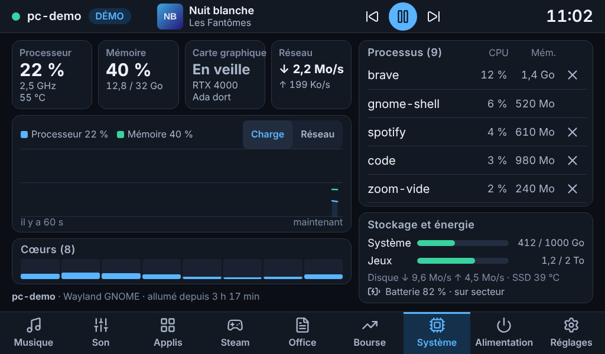
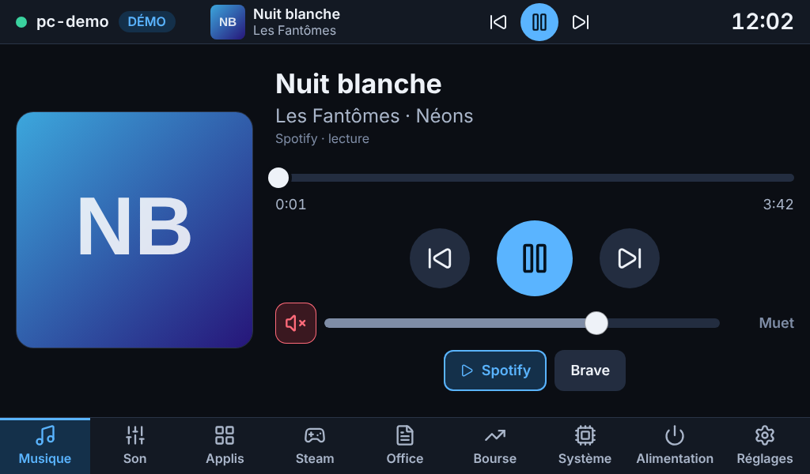
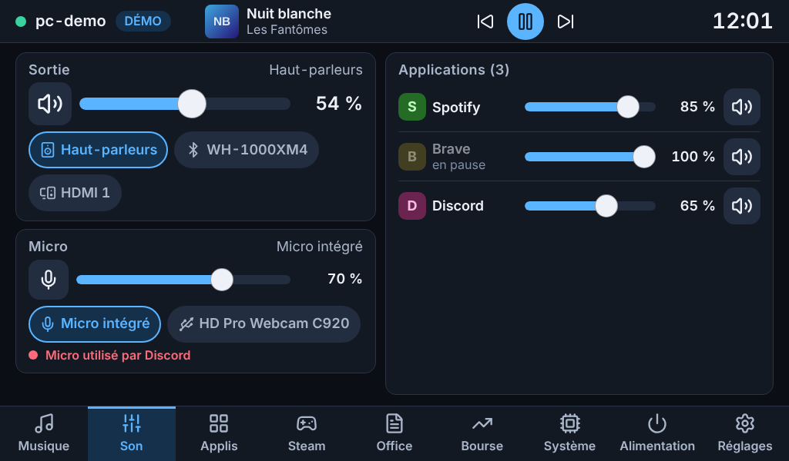
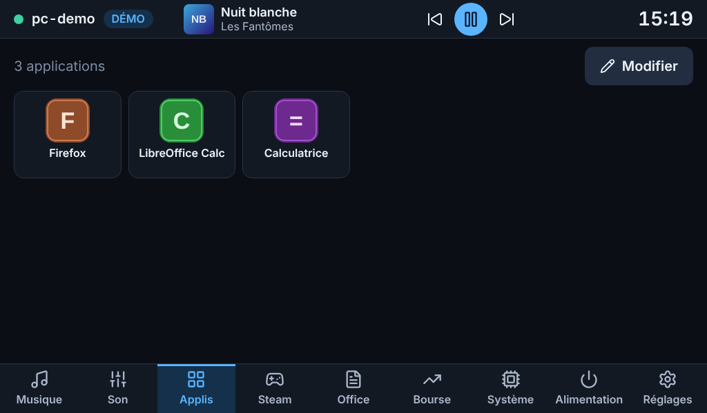
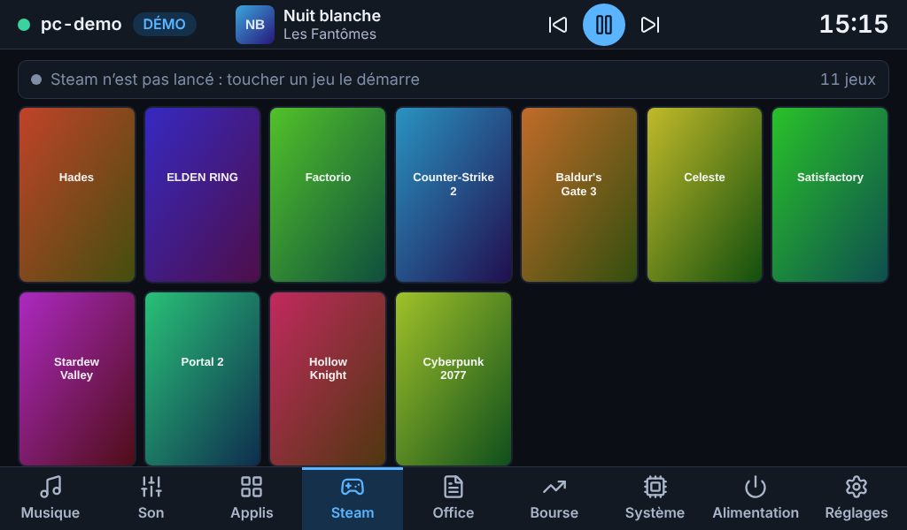
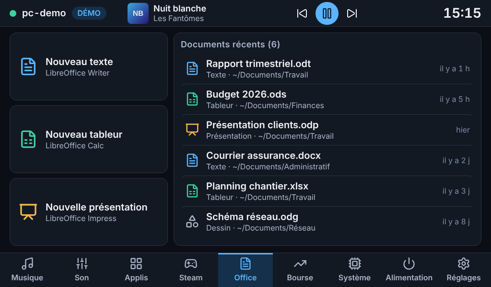

# MyDock

Un dock tactile pour piloter un PC Ubuntu : un Raspberry Pi 4 avec un écran 7" (1024×600) posé à côté du PC affiche son état et permet de le commander. Le dock reste utile PC éteint : horloge, bourse, et bouton **Allumer le PC** (Wake-on-LAN).

| Système | Musique | Son |
|---|---|---|
|  |  |  |

| Applis | Steam | Office |
|---|---|---|
|  |  |  |

*Captures prises en mode démo (fausses données), en 1024×600 tactile. PC éteint : [écran « PC hors ligne »](docs/etapes/a/06-hors-ligne.png).*

## Où en est le projet

La livraison se fait par étapes, chacune utilisable.

| Étape | Contenu | État |
|---|---|---|
| **a** | Squelette : agent sécurisé, serveur du dock, kiosque, écran « PC hors ligne », Wake-on-LAN, Réglages | **livrée** ([rapport](docs/etapes/a/RAPPORT.md)) |
| **b** | Système (CPU, mémoire, GPU sans réveiller la carte NVIDIA, réseau, disques, historique de 60 s, processus avec arrêt confirmé) et Musique (MPRIS, pochette, progression glissable, mini-lecteur) | **livrée** ([rapport](docs/etapes/b/RAPPORT.md)) |
| **c** | Son (sortie par défaut, volume et muet par sortie et par application, micro et micro utilisé, volume sur la page Musique) | **livrée** ([rapport](docs/etapes/c/RAPPORT.md)) |
| **d** | Lanceur d'applications (choisies dans Réglages, dans l'ordre voulu), Steam (jaquettes, jeu en cours), LibreOffice (nouveau document, documents récents) | **livrée** ([rapport](docs/etapes/d/RAPPORT.md)) |
| e | Bourse (crypto et actions) | à venir |
| f | Alimentation (verrouiller, veille, redémarrer, éteindre), Réglages complets, finitions | à venir |

Les pages des étapes à venir existent déjà dans l'interface et disent ce qu'elles offriront.

## Comment ça marche

```
Chromium (kiosque)  ──ws──▶  serveur dock (Pi, 127.0.0.1)  ──ws + jeton──▶  agent (PC, ta session)
 interface Svelte            configuration · Wake-on-LAN · bourse            D-Bus · PipeWire · psutil
```

- **L'agent** tourne sur le PC, dans la session graphique (service systemd *utilisateur*). Il n'envoie son état que lorsqu'il change et n'exécute que des actions nommées d'une liste blanche.
- **Le serveur du dock** tourne sur le Pi. Il sert l'interface, garde la configuration, envoie le Wake-on-LAN et se reconnecte tout seul à l'agent (1 à 10 s). Le navigateur ne parle qu'à lui, en local : il ne voit jamais le jeton.
- **L'écran** est un Chromium en mode kiosque dans un compositeur Wayland minimal (labwc).

Le PC est joint par son **adresse IPv4** (recommandé) ou par son nom mDNS (`nom-du-pc.local`). Depuis un Pi, la résolution des noms `.local` échoue souvent : l'adresse IP, réservée dans la box, est plus fiable.

## Installation

### Prérequis

- PC : Ubuntu 26.04 (GNOME, session Wayland ou X11) ou Debian 13 ; une session graphique ouverte. Le paquet dépend des paquets `python3-*` de la distribution (fastapi 0.115+, uvicorn, websockets 13+, psutil, pydantic 2.7+) : tous présents dans Ubuntu 26.04 (dépôt `universe`, activé par défaut sur Ubuntu Desktop).
- Pi : Raspberry Pi 4 sous Raspberry Pi OS 64 bits (Bookworm ou Trixie), écran tactile USB + HDMI.
- Le PC et le Pi sur le même réseau local.

Récupérer le dépôt sur **les deux machines** :

```bash
git clone https://github.com/neomars/MyDock.git
cd MyDock
```

### 1. Sur le PC : le paquet `.deb` de l'agent

```bash
python3 packaging/build_deb.py                          # → build/mydock-agent_<version>_all.deb  (2 s, seul dpkg-deb est requis)
sudo apt install ./build/mydock-agent_*_all.deb
mydock-agent setup --pi 192.168.1.50 --open-firewall    # 192.168.1.50 = adresse IP du Pi
```

`mydock-agent setup`, à lancer dans un terminal de **ta session graphique** (pas en SSH, **pas avec `sudo`**) :

- crée `~/.config/mydock/agent.toml` (droits 600) avec un jeton de 256 bits, et n'autorise que l'adresse du Pi ;
- démarre le service `mydock-agent` (service systemd *utilisateur*, fourni par le paquet et activé pour tous les utilisateurs mais sans effet tant que `setup` n'a pas été lancé) ;
- si `ufw` est actif, autorise le Pi sur le port de l'agent (`--open-firewall` : `sudo` demande ton mot de passe) ; sans le drapeau, il affiche la commande à copier ;
- affiche l'**adresse IP du PC**, la commande à lancer sur le Pi, le test `curl` pour vérifier la liaison, et le **jeton, une seule fois** (le revoir : `mydock-agent show-token`).

La commande est idempotente : la relancer ne change pas le jeton (sauf `--rotate-token`). Elle remplace aussi l'ancienne installation par script (voir plus bas) si elle existe.

**Mise à jour** : `git pull`, `python3 packaging/build_deb.py`, `sudo apt install ./build/mydock-agent_*_all.deb` ; les sessions ouvertes redémarrent leur agent toutes seules. **Désinstallation** : `sudo apt remove mydock-agent` (la configuration reste dans `~/.config/mydock` ; `rm -r` pour l'effacer).

<details>
<summary>Installation sans paquet (autre distribution, développement)</summary>

```bash
./deploy/pc/install-agent.sh --pi 192.168.1.50
```

Crée un environnement Python dédié dans `~/.local/share/mydock/venv` et un service utilisateur, même résultat que le paquet ; refuse de tourner si le paquet est installé. Désinstallation : `./deploy/pc/uninstall-agent.sh --purge`.
</details>

### 2. Sur le Pi : le dock et le kiosque

```bash
sudo ./deploy/pi/install-dock.sh --pc 192.168.1.3     # l'adresse IP du PC, affichée par « mydock-agent setup »
```

Le jeton est demandé (saisie masquée) ; on peut aussi le passer par `--token-file` ou la variable `MYDOCK_TOKEN`. Le script détecte le type d'image :

- **Raspberry Pi OS Desktop** (labwc) : le kiosque démarre avec la session ouverte automatiquement. Il remplace le `~/.config/labwc/autostart` de l'utilisateur (l'ancien est sauvegardé en `.avant-mydock`).
- **Raspberry Pi OS Lite** : labwc et Chromium sont lancés sur la console 1 par un service systemd.
- `--kiosk none` : seulement le serveur.

Redémarrer ensuite le Pi (`sudo reboot`) : l'écran affiche le dock en plein écran. Pour forcer le mode de l'écran : `--force-mode 1024x600@60`.

### 3. Vérifier

```bash
# sur le PC
mydock-agent doctor
# sur le Pi
sudo -u mydock /opt/mydock/venv/bin/mydock-dock doctor
```

Les deux affichent un diagnostic lisible. Celui du PC vérifie la configuration, la session, le réseau, le **pare-feu** (avec les commandes exactes si `ufw` est actif), le service systemd, et prépare le test `curl` à lancer depuis le Pi. Celui du Pi teste **chaque adresse du PC** (port ouvert, refusé ou muet, et ping pour distinguer un pare-feu d'un PC éteint) puis le jeton. Dans l'interface, **Réglages → Tester la connexion** donne le verdict en un toucher, et **Mesurer** donne la latence appui → PC.

### Mises à jour et désinstallation

```bash
git pull
python3 packaging/build_deb.py && sudo apt install ./build/mydock-agent_*_all.deb    # PC
sudo ./deploy/pi/install-dock.sh                                                      # Pi (la configuration existante est reprise)
```

`deploy/pi/uninstall-dock.sh` retire le service du Pi (`--purge` supprime aussi configuration et jeton).

## Utilisation

Neuf onglets en bas ; en haut, le nom du PC et son état, le **mini-lecteur** (pochette, titre, précédent, lecture/pause, suivant : présent sur toutes les pages) et l'horloge. Textes d'au moins 16 px (courant 20 px), cibles tactiles d'au moins 48 px, thème sombre.

- **Musique** : pochette, titre, artiste · album, progression que l'on **fait glisser** (appliquée au relâchement), précédent / lecture-pause / suivant. Tous les lecteurs MPRIS (Spotify, VLC, Firefox, Brave…) ; avec plusieurs, des pastilles choisissent celui qu'on pilote (par défaut celui qui joue, Spotify d'abord).
- **Son** : la **sortie** (volume au doigt, bouton muet, pastilles pour changer de sortie : haut-parleurs, casque, Bluetooth, HDMI…), le **micro** (volume, muet, choix du micro, et « Micro utilisé par Discord » quand une application l'écoute), et la liste des **applications** qui jouent du son, chacune avec son volume et son bouton muet (Spotify toujours en tête). Le volume de la sortie est aussi sur la page **Musique**. Le dock ne dépasse jamais 100 % ; bouger le curseur d'un son coupé le rétablit.
- **Applis** : les applications que **tu** choisis (Réglages ou bouton « Modifier » de la page, avec recherche au clavier tactile, ajout, retrait et ordre), en grande grille d'icônes ; un toucher lance l'application. Elles viennent des fichiers `.desktop` du PC (système, utilisateur, Flatpak, Snap), avec le nom dans la langue de la session et l'icône du thème.
- **Steam** : tes jeux installés (tous les disques de jeux, sans les outils comme Proton), avec leurs **jaquettes** (celles du cache de Steam, demandées au fil du défilement) ; les jeux joués récemment d'abord ; un toucher lance le jeu, et le jeu **en cours** passe en tête avec son badge.
- **Office** : trois boutons « Nouveau texte / tableur / présentation » (LibreOffice Writer, Calc, Impress) et la liste de tes **documents récents** (celle de LibreOffice) : un toucher rouvre le document.
- **Système** : processeur (charge, fréquence, température), mémoire, **carte graphique**, réseau ↓↑, graphique des 60 dernières secondes (charge ou réseau), une barre par cœur, disques, batterie, et les 8 processus les plus gourmands avec un bouton ✕ qui demande **confirmation** avant d'arrêter un processus (« Forcer » s'il résiste). Sur un portable hybride, la carte NVIDIA endormie s'affiche « En veille » : le dock ne la réveille jamais.
- **Alimentation** : Wake-on-LAN. Les commandes verrouiller / veille / redémarrer / éteindre arrivent à l'étape f.
- **Réglages** : adresse, port et jeton du PC (clavier tactile AZERTY intégré), test de connexion, adresse MAC du réveil, mesure de latence, adresse(s) du Pi.
- **PC éteint ou injoignable** : l'écran dit pourquoi, **en nommant l'adresse essayée** — *PC hors ligne* (éteint, en veille, pare-feu), *PC allumé, agent arrêté* (session fermée ?), *Connexion refusée* (jeton ou adresse du Pi non autorisée) — compte à rebours de la prochaine tentative, bouton **Allumer le PC**. Bourse et Réglages restent utilisables.
- **`?debug=1`** ajouté à l'adresse (ou `chromium.flags`) affiche les images par seconde et l'état des liaisons.

## Sécurité

- **Jeton** de 256 bits généré à l'installation, dans un fichier en droits 600 de chaque côté (le programme refuse de démarrer s'ils sont plus ouverts). Envoyé dans l'en-tête `Authorization`, jamais dans une URL, jamais journalisé, jamais envoyé au navigateur.
- **Réseau** : l'agent refuse en silence toute adresse hors de `allowed_clients` (idéalement l'IP du Pi) avant même de regarder le jeton, et bloque une minute une adresse qui échoue 8 fois. Il n'écoute qu'en IPv4. Le serveur du dock n'écoute que sur `127.0.0.1` et refuse toute autre origine (contre les sites malveillants et le « DNS rebinding »).
- **Actions** : jamais de commande venue du dock, seulement des actions nommées d'une liste blanche, aux paramètres validés (champs inconnus refusés). Les actions sensibles exigent une confirmation à l'écran **et** un jeton de confirmation à usage unique côté agent, lié à la connexion, à l'action et à ses paramètres (10 s). Lancer une application, un jeu ou un document (`apps.launch`, `steam.launch`, `office.*`) ne demande pas de confirmation non plus, mais le dock n'envoie jamais qu'un identifiant que l'agent a lui-même listé (fichier `.desktop` installé, jeu de la bibliothèque Steam, document de la liste de LibreOffice qui existe encore) : le chemin et la commande sont reconstruits par l'agent, sans shell, et le programme est lancé par `gio launch` dans son propre scope systemd. Régler le volume, couper le son ou changer de sortie (`audio.*`) ne demande pas de confirmation (réversible, sans danger) mais n'agit que sur un périphérique ou une application que l'écran montre, avec un volume entre 0 et 100 %. Arrêter un processus (`system.kill`) est la seule action sensible : l'agent revérifie lui-même que c'est le même processus (heure de démarrage), qu'il appartient à ton utilisateur et que ce n'est ni lui-même ni un processus de session (gnome-shell, pipewire…). Les pochettes de musique ne sont lues que si le fichier est une image, ou en https vers une machine publique (jamais le réseau local).
- **Séparation des privilèges sur le Pi** : le serveur (qui détient le jeton) et le navigateur tournent sous deux utilisateurs système différents ; un navigateur compromis ne lit pas le jeton.
- **Secrets** : jamais dans le dépôt (`.gitignore`, et un test vérifie qu'aucun secret n'y est suivi). Les clés d'API de la bourse (étape e) iront dans le fichier de configuration du Pi, en droits 600.

Limite connue : le trafic sur le réseau local n'est pas chiffré (le jeton ne l'est pas dans la poignée de main). Le chiffrement TLS avec certificat épinglé est prévu en option à l'étape f.

## Wake-on-LAN

Allumer un PC **éteint** à distance n'est possible qu'en **Ethernet** : la carte réseau doit rester à l'écoute, et le BIOS doit l'autoriser. En Wi-Fi, au mieux depuis la veille et selon la machine.

1. Brancher le PC en Ethernet (portable : le laisser sur secteur).
2. Lancer sur le PC `mydock-agent enable-wol` (réglage durable via NetworkManager ; `--dry-run` pour voir sans appliquer).
3. Dans le BIOS : activer « Wake on LAN » / « Power on by PCI-E », désactiver « ErP / Deep Sleep ».
4. Le dock mémorise tout seul l'adresse MAC du PC tant qu'il est allumé ; elle se voit et se corrige dans **Réglages**. Le dock préfère l'Ethernet au Wi-Fi et avertit si seule l'adresse du Wi-Fi est connue.

## Dépannage

| Symptôme | Cause probable | Remède |
|---|---|---|
| « PC hors ligne » alors que le PC est allumé | **Nom `.local` non résolu depuis le Pi** (le plus fréquent) ; pare-feu (`ufw`) ; PC en veille ; Wi-Fi qui isole les appareils | **Saisir l'adresse IP du PC dans Réglages.** L'écran dit l'adresse essayée (`ubuntu.local (192.168.1.3:8765)`) et pourquoi ; sur le Pi : `sudo -u mydock /opt/mydock/venv/bin/mydock-dock doctor` teste chaque adresse ; sur le PC : `mydock-agent doctor` |
| « PC allumé, agent arrêté » | Session fermée (l'agent vit dans ta session) ; service arrêté | `mydock-agent doctor` (section « Service systemd »), `journalctl --user -u mydock-agent -e` |
| « Connexion refusée » | Jeton différent, ou IP du Pi absente de `allowed_clients` | Réglages → Jeton ; `mydock-agent doctor` ; `mydock-agent setup --pi IP_DU_PI` sur le PC (le message dit quelle adresse le PC voit arriver) |
| Le nom `ubuntu.local` change ou ne répond pas | Deux machines nommées « ubuntu » | `sudo hostnamectl set-hostname mon-pc`, ou utiliser l'IP (idéalement réservée dans la box) |
| Page Musique : « Aucun lecteur ouvert » alors que Spotify joue | Le lecteur ne parle pas MPRIS (Spotify en Flatpak/Snap : accès au bus bloqué) ou l'agent n'a pas la session D-Bus | Sur le PC : `mydock-agent doctor` (section « Musique (MPRIS) » : lecteurs vus) ou `playerctl -l` ; `journalctl --user -u mydock-agent -e` |
| Page Musique : « Musique indisponible » | Bus de session D-Bus injoignable (agent lancé hors session graphique) | Lancer l'agent par le service (`systemctl --user restart mydock-agent`), pas depuis un terminal SSH |
| Système : la carte graphique dit « En veille » | La carte NVIDIA dort pour économiser la batterie : c'est voulu, le dock ne la réveille pas | Lancer un programme sur la carte (`prime-run …`) : sa charge apparaît |
| Toucher une application ne l'ouvre pas | `gio` absent, ou `systemd-run --user` inutilisable (agent lancé hors session) | `mydock-agent doctor` (sections « Lancement des programmes » et « Applications (lanceur) ») ; `sudo apt install libglib2.0-bin` |
| Steam : « n'est pas installé » ou jeux manquants | Dossier Steam inhabituel, jeu sur un disque non monté | `mydock-agent doctor` (section « Steam ») liste les dossiers lus et le nombre de jeux et de jaquettes |
| Office : aucun document récent | LibreOffice jamais ouvert, ou profil dans un dossier inhabituel | `mydock-agent doctor` (section « LibreOffice ») |
| « Allumer le PC » n'a aucun effet | Pas d'Ethernet, BIOS, câble débranché à l'extinction | Voir la section Wake-on-LAN ; Réglages → vérifier l'adresse MAC |
| Écran noir au démarrage du Pi | Compositeur ou Chromium ne démarre pas | `journalctl -u mydock-kiosk -e` (Lite) ; vérifier `chromium` et `labwc` installés ; essayer `--force-mode 1024x600@60` |
| Écran à la mauvaise résolution | Mode non détecté | `sudo ./deploy/pi/install-dock.sh --force-mode 1024x600@60` ; ou `video=HDMI-A-1:1024x600@60` dans `/boot/firmware/cmdline.txt` |
| Interface saccadée | Accélération GPU absente | `?debug=1` pour voir les i/s ; ajouter des options dans `/etc/mydock-kiosk/chromium.flags` (ex. `--use-gl=angle`) |
| Le jeton a fuité | — | Sur le PC : `mydock-agent setup --pi IP_DU_PI --rotate-token`, puis ressaisir le jeton dans Réglages |

Outils : `./deploy/pc/diagnose.sh [--anonyme]` décrit le PC (session, GPU, audio, Steam, LibreOffice, réseau) sans afficher de secret.

## Développement

```bash
make venv          # environnement Python (3 paquets en mode éditable)
make test-fast     # tests Python rapides
make test          # tous les tests Python, déploiement et paquet compris
make test-ubuntu   # tests de l'agent avec les versions EXACTES des paquets Python d'Ubuntu 26.04
make deb           # construit build/mydock-agent_<version>_all.deb
make lint          # ruff, svelte-check, shellcheck
cd dock/web && npm ci && npm test      # tests unitaires de l'interface
make demo          # agent en mode démo + dock sur http://127.0.0.1:8080
make e2e           # tests Playwright 1024×600 tactiles ; make shots régénère les captures de l'étape en cours
make web           # recompile l'interface (dock/web/dist est commité : pas de Node sur le Pi)
```

```
common/   protocole WebSocket, jeton, configuration 600, registre d'actions   (partagé)
agent/    service du PC : serveur, hub d'état, collecteurs (système, GPU, processus, musique, son, applications, Steam, LibreOffice), mode démo, doctor
dock/
  server/ serveur du Pi : liaison avec l'agent, Wake-on-LAN, configuration
  web/    interface Svelte 5 + Vite + TypeScript (dist/ compilé et commité)
packaging/ construction du paquet .deb de l'agent (build_deb.py), modèles et scripts du paquet
deploy/   installateurs idempotents (pc/ : sans paquet, pi/), unités systemd, kiosque
docs/     rapports d'étape et captures 1024×600
scripts/  pile de démonstration, contrôle de l'interface compilée, tests de déploiement
```

Le protocole est décrit dans [`common/mydock_common/protocol.py`](common/mydock_common/protocol.py). Les tests automatiques tournent sous Python 3.13 et 3.14, ainsi qu'avec les versions exactes des paquets d'Ubuntu 26.04 (`make test-ubuntu`) ; le code vise Python 3.11 et plus.
