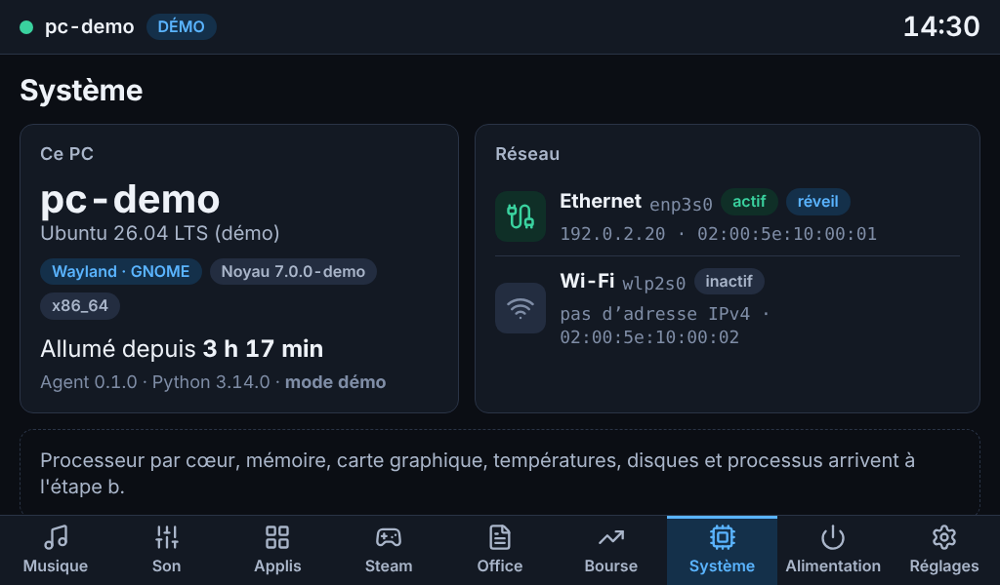
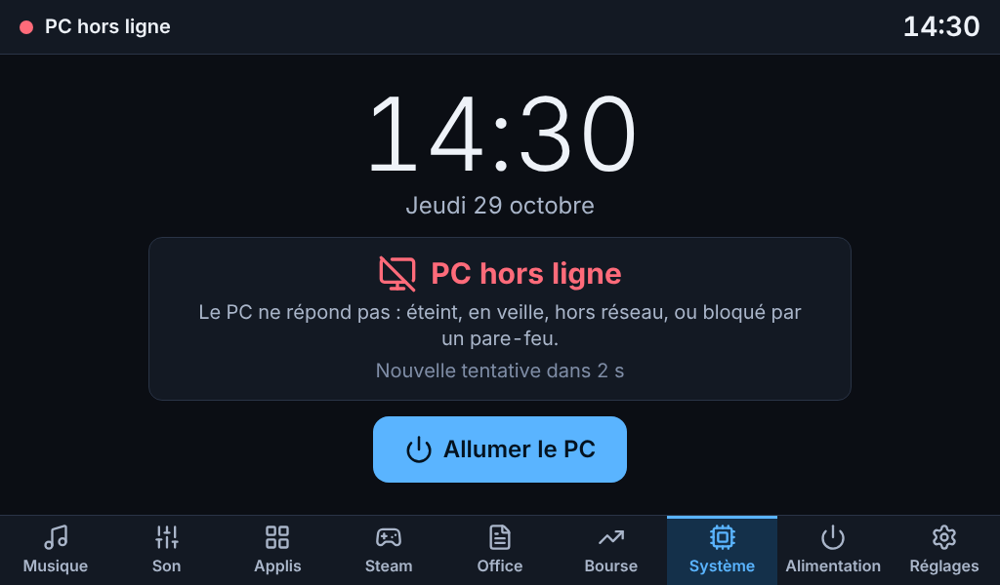

# MyDock

Un dock tactile pour piloter un PC Ubuntu : un Raspberry Pi 4 avec un écran 7" (1024×600) posé à côté du PC affiche son état et permet de le commander. Le dock reste utile PC éteint : horloge, bourse, et bouton **Allumer le PC** (Wake-on-LAN).

| PC allumé | PC éteint |
|---|---|
|  |  |

*Captures prises en mode démo (fausses données), en 1024×600 tactile.*

## Où en est le projet

La livraison se fait par étapes, chacune utilisable.

| Étape | Contenu | État |
|---|---|---|
| **a** | Squelette : agent sécurisé, serveur du dock, kiosque, écran « PC hors ligne », Wake-on-LAN, Réglages | **livrée** ([rapport](docs/etapes/a/RAPPORT.md)) |
| b | Système (CPU, mémoire, GPU, processus) et Musique (MPRIS) | à venir |
| c | Son (sorties, volume par application, micro) | à venir |
| d | Lanceur d'applications, Steam, LibreOffice | à venir |
| e | Bourse (crypto et actions) | à venir |
| f | Alimentation (verrouiller, veille, redémarrer, éteindre), Réglages complets, finitions | à venir |

Les pages des étapes à venir existent déjà dans l'interface et disent ce qu'elles offriront.

## Comment ça marche

```
Chromium (kiosque)  ──ws──▶  serveur dock (Pi, 127.0.0.1)  ──ws + jeton──▶  agent (PC, ta session)
 interface Svelte            configuration · Wake-on-LAN · bourse            D-Bus · PipeWire · psutil
```

- **L'agent** tourne sur le PC, dans la session graphique (service systemd *utilisateur*). Il n'envoie son état que lorsqu'il change et n'exécute que des actions nommées d'une liste blanche.
- **Le serveur du dock** tourne sur le Pi. Il sert l'interface, garde la configuration, envoie le Wake-on-LAN et se reconnecte tout seul à l'agent (1 à 10 s). Le navigateur ne parle qu'à lui, en local : il ne voit jamais le jeton.
- **L'écran** est un Chromium en mode kiosque dans un compositeur Wayland minimal (labwc).

Le PC est trouvé par son nom mDNS (`mon-pc.local`) ou par son adresse IPv4.

## Installation

### Prérequis

- PC : Ubuntu 24.04 ou plus récent (GNOME, session Wayland ou X11 ; conçu pour la 26.04), Python 3.11 ou plus récent, une session graphique ouverte.
- Pi : Raspberry Pi 4 sous Raspberry Pi OS 64 bits (Bookworm ou Trixie), écran tactile USB + HDMI.
- Le PC et le Pi sur le même réseau local.

Récupérer le dépôt sur **les deux machines** :

```bash
git clone https://github.com/neomars/MyDock.git
cd MyDock
```

### 1. Sur le PC : l'agent

Dans un terminal de ta session graphique (pas en SSH, pas avec `sudo`), en donnant l'adresse IP du Pi :

```bash
./deploy/pc/install-agent.sh --pi 192.168.1.50
```

Le script est idempotent : il crée un environnement Python dédié, génère la configuration et un jeton (fichier en droits 600), installe et démarre le service `mydock-agent`, et ouvre le port dans `ufw` si le pare-feu est actif. Le **jeton est affiché une seule fois** : le copier pour l'étape suivante. Pour le réafficher :

```bash
~/.local/share/mydock/venv/bin/mydock-agent show-token
```

### 2. Sur le Pi : le dock et le kiosque

```bash
sudo ./deploy/pi/install-dock.sh --pc mon-pc.local
```

Le jeton est demandé (saisie masquée) ; on peut aussi le passer par `--token-file` ou la variable `MYDOCK_TOKEN`. Le script détecte le type d'image :

- **Raspberry Pi OS Desktop** (labwc) : le kiosque démarre avec la session ouverte automatiquement. Il remplace le `~/.config/labwc/autostart` de l'utilisateur (l'ancien est sauvegardé en `.avant-mydock`).
- **Raspberry Pi OS Lite** : labwc et Chromium sont lancés sur la console 1 par un service systemd.
- `--kiosk none` : seulement le serveur.

Redémarrer ensuite le Pi (`sudo reboot`) : l'écran affiche le dock en plein écran. Pour forcer le mode de l'écran : `--force-mode 1024x600@60`.

### 3. Vérifier

```bash
# sur le PC
~/.local/share/mydock/venv/bin/mydock-agent doctor
# sur le Pi
sudo -u mydock /opt/mydock/venv/bin/mydock-dock doctor
```

Les deux affichent un diagnostic lisible (configuration, session, réseau, liaison, Wake-on-LAN). Dans l'interface, **Réglages → Tester la connexion** donne le verdict en un toucher, et **Mesurer** donne la latence appui → PC.

### Mises à jour et désinstallation

```bash
git pull
./deploy/pc/install-agent.sh --pi 192.168.1.50     # PC
sudo ./deploy/pi/install-dock.sh                   # Pi (la configuration existante est reprise)
```

`deploy/pc/uninstall-agent.sh` et `deploy/pi/uninstall-dock.sh` retirent les services (`--purge` supprime aussi configuration et jeton).

## Utilisation

Neuf onglets en bas ; le nom du PC, son état et l'horloge en haut (le mini-lecteur s'y ajoutera à l'étape b). Textes d'au moins 20 px (légendes 16 px), cibles tactiles d'au moins 56 px, thème sombre.

- **Système** : identité du PC, session (Wayland/X11), durée depuis le démarrage, interfaces réseau.
- **Alimentation** : Wake-on-LAN. Les commandes verrouiller / veille / redémarrer / éteindre arrivent à l'étape f.
- **Réglages** : adresse, port et jeton du PC (clavier tactile AZERTY intégré), test de connexion, adresse MAC du réveil, mesure de latence.
- **PC éteint ou injoignable** : l'écran dit pourquoi — *PC hors ligne* (éteint, en veille, pare-feu), *PC allumé, agent arrêté* (session fermée ?), *Connexion refusée* (jeton ou adresse du Pi non autorisée) — compte à rebours de la prochaine tentative, bouton **Allumer le PC**. Bourse et Réglages restent utilisables.
- **`?debug=1`** ajouté à l'adresse (ou `chromium.flags`) affiche les images par seconde et l'état des liaisons.

## Sécurité

- **Jeton** de 256 bits généré à l'installation, dans un fichier en droits 600 de chaque côté (le programme refuse de démarrer s'ils sont plus ouverts). Envoyé dans l'en-tête `Authorization`, jamais dans une URL, jamais journalisé, jamais envoyé au navigateur.
- **Réseau** : l'agent refuse en silence toute adresse hors de `allowed_clients` (idéalement l'IP du Pi) avant même de regarder le jeton, et bloque une minute une adresse qui échoue 8 fois. Il n'écoute qu'en IPv4. Le serveur du dock n'écoute que sur `127.0.0.1` et refuse toute autre origine (contre les sites malveillants et le « DNS rebinding »).
- **Actions** : jamais de commande venue du dock, seulement des actions nommées d'une liste blanche, aux paramètres validés (champs inconnus refusés). Les actions sensibles exigent une confirmation à l'écran **et** un jeton de confirmation à usage unique côté agent, lié à la connexion, à l'action et à ses paramètres (10 s).
- **Séparation des privilèges sur le Pi** : le serveur (qui détient le jeton) et le navigateur tournent sous deux utilisateurs système différents ; un navigateur compromis ne lit pas le jeton.
- **Secrets** : jamais dans le dépôt (`.gitignore`, et un test vérifie qu'aucun secret n'y est suivi). Les clés d'API de la bourse (étape e) iront dans le fichier de configuration du Pi, en droits 600.

Limite connue : le trafic sur le réseau local n'est pas chiffré (le jeton ne l'est pas dans la poignée de main). Le chiffrement TLS avec certificat épinglé est prévu en option à l'étape f.

## Wake-on-LAN

Allumer un PC **éteint** à distance n'est possible qu'en **Ethernet** : la carte réseau doit rester à l'écoute, et le BIOS doit l'autoriser. En Wi-Fi, au mieux depuis la veille et selon la machine.

1. Brancher le PC en Ethernet (portable : le laisser sur secteur).
2. Lancer sur le PC `./deploy/pc/enable-wol.sh` (réglage durable via NetworkManager).
3. Dans le BIOS : activer « Wake on LAN » / « Power on by PCI-E », désactiver « ErP / Deep Sleep ».
4. Le dock mémorise tout seul l'adresse MAC du PC tant qu'il est allumé ; elle se voit et se corrige dans **Réglages**. Le dock préfère l'Ethernet au Wi-Fi et avertit si seule l'adresse du Wi-Fi est connue.

## Dépannage

| Symptôme | Cause probable | Remède |
|---|---|---|
| « PC hors ligne » alors que le PC est allumé | Pare-feu (`ufw`) ; nom `.local` non résolu ; PC en veille | Vérifier `sudo ufw status` ; essayer l'adresse IP dans Réglages ; `getent hosts mon-pc.local` sur le Pi |
| « PC allumé, agent arrêté » | Session fermée (l'agent vit dans ta session) ; service arrêté | `systemctl --user status mydock-agent`, `journalctl --user -u mydock-agent -e` |
| « Connexion refusée » | Jeton différent, ou IP du Pi absente de `allowed_clients` | Réglages → Jeton ; `mydock-agent doctor` ; relancer l'installateur du PC avec `--pi IP_DU_PI` |
| Le nom `ubuntu.local` change ou ne répond pas | Deux machines nommées « ubuntu » | `sudo hostnamectl set-hostname mon-pc`, ou utiliser l'IP (idéalement réservée dans la box) |
| « Allumer le PC » n'a aucun effet | Pas d'Ethernet, BIOS, câble débranché à l'extinction | Voir la section Wake-on-LAN ; Réglages → vérifier l'adresse MAC |
| Écran noir au démarrage du Pi | Compositeur ou Chromium ne démarre pas | `journalctl -u mydock-kiosk -e` (Lite) ; vérifier `chromium` et `labwc` installés ; essayer `--force-mode 1024x600@60` |
| Écran à la mauvaise résolution | Mode non détecté | `sudo ./deploy/pi/install-dock.sh --force-mode 1024x600@60` ; ou `video=HDMI-A-1:1024x600@60` dans `/boot/firmware/cmdline.txt` |
| Interface saccadée | Accélération GPU absente | `?debug=1` pour voir les i/s ; ajouter des options dans `/etc/mydock-kiosk/chromium.flags` (ex. `--use-gl=angle`) |
| Le jeton a fuité | — | Sur le PC : `./deploy/pc/install-agent.sh --pi IP --rotate-token`, puis ressaisir le jeton dans Réglages |

Outils : `./deploy/pc/diagnose.sh [--anonyme]` décrit le PC (session, GPU, audio, Steam, LibreOffice, réseau) sans afficher de secret.

## Développement

```bash
make venv          # environnement Python (3 paquets en mode éditable)
make test-fast     # tests Python rapides
make test          # tous les tests Python, déploiement compris
make lint          # ruff, svelte-check, shellcheck
cd dock/web && npm ci && npm test      # tests unitaires de l'interface
make demo          # agent en mode démo + dock sur http://127.0.0.1:8080
make e2e           # tests Playwright 1024×600 tactiles ; make shots régénère les captures
make web           # recompile l'interface (dock/web/dist est commité : pas de Node sur le Pi)
```

```
common/   protocole WebSocket, jeton, configuration 600, registre d'actions   (partagé)
agent/    service du PC : serveur, hub d'état, collecteurs, mode démo, doctor
dock/
  server/ serveur du Pi : liaison avec l'agent, Wake-on-LAN, configuration
  web/    interface Svelte 5 + Vite + TypeScript (dist/ compilé et commité)
deploy/   installateurs idempotents (pc/, pi/), unités systemd, kiosque
docs/     rapports d'étape et captures 1024×600
scripts/  pile de démonstration, contrôle de l'interface compilée, tests de déploiement
```

Le protocole est décrit dans [`common/mydock_common/protocol.py`](common/mydock_common/protocol.py). Les tests automatiques tournent sous Python 3.13 et 3.14 ; le code vise Python 3.11 et plus.
