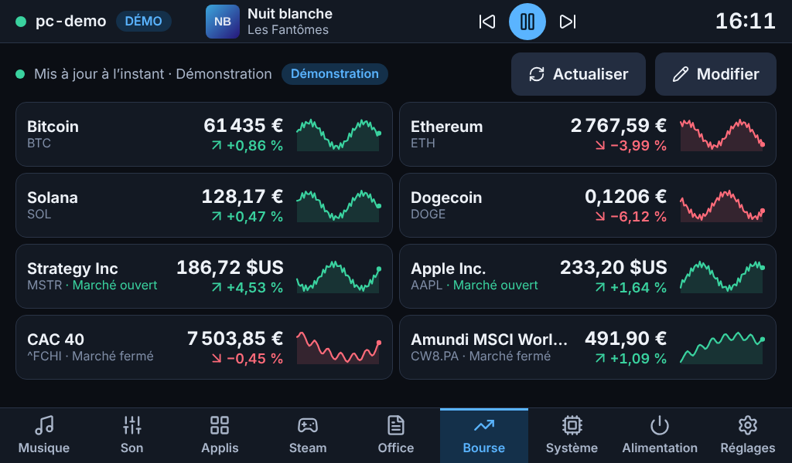
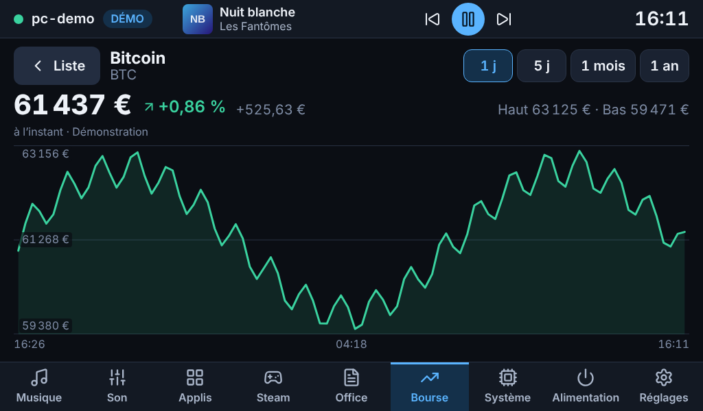
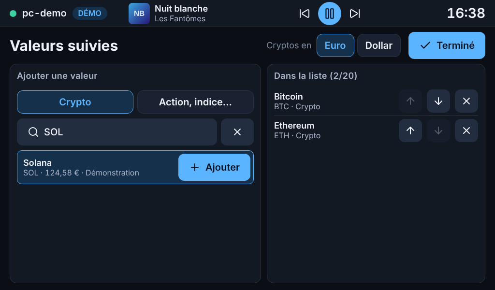
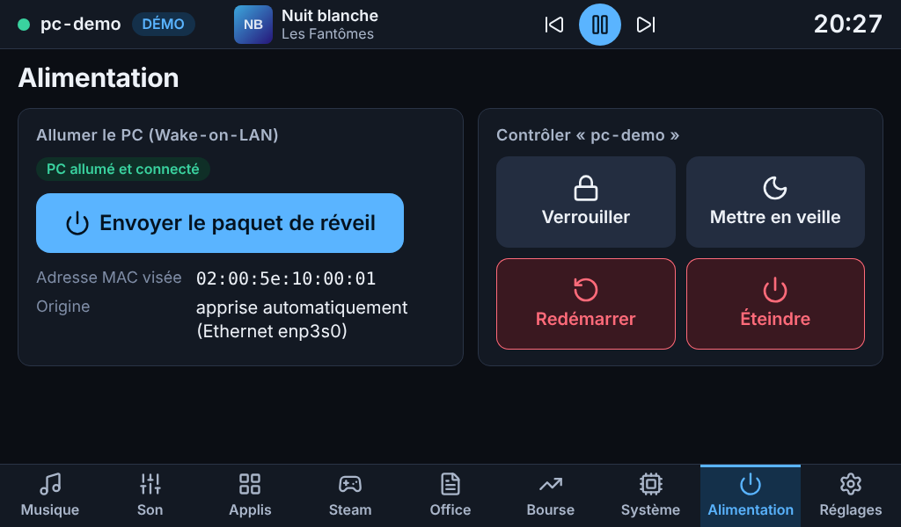
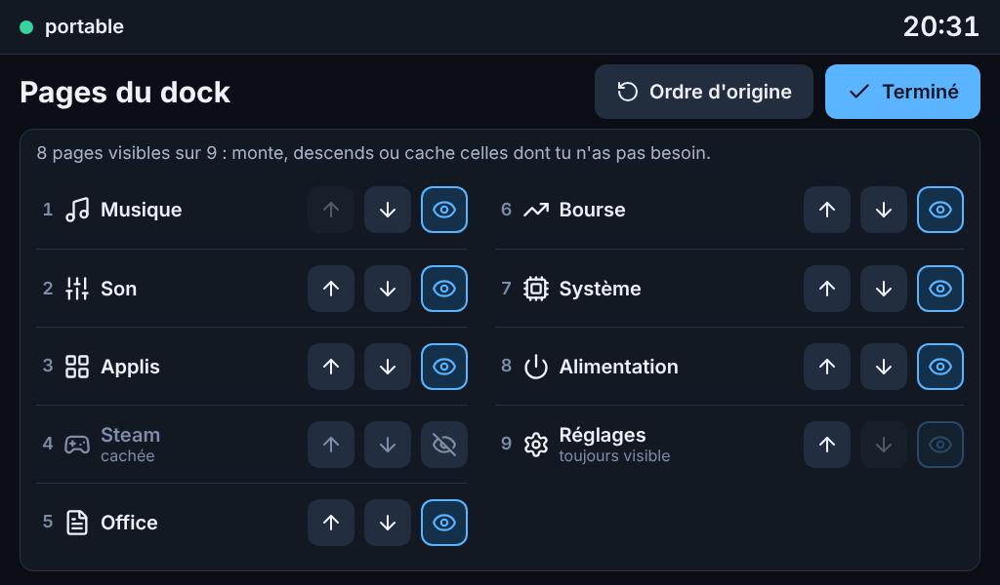
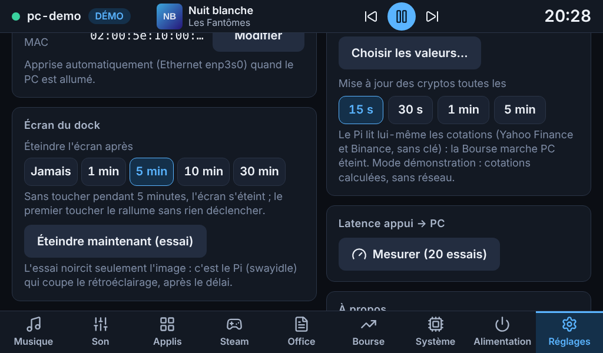
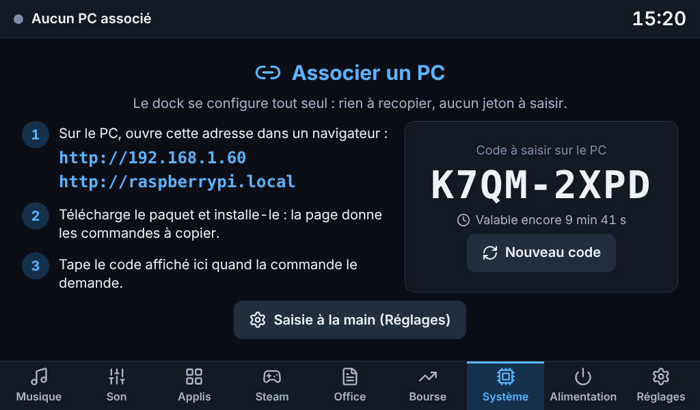
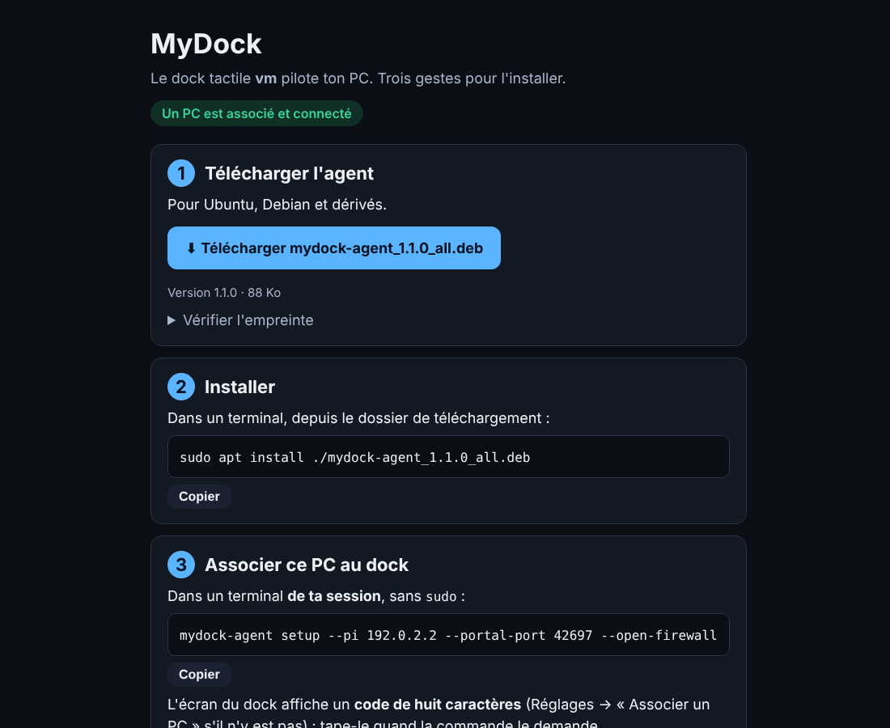
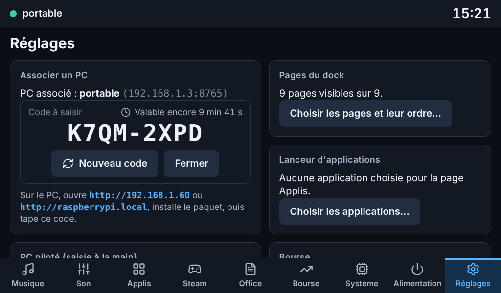

# MyDock

Un dock tactile pour piloter un PC Ubuntu : un Raspberry Pi 4 avec un écran 7" (1024×600) posé à côté du PC affiche son état et permet de le commander. Le dock reste utile PC éteint : horloge, bourse, et bouton **Allumer le PC** (Wake-on-LAN).

**Une seule chose à installer : le paquet `mydock` sur le Pi.** Le Pi sert alors, sur le réseau local, une **page web** d'où le PC (Ubuntu ou autre) télécharge son propre paquet et s'associe au dock avec un code affiché sur l'écran : rien à copier, aucun jeton à recopier.

| Système | Musique | Son |
|---|---|---|
|  |  |  |

| Applis | Steam | Office |
|---|---|---|
|  |  |  |

| Bourse | Détail d'une valeur | Choix des valeurs |
|---|---|---|
|  |  |  |

| Alimentation | Pages et ordre | Veille de l'écran |
|---|---|---|
|  |  |  |

| Dock neuf : associer un PC | Page d'installation, vue du PC | Réglages → Associer un PC |
|---|---|---|
|  |  |  |

*Captures prises en mode démo (fausses données), en 1024×600 tactile. PC éteint : [écran « PC hors ligne »](docs/etapes/a/06-hors-ligne.png).*

## Où en est le projet

La livraison se fait par étapes, chacune utilisable.

| Étape | Contenu | État |
|---|---|---|
| **a** | Squelette : agent sécurisé, serveur du dock, kiosque, écran « PC hors ligne », Wake-on-LAN, Réglages | **livrée** ([rapport](docs/etapes/a/RAPPORT.md)) |
| **b** | Système (CPU, mémoire, GPU sans réveiller la carte NVIDIA, réseau, disques, historique de 60 s, processus avec arrêt confirmé) et Musique (MPRIS, pochette, progression glissable, mini-lecteur) | **livrée** ([rapport](docs/etapes/b/RAPPORT.md)) |
| **c** | Son (sortie par défaut, volume et muet par sortie et par application, micro et micro utilisé, volume sur la page Musique) | **livrée** ([rapport](docs/etapes/c/RAPPORT.md)) |
| **d** | Lanceur d'applications (choisies dans Réglages, dans l'ordre voulu), Steam (jaquettes, jeu en cours), LibreOffice (nouveau document, documents récents) | **livrée** ([rapport](docs/etapes/d/RAPPORT.md)) |
| **e** | Bourse : cryptos et actions lues par le Pi (Yahoo Finance et Binance, sans clé), liste au choix, graphique sur 1 j à 1 an, utilisable PC éteint | **livrée** ([rapport](docs/etapes/e/RAPPORT.md)) |
| **f** | Alimentation (verrouiller, veille, redémarrer, éteindre, chacun avec ses garde-fous), Réglages complets (pages visibles et ordre, veille de l'écran du dock), finitions | **livrée** ([rapport](docs/etapes/f/RAPPORT.md)) |
| **g** | **Installation simplifiée** : un seul paquet (`mydock`) sur le Pi, qui sert une page web où le PC prend son paquet puis s'associe par un code affiché sur l'écran du dock | **livrée** ([rapport](docs/etapes/g/RAPPORT.md)) |

Le cahier des charges est entièrement livré. Ce qui reste est de **vérifier sur le vrai matériel** ce qu'un conteneur de développement ne peut pas essayer : la liste est à la fin du [rapport de l'étape g](docs/etapes/g/RAPPORT.md).

## Comment ça marche

```
navigateur du PC ──http──▶  portail du Pi (port 80)   page d'installation, paquet du PC, association par code
                                     │
Chromium (kiosque) ──ws──▶  serveur dock (Pi, 127.0.0.1)  ──ws + jeton──▶  agent (PC, ta session)
 interface Svelte            configuration · Wake-on-LAN · bourse           D-Bus · PipeWire · psutil
```

- **Le Pi** est la seule machine à installer à la main : le paquet `mydock` contient le serveur du dock, l'interface, le kiosque, la veille de l'écran **et le paquet du PC**.
- **Le portail** est une petite page web que le Pi sert à tout le réseau local (port 80). Elle propose le paquet du PC, dit quoi taper, et reçoit le code d'association. Elle ne donne ni jeton ni configuration.
- **L'agent** tourne sur le PC, dans la session graphique (service systemd *utilisateur*). Il n'envoie son état que lorsqu'il change et n'exécute que des actions nommées d'une liste blanche.
- **Le serveur du dock** sert l'interface, garde la configuration, envoie le Wake-on-LAN et se reconnecte tout seul à l'agent (1 à 10 s). Le navigateur du kiosque ne parle qu'à lui, en local : il ne voit jamais le jeton.
- **L'écran** est un Chromium en mode kiosque dans un compositeur Wayland minimal (labwc).

À l'association, le dock enregistre l'**adresse IPv4** du PC telle qu'il la voit (la plus fiable) : pas de nom `.local` à résoudre depuis le Pi, ce qui échoue souvent. Réserve-la dans ta box pour qu'elle ne change pas.

## Installation

Trois gestes : installer le paquet sur le Pi, ouvrir la page du Pi depuis le PC, taper le code affiché sur l'écran.

### Prérequis

- **Pi** : Raspberry Pi 4 sous **Raspberry Pi OS 64 bits « Trixie » (Debian 13)**, avec bureau (labwc) ou Lite, écran tactile USB + HDMI. Le paquet s'appuie sur les paquets Python de la distribution (fastapi 0.115+, uvicorn, websockets 13+, psutil, pydantic 2.7+) : ceux de l'ancienne version « Bookworm » sont trop anciens, `apt` refuserait l'installation (voir le [dépannage](#dépannage)).
- **PC** : Ubuntu 26.04 (GNOME, Wayland ou X11) ou Debian 13, avec une session graphique ouverte. Autre distribution : [voir plus bas](#autre-système-que-ubuntu-ou-debian).
- Le PC et le Pi sur le même réseau local.

### 1. Sur le Pi : un seul paquet

```bash
git clone https://github.com/neomars/MyDock.git
cd MyDock
python3 packaging/build_deb.py --target pi      # → build/mydock_<version>_all.deb  (seul dpkg-deb est requis)
sudo apt install ./build/mydock_*_all.deb
sudo reboot                                      # l'écran affiche le dock en plein écran
```

`apt` installe les dépendances (labwc, Chromium, swayidle, les paquets Python…) et le paquet fait le reste : utilisateur système `mydock`, configuration en droits 600 (`/etc/mydock/dock.toml`), services, **kiosque** (il détecte le type d'image : bureau Raspberry Pi OS → le kiosque démarre avec la session ouverte automatiquement, l'`autostart` d'origine est sauvegardé en `.avant-mydock` ; Lite → labwc et Chromium sur la console 1 par un service systemd), et veille de l'écran. Pour changer de mode ou forcer la résolution : `sudo /usr/lib/mydock/setup --kiosk systemd` ou `--force-mode 1024x600@60`.

Au redémarrage, **l'écran affiche « Associer un PC » : l'adresse à ouvrir depuis le PC et un code**.

> Le paquet se construit aussi sur le PC (`python3 packaging/build_deb.py --target pi`) et se copie sur le Pi (`scp`) : n'importe quelle machine Debian ou Ubuntu convient, le résultat est le même fichier.

### 2. Sur le PC : la page du Pi

1. Dans un navigateur, ouvrir **l'adresse affichée sur l'écran du dock** (par exemple `http://192.168.1.60/`, ou `http://raspberrypi.local/`).
2. **Télécharger** le paquet proposé, puis dans un terminal de **ta session graphique** (pas en SSH, **pas avec `sudo`** pour la seconde commande) : les deux commandes sont écrites sur la page, avec un bouton *Copier* :

   ```bash
   sudo apt install ./mydock-agent_<version>_all.deb
   mydock-agent setup --pi 192.168.1.60 --open-firewall      # 192.168.1.60 = l'adresse du Pi
   ```
3. La commande demande **le code affiché sur l'écran du dock** : le taper. Le dock répond « PC associé » et se connecte tout seul, en quelques secondes. Il n'y a **rien d'autre à saisir**, ni adresse, ni port, ni jeton.

`mydock-agent setup` :

- crée `~/.config/mydock/agent.toml` (droits 600) avec un jeton de 256 bits, et n'autorise que l'adresse du Pi ;
- démarre le service `mydock-agent` (service systemd *utilisateur*, fourni par le paquet et activé pour tous les utilisateurs, sans effet tant que `setup` n'a pas été lancé) ;
- si `ufw` est actif, autorise le Pi sur le port de l'agent (`--open-firewall` : `sudo` demande ton mot de passe) ; sans le drapeau, il affiche la commande à copier ;
- **associe le PC au dock** : il présente le code au portail du Pi, avec le jeton qu'**il a lui-même généré** ; le Pi vérifie qu'il joint bien l'agent puis enregistre l'adresse, le port et le jeton. Si l'association échoue, la commande dit pourquoi et ce qu'il reste à saisir à la main dans **Réglages → PC piloté**.

La commande est idempotente : la relancer ne change pas le jeton (sauf `--rotate-token`). Options utiles : `--code CODE` (sans question), `--no-pair` (pas d'association), `--portal-port N` (si le portail n'est pas sur le port 80). **`mydock-agent pair --pi ADRESSE`** ne refait que l'association (changement de dock, code manqué).

**Un deuxième PC, ou un autre** : sur le dock, **Réglages → Associer un PC…** affiche un nouveau code (valable dix minutes) ; le PC refait la même chose. Le dock pilote **un PC à la fois** : une nouvelle association remplace l'ancienne.

### Autre système que Ubuntu ou Debian

La page du Pi ne propose aujourd'hui que le paquet `.deb`. Sur une autre distribution, l'agent s'installe depuis les sources (environnement Python dédié et service utilisateur), puis s'associe de la même façon :

```bash
git clone https://github.com/neomars/MyDock.git && cd MyDock
./deploy/pc/install-agent.sh --pi 192.168.1.60
~/.local/share/mydock/venv/bin/mydock-agent pair --pi 192.168.1.60     # le code est sur l'écran du dock
```

Désinstallation : `./deploy/pc/uninstall-agent.sh --purge`. Ce script refuse de tourner si le paquet est installé.

### 3. Vérifier

```bash
# sur le PC
mydock-agent doctor
# sur le Pi
sudo -u mydock mydock-dock doctor
```

Les deux affichent un diagnostic lisible. Celui du PC vérifie la configuration, la session, le réseau, le **pare-feu** (avec les commandes exactes si `ufw` est actif), le service systemd, **le portail du dock** (répond-il, avec quelle version), et prépare le test `curl` à lancer depuis le Pi. Celui du Pi teste **le portail** (port, paquet proposé), **chaque adresse du PC** (port ouvert, refusé ou muet, et ping pour distinguer un pare-feu d'un PC éteint) puis le jeton. Dans l'interface, **Réglages → Tester la connexion** donne le verdict en un toucher, et **Mesurer** donne la latence appui → PC.

### La bourse : aucune clé nécessaire

Yahoo Finance (actions, indices, devises, et cryptos en secours) et Binance (cryptos) répondent sans compte ni clé, comme dans `dashboard_crypto`. Si un jour Yahoo cesse de répondre, une clé **Finnhub** gratuite (finnhub.io) ajoute un secours pour les actions américaines :

```bash
sudo nano /etc/mydock/dock.toml     # ajouter, en gardant les droits 600 :
#   [markets]
#   finnhub_key = "ta-clé"
sudo systemctl restart mydock-dock
```

### Mises à jour et désinstallation

```bash
git pull
python3 packaging/build_deb.py --target pi && sudo apt install ./build/mydock_*_all.deb    # Pi : le portail propose aussitôt le nouveau paquet du PC
```

Sur le PC, télécharger le nouveau paquet depuis la page du Pi et `sudo apt install ./mydock-agent_*_all.deb` : les sessions ouvertes redémarrent leur agent toutes seules, **sans nouvelle association** (le jeton est conservé).

**Depuis l'ancienne installation par script** (`install-dock.sh`, environnement dans `/opt/mydock`) : `sudo apt install ./build/mydock_*_all.deb` reprend la configuration et le jeton existants, retire l'ancien service et sa vieille unité systemd ; le PC déjà associé continue de marcher tel quel. Libérer ensuite la place : `sudo rm -r /opt/mydock`.

**Désinstallation** : `sudo apt remove mydock` retire le kiosque (l'`autostart` d'origine est restauré) et les services, en gardant la configuration ; `sudo apt purge mydock` efface aussi la configuration, le jeton, l'état et les utilisateurs système. Sur le PC : `sudo apt remove mydock-agent` (la configuration reste dans `~/.config/mydock` ; `rm -r` pour l'effacer).

## Utilisation

Neuf onglets en bas ; en haut, le nom du PC et son état, le **mini-lecteur** (pochette, titre, précédent, lecture/pause, suivant : présent sur toutes les pages) et l'horloge. Textes d'au moins 16 px (courant 20 px), cibles tactiles d'au moins 48 px, thème sombre.

- **Musique** : pochette, titre, artiste · album, progression que l'on **fait glisser** (appliquée au relâchement), précédent / lecture-pause / suivant. Tous les lecteurs MPRIS (Spotify, VLC, Firefox, Brave…) ; avec plusieurs, des pastilles choisissent celui qu'on pilote (par défaut celui qui joue, Spotify d'abord).
- **Son** : la **sortie** (volume au doigt, bouton muet, pastilles pour changer de sortie : haut-parleurs, casque, Bluetooth, HDMI…), le **micro** (volume, muet, choix du micro, et « Micro utilisé par Discord » quand une application l'écoute), et la liste des **applications** qui jouent du son, chacune avec son volume et son bouton muet (Spotify toujours en tête). Le volume de la sortie est aussi sur la page **Musique**. Le dock ne dépasse jamais 100 % ; bouger le curseur d'un son coupé le rétablit.
- **Applis** : les applications que **tu** choisis (Réglages ou bouton « Modifier » de la page, avec recherche au clavier tactile, ajout, retrait et ordre), en grande grille d'icônes ; un toucher lance l'application. Elles viennent des fichiers `.desktop` du PC (système, utilisateur, Flatpak, Snap), avec le nom dans la langue de la session et l'icône du thème.
- **Steam** : tes jeux installés (tous les disques de jeux, sans les outils comme Proton), avec leurs **jaquettes** (celles du cache de Steam, demandées au fil du défilement) ; les jeux joués récemment d'abord ; un toucher lance le jeu, et le jeu **en cours** passe en tête avec son badge.
- **Office** : trois boutons « Nouveau texte / tableur / présentation » (LibreOffice Writer, Calc, Impress) et la liste de tes **documents récents** (celle de LibreOffice) : un toucher rouvre le document.
- **Bourse** : tes cryptos et tes valeurs (actions, indices, ETF, devises) avec prix, variation **toujours écrite avec son signe** (+1,41 %, −0,32 %), mini-graphique et, pour une action, l'état du marché (ouvert, fermé) et **le dernier échange quand il est ancien** (cours différés ou valeur peu échangée). Un toucher ouvre le graphique de la valeur sur **1 jour, 5 jours, 1 mois ou 1 an**. **Modifier** : on **cherche par nom ou par symbole** au clavier tactile (`apple`, `bitcoin`, `MSTR`, `^FCHI`, `CW8.PA`…) ; le dock interroge Yahoo Finance (il connaît d'avance les cryptos courantes, même sans réseau) et un résultat s'ajoute d'un toucher après vérification de son prix ; on ordonne et on retire ; la devise des cryptos (euro ou dollar) se règle au même endroit, et **la fréquence des mises à jour** (15 s, 30 s, 1 min, 5 min) dans Réglages. C'est **le Pi** qui lit les cotations : la page marche PC éteint, et elle ne demande rien à Internet tant qu'elle n'est pas ouverte. Si un fournisseur ne répond plus, un bandeau dit lequel et pourquoi, et les derniers cours connus restent affichés **avec leur âge**.
- **Système** : processeur (charge, fréquence, température), mémoire, **carte graphique**, réseau ↓↑, graphique des 60 dernières secondes (charge ou réseau), une barre par cœur, disques, batterie, et les 8 processus les plus gourmands avec un bouton ✕ qui demande **confirmation** avant d'arrêter un processus (« Forcer » s'il résiste). Sur un portable hybride, la carte NVIDIA endormie s'affiche « En veille » : le dock ne la réveille jamais.
- **Alimentation** : à gauche le **réveil** (Wake-on-LAN), à droite quatre commandes pour **le PC** : **Verrouiller** (un toucher : l'écran de verrouillage de la session s'affiche), **Mettre en veille**, **Redémarrer** et **Éteindre** (chacune demande d'abord **confirmation à l'écran**, avec le nom du PC et ce qui va arriver). Un bouton grisé dit pourquoi : PC hors ligne, indisponible sur ce PC, « Bloqué par « Mises à jour logicielles » » (le programme qui s'oppose est nommé), mot de passe exigé par le système. Voir [Alimentation](#alimentation-verrouiller-veille-redémarrer-éteindre).
- **Réglages** : **Associer un PC** (affiche un code et l'adresse du portail ; voir [Installation](#2-sur-le-pc--la-page-du-pi)), adresse, port et jeton du PC à la main (clavier tactile AZERTY intégré), test de connexion, adresse MAC du réveil, **écran du dock** (extinction après 1, 5, 10 ou 30 minutes sans toucher), **pages du dock** (lesquelles s'affichent dans la barre d'onglets, et dans quel ordre ; les Réglages restent toujours visibles), mesure de latence, lanceur d'applications, valeurs de la bourse, adresse(s) du Pi, adresse de la page d'installation et paquet du PC qu'elle propose.
- **Écran qui s'éteint** : après le délai choisi (par défaut : jamais), l'écran passe au noir ; **le premier toucher le rallume sans rien déclencher** (le doigt ne tape jamais sur ce qui se trouve dessous). Voir [Veille de l'écran](#veille-de-lécran-du-dock).
- **Dock neuf, ou jeton refusé** : l'écran **« Associer un PC »** donne l'adresse du portail à ouvrir sur le PC, les trois gestes à faire et **le code**, avec le temps qu'il lui reste ; « Nouveau code » en demande un autre. Un dock sans PC garde toujours un code affiché ; un dock déjà associé n'en montre un que sur demande (**Réglages → Associer un PC…**, ou **Associer à nouveau** sur l'écran « Connexion refusée »). Quand le PC s'associe, un message le dit et les pages arrivent.
- **PC éteint ou injoignable** : l'écran dit pourquoi, **en nommant l'adresse essayée** — *PC hors ligne* (éteint, en veille, pare-feu), *PC allumé, agent arrêté* (session fermée ?), *Connexion refusée* (jeton ou adresse du Pi non autorisée) — compte à rebours de la prochaine tentative, bouton **Allumer le PC**. Bourse et Réglages restent utilisables.
- **`?debug=1`** ajouté à l'adresse (ou `chromium.flags`) affiche les images par seconde et l'état des liaisons.

## Sécurité

- **Jeton** de 256 bits généré à l'installation, dans un fichier en droits 600 de chaque côté (le programme refuse de démarrer s'ils sont plus ouverts). Envoyé dans l'en-tête `Authorization`, jamais dans une URL, jamais journalisé, jamais envoyé au navigateur.
- **Réseau** : l'agent refuse en silence toute adresse hors de `allowed_clients` (idéalement l'IP du Pi) avant même de regarder le jeton, et bloque une minute une adresse qui échoue 8 fois. Il n'écoute qu'en IPv4. Le serveur du dock n'écoute que sur `127.0.0.1` et refuse toute autre origine (contre les sites malveillants et le « DNS rebinding »).
- **Actions** : jamais de commande venue du dock, seulement des actions nommées d'une liste blanche, aux paramètres validés (champs inconnus refusés). Les actions sensibles exigent une confirmation à l'écran **et** un jeton de confirmation à usage unique côté agent, lié à la connexion, à l'action et à ses paramètres (10 s). Lancer une application, un jeu ou un document (`apps.launch`, `steam.launch`, `office.*`) ne demande pas de confirmation non plus, mais le dock n'envoie jamais qu'un identifiant que l'agent a lui-même listé (fichier `.desktop` installé, jeu de la bibliothèque Steam, document de la liste de LibreOffice qui existe encore) : le chemin et la commande sont reconstruits par l'agent, sans shell, et le programme est lancé par `gio launch` dans son propre scope systemd. Régler le volume, couper le son ou changer de sortie (`audio.*`) ne demande pas de confirmation (réversible, sans danger) mais n'agit que sur un périphérique ou une application que l'écran montre, avec un volume entre 0 et 100 %. Les actions sensibles sont **arrêter un processus** (`system.kill`) et **mettre en veille, redémarrer, éteindre** (`power.suspend`, `power.reboot`, `power.poweroff`) : l'écran de confirmation dit ce qui va arriver. Pour `system.kill`, l'agent revérifie lui-même que c'est le même processus (heure de démarrage), qu'il appartient à ton utilisateur et que ce n'est ni lui-même ni un processus de session (gnome-shell, pipewire…). Les ordres d'alimentation, eux, ne contiennent aucun paramètre (rien à détourner) : l'agent les passe à **logind par D-Bus**, jamais par une commande ni un shell, **sans jamais demander de mot de passe** (`interactive = false`) et sans jamais forcer : si le système refuse, l'ordre échoue en le disant. Verrouiller (`power.lock`) ne demande pas de confirmation (on le défait avec son mot de passe). Jamais deux ordres d'alimentation en même temps, et chacun est écrit dans le journal de l'agent avec l'adresse qui l'a demandé. Les pochettes de musique ne sont lues que si le fichier est une image, ou en https vers une machine publique (jamais le réseau local).
- **Portail du Pi** (page d'installation, port 80) : c'est la **seule** écoute du Pi hors de `127.0.0.1`, et elle est limitée à quatre adresses : la page, le téléchargement d'un paquet qui existe vraiment dans le dossier du portail (nom exact vérifié, jamais un chemin), l'état public (version, nom du Pi, paquet proposé : ni jeton, ni code, ni configuration) et l'association. Pas de WebSocket, des en-têtes de sécurité partout (CSP stricte, `nosniff`, pas d'iframe), corps de requête limité à 4 Ko, rien de la requête n'est jamais recopié dans la page, au plus 32 connexions à la fois. Un port 80 pris ou refusé n'arrête pas le dock : l'écran le dit. Le service du dock n'a qu'une capacité Linux, `CAP_NET_BIND_SERVICE`, pour écouter ce port.
- **Association par code** : le code **n'apparaît que sur l'écran du Pi** (jamais sur le portail ni dans son état public) : il prouve qu'on est devant le dock. Huit caractères d'un alphabet sans ambiguïté (≈ 40 bits), **valable dix minutes, à usage unique**, annulé après cinq erreurs, au plus douze demandes par minute et par adresse, comparaison à temps constant. Le PC y joint le jeton **qu'il a lui-même généré** ; avant d'enregistrer quoi que ce soit, le Pi vérifie qu'il joint bien l'agent avec ce jeton, et le jeton n'est jamais renvoyé ni journalisé. Limites assumées : une personne du réseau local peut épuiser les essais et **empêcher** une association (déni de service sans conséquence : un nouveau code suffit) mais pas en forcer une ; et le jeton voyage du PC au Pi en clair sur le réseau local, comme la liaison elle-même (voir la limite ci-dessous).
- **Séparation des privilèges sur le Pi** : le serveur (qui détient le jeton) et le navigateur tournent sous deux utilisateurs système différents ; un navigateur compromis ne lit pas le jeton.
- **Secrets** : jamais dans le dépôt (`.gitignore`, et un test vérifie qu'aucun secret n'y est suivi). La clé d'API facultative de la bourse (Finnhub) va dans la section `[markets]` du fichier de configuration du Pi, en droits 600 : elle n'est jamais envoyée à l'écran, jamais mise dans une adresse (elle part dans un en-tête) et jamais écrite dans un journal ni dans le diagnostic.
- **Accès à Internet** : seul le serveur du dock sort, et seulement vers Yahoo Finance, Binance (et Finnhub si une clé est configurée), à des adresses écrites dans le code. Les symboles saisis sont validés (lettres, chiffres, `. ^ = - _`), une redirection vers un autre site est refusée, une réponse de plus de 2 Mo est abandonnée, et chaque fournisseur a sa limite de débit et sa pause après un refus. Le navigateur du kiosque ne contacte jamais Internet (`connect-src 'self'`).

Limite connue : le trafic sur le réseau local n'est pas chiffré (le jeton ne l'est pas dans la poignée de main). Il reste protégé par le jeton et par la liste des adresses autorisées, mais une personne qui écouterait le réseau local le verrait passer. Le chiffrement TLS avec certificat épinglé n'est pas fait : à envisager si ton réseau n'est pas de confiance.

## Wake-on-LAN

Allumer un PC **éteint** à distance n'est possible qu'en **Ethernet** : la carte réseau doit rester à l'écoute, et le BIOS doit l'autoriser. En Wi-Fi, au mieux depuis la veille et selon la machine.

1. Brancher le PC en Ethernet (portable : le laisser sur secteur).
2. Lancer sur le PC `mydock-agent enable-wol` (réglage durable via NetworkManager ; `--dry-run` pour voir sans appliquer).
3. Dans le BIOS : activer « Wake on LAN » / « Power on by PCI-E », désactiver « ErP / Deep Sleep ».
4. Le dock mémorise tout seul l'adresse MAC du PC tant qu'il est allumé ; elle se voit et se corrige dans **Réglages**. Le dock préfère l'Ethernet au Wi-Fi et avertit si seule l'adresse du Wi-Fi est connue.

## Alimentation (verrouiller, veille, redémarrer, éteindre)

L'agent demande à **logind** (le service de session de systemd) ce qu'il autorise à ton utilisateur, et ne propose que cela : sur un PC où la veille n'existe pas, le bouton est grisé « Indisponible sur ce PC ». Il ne force jamais rien. Si un programme demande à bloquer l'extinction (une mise à jour qui s'installe, une copie de fichiers), le bouton dit « Bloqué par « … » » et ce programme est nommé sur la page : termine-le d'abord.

- **Verrouiller** envoie à ta session graphique le signal de verrouillage de logind (GNOME, KDE et la plupart des bureaux y répondent) ; l'écran de verrouillage de GNOME sert de repli.
- **Veille** : le PC s'endort, le dock affiche « PC hors ligne » puis se reconnecte tout seul au réveil. Le réveil depuis la veille par le réseau marche si le Wake-on-LAN est réglé (voir plus haut) : bouton **Allumer le PC**.
- **Redémarrer** et **éteindre** ferment les programmes ouverts : la confirmation le dit.
- **Le système demande un mot de passe** (« Mot de passe exigé par le système ») : rare avec Ubuntu 26.04, plus fréquent si un autre utilisateur est aussi connecté. `mydock-agent doctor` (section « Alimentation ») montre les droits **tels que l'agent en marche les voit**, et donne la règle polkit qui autorise veille, redémarrage et extinction sans mot de passe à ton utilisateur :

  ```js
  // /etc/polkit-1/rules.d/50-mydock-power.rules   (à créer avec sudo, remplace « mars » par ton nom d'utilisateur)
  polkit.addRule(function (action, subject) {
    if (subject.user == "mars" && ["org.freedesktop.login1.suspend",
        "org.freedesktop.login1.reboot", "org.freedesktop.login1.power-off"]
        .indexOf(action.id) >= 0) {
      return polkit.Result.YES;
    }
  });
  ```

## Veille de l'écran du dock

**Réglages → Écran du dock** : *Jamais* (le choix de départ : le dock ne coupe rien sans que tu l'aies demandé), 1, 5, 10 ou 30 minutes. Deux étages :

1. **L'interface** noircit l'écran après le délai (elle ne dépend de rien) et avale le premier toucher : on rallume en touchant, sans rien déclencher dessous. Le bouton **Éteindre maintenant (essai)** montre l'effet tout de suite.
2. **Le Pi** coupe réellement l'écran (rétroéclairage) avec `swayidle` : `deploy/pi/screen-sleep.sh`, lancé par le compositeur à côté du navigateur, lit la durée choisie auprès du dock (`/api/screen`), relance `swayidle` quand elle change, éteint avec `wlopm` (ou `wlr-randr` à défaut) et rallume au premier toucher. Si le script ne trouve pas `swayidle` il le dit dans le journal et l'écran reste seulement noirci par l'interface (`sudo apt install swayidle`).

## Dépannage

| Symptôme | Cause probable | Remède |
|---|---|---|
| « PC hors ligne » alors que le PC est allumé | **Nom `.local` non résolu depuis le Pi** (le plus fréquent) ; pare-feu (`ufw`) ; PC en veille ; Wi-Fi qui isole les appareils | **Saisir l'adresse IP du PC dans Réglages.** L'écran dit l'adresse essayée (`ubuntu.local (192.168.1.3:8765)`) et pourquoi ; sur le Pi : `sudo -u mydock mydock-dock doctor` teste chaque adresse ; sur le PC : `mydock-agent doctor` |
| « PC allumé, agent arrêté » | Session fermée (l'agent vit dans ta session) ; service arrêté | `mydock-agent doctor` (section « Service systemd »), `journalctl --user -u mydock-agent -e` |
| « Connexion refusée » | Jeton différent, ou IP du Pi absente de `allowed_clients` | Bouton **Associer à nouveau** sur l'écran du dock, puis `mydock-agent pair --pi IP_DU_PI` sur le PC ; `mydock-agent doctor` ; `mydock-agent setup --pi IP_DU_PI` si l'adresse du Pi n'est pas autorisée (le message dit quelle adresse le PC voit arriver) |
| Le nom `ubuntu.local` change ou ne répond pas | Deux machines nommées « ubuntu » | `sudo hostnamectl set-hostname mon-pc`, ou utiliser l'IP (idéalement réservée dans la box) |
| Page Musique : « Aucun lecteur ouvert » alors que Spotify joue | Le lecteur ne parle pas MPRIS (Spotify en Flatpak/Snap : accès au bus bloqué) ou l'agent n'a pas la session D-Bus | Sur le PC : `mydock-agent doctor` (section « Musique (MPRIS) » : lecteurs vus) ou `playerctl -l` ; `journalctl --user -u mydock-agent -e` |
| Page Musique : « Musique indisponible » | Bus de session D-Bus injoignable (agent lancé hors session graphique) | Lancer l'agent par le service (`systemctl --user restart mydock-agent`), pas depuis un terminal SSH |
| Système : la carte graphique dit « En veille » | La carte NVIDIA dort pour économiser la batterie : c'est voulu, le dock ne la réveille pas | Lancer un programme sur la carte (`prime-run …`) : sa charge apparaît |
| Toucher une application ne l'ouvre pas | `gio` absent, ou `systemd-run --user` inutilisable (agent lancé hors session) | `mydock-agent doctor` (sections « Lancement des programmes » et « Applications (lanceur) ») ; `sudo apt install libglib2.0-bin` |
| Steam : « n'est pas installé » ou jeux manquants | Dossier Steam inhabituel, jeu sur un disque non monté | `mydock-agent doctor` (section « Steam ») liste les dossiers lus et le nombre de jeux et de jaquettes |
| Office : aucun document récent | LibreOffice jamais ouvert, ou profil dans un dossier inhabituel | `mydock-agent doctor` (section « LibreOffice ») |
| Bourse : « Cotations indisponibles » | Le Pi n'a pas d'accès à Internet ou de DNS, ou les fournisseurs refusent | `sudo -u mydock mydock-dock doctor` (section « Bourse ») teste chaque fournisseur ; `curl -sI https://query2.finance.yahoo.com` depuis le Pi |
| Bourse : bandeau orange et cours « il y a 3 h » | Un fournisseur ne répond plus : ce sont les derniers cours connus | Le dock réessaie seul (pause croissante, 15 min au plus) ; **Actualiser** force un essai |
| Bourse : « Binance n'est pas accessible depuis ce pays » | Binance coupe l'accès (HTTP 451) dans certains pays | Rien à faire : son miroir de données puis Yahoo Finance prennent le relais |
| Alimentation : boutons grisés « Mot de passe exigé par le système » | Le système n'autorise pas ces actions au service de l'agent sans mot de passe | `mydock-agent doctor` (section « Alimentation ») : règle polkit à copier, voir la section Alimentation |
| Alimentation : « Bloqué par « … » » | Un programme de la session empêche l'extinction ou la veille (mise à jour, copie en cours) | Le terminer, ou attendre ; `systemd-inhibit --list` sur le PC |
| Alimentation : « Le service de session (logind) ne répond pas » | `systemd-logind` arrêté, PC sans logind (conteneur) | `systemctl status systemd-logind` ; le verrouillage peut rester possible |
| Alimentation : « Cette version de l'agent ne sait pas faire cela » | Le Pi est à jour mais pas le paquet du PC | Télécharger le paquet à jour depuis la page du Pi (`http://IP_DU_PI/`) et `sudo apt install ./mydock-agent_*_all.deb` |
| L'écran du dock ne s'éteint pas (il devient noir mais reste allumé) | `swayidle` absent, ou le compositeur ne gère pas l'extinction | `sudo apt install swayidle` ; `pgrep -a swayidle` ; `journalctl -t labwc -e` (ou la sortie du kiosque) ; essayer `wlopm --off '*'` à la main |
| L'écran du dock se rallume mais l'interface reste noire jusqu'au deuxième toucher | Le premier toucher a servi à réveiller l'écran physique | Normal sur certains écrans : un second toucher suffit |
| « Allumer le PC » n'a aucun effet | Pas d'Ethernet, BIOS, câble débranché à l'extinction | Voir la section Wake-on-LAN ; Réglages → vérifier l'adresse MAC |
| `apt install ./mydock_*.deb` refuse : « python3-fastapi (>= 0.115) » introuvable ou trop ancien | Le Pi est sous Raspberry Pi OS **Bookworm** (Debian 12), dont les paquets Python sont trop anciens | Réinstaller le Pi avec Raspberry Pi OS 64 bits **Trixie** (Debian 13) avec Raspberry Pi Imager |
| La page `http://IP_DU_PI/` ne s'ouvre pas depuis le PC | Portail arrêté ou port 80 pris ; mauvaise adresse ; PC et Pi sur deux réseaux (Wi-Fi invités, VLAN) | L'écran du dock dit si le portail tourne (Réglages → À propos) ; sur le Pi : `curl http://127.0.0.1/api/portal`, `sudo -u mydock mydock-dock doctor` (section « Portail »), `journalctl -u mydock-dock -e` ; essayer l'adresse IP plutôt que le nom `.local` |
| Association : « Code incorrect » / « Trop d'essais » / « Aucune association n'est en cours » | Faute de frappe, code expiré (dix minutes) ou annulé | Sur le dock : **Réglages → Associer un PC…** (un dock sans PC affiche déjà un nouveau code), puis relancer `mydock-agent pair --pi IP_DU_PI` |
| Association : « Le dock ne joint pas ce PC » | Le pare-feu du PC bloque le port de l'agent (8765), ou le PC est sur un autre réseau que le Pi | `mydock-agent setup --pi IP_DU_PI --open-firewall` ; la commande affiche l'adresse que le dock utilise et la règle `ufw` exacte |
| Écran noir au démarrage du Pi | Compositeur ou Chromium ne démarre pas | `journalctl -u mydock-kiosk -e` (Lite) ; vérifier `chromium` et `labwc` installés ; essayer `--force-mode 1024x600@60` |
| Écran à la mauvaise résolution | Mode non détecté | `sudo /usr/lib/mydock/setup --force-mode 1024x600@60` ; ou `video=HDMI-A-1:1024x600@60` dans `/boot/firmware/cmdline.txt` |
| Interface saccadée | Accélération GPU absente | `?debug=1` pour voir les i/s ; ajouter des options dans `/etc/mydock-kiosk/chromium.flags` (ex. `--use-gl=angle`) |
| Le jeton a fuité | — | Sur le PC : `mydock-agent setup --pi IP_DU_PI --rotate-token` ; le dock doit afficher un code (**Réglages → Associer un PC…**) : le nouveau jeton lui est transmis avec |

Outils : `./deploy/pc/diagnose.sh [--anonyme]` décrit le PC (session, GPU, audio, Steam, LibreOffice, réseau) sans afficher de secret.

## Développement

```bash
make venv          # environnement Python (3 paquets en mode éditable)
make test-fast     # tests Python rapides
make test          # tous les tests Python, déploiement et paquet compris
make test-ubuntu   # tests de l'agent avec les versions EXACTES des paquets Python d'Ubuntu 26.04
make deb           # construit build/mydock_<version>_all.deb (Pi, avec le paquet du PC dedans) et build/mydock-agent_<version>_all.deb
make lint          # ruff, svelte-check, shellcheck
cd dock/web && npm ci && npm test      # tests unitaires de l'interface
make demo          # agent en mode démo + dock sur http://127.0.0.1:8080
make e2e           # tests Playwright 1024×600 tactiles ; make shots régénère les captures de l'étape en cours
make web           # recompile l'interface (dock/web/dist est commité : pas de Node sur le Pi)
```

```
common/   protocole WebSocket, jeton, configuration 600, registre d'actions   (partagé)
agent/    service du PC : serveur, hub d'état, collecteurs (système, GPU, processus, musique, son, applications, Steam, LibreOffice, alimentation), mode démo, doctor
dock/
  server/ serveur du Pi : liaison avec l'agent, portail web et association par code, Wake-on-LAN, configuration, bourse (fournisseurs, cache, limites de débit), réglage de la veille de l'écran
  web/    interface Svelte 5 + Vite + TypeScript (dist/ compilé et commité)
packaging/ construction des deux paquets .deb (build_deb.py) : deb-pi/ (le Pi, « mydock ») et deb/ (le PC, « mydock-agent »)
deploy/   pc/ : installation sans paquet ; pi/ : mise en place système lancée par le paquet (setup.sh), unité du kiosque, kiosque, veille de l'écran
docs/     rapports d'étape et captures 1024×600
scripts/  pile de démonstration, contrôle de l'interface compilée, tests de déploiement
```

Le protocole est décrit dans [`common/mydock_common/protocol.py`](common/mydock_common/protocol.py). Les tests automatiques tournent sous Python 3.13 et 3.14, ainsi qu'avec les versions exactes des paquets d'Ubuntu 26.04 (`make test-ubuntu`) ; le code vise Python 3.11 et plus.
