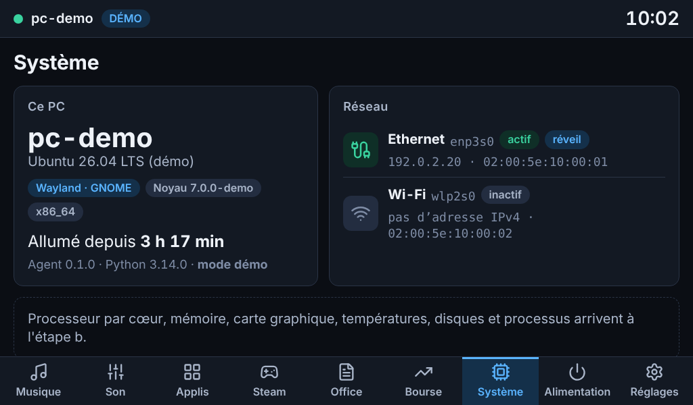
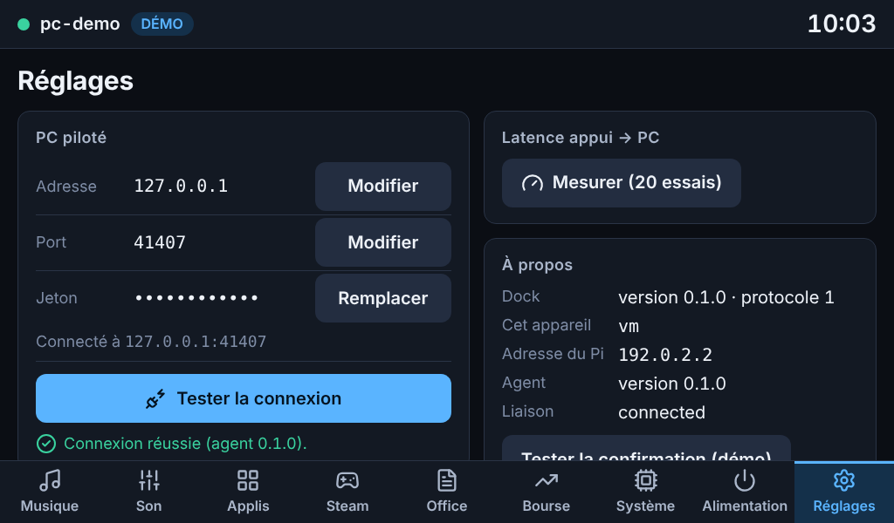
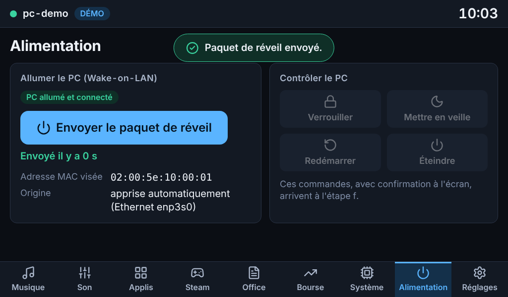
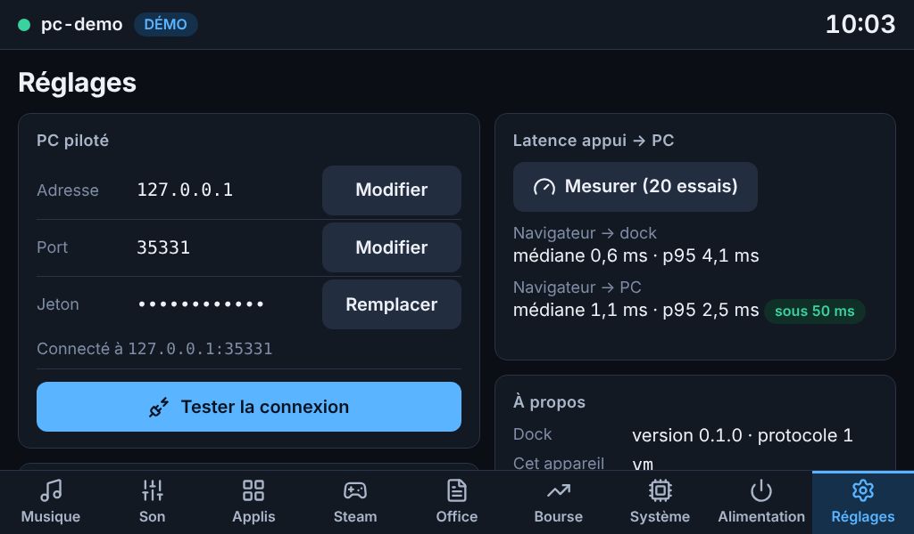
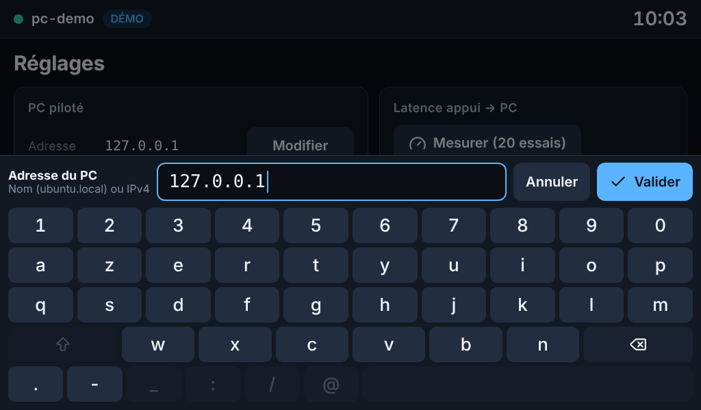
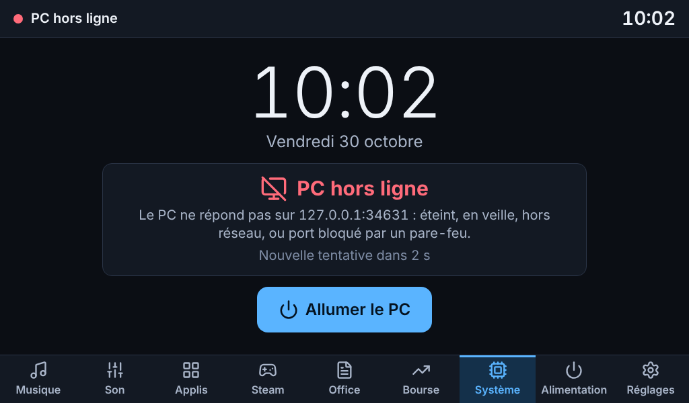
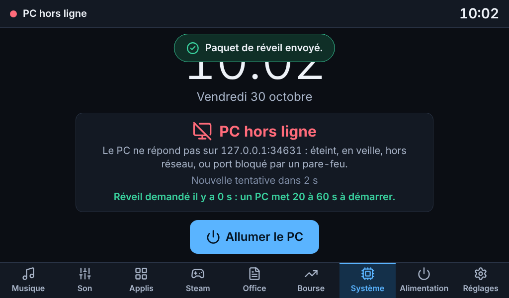
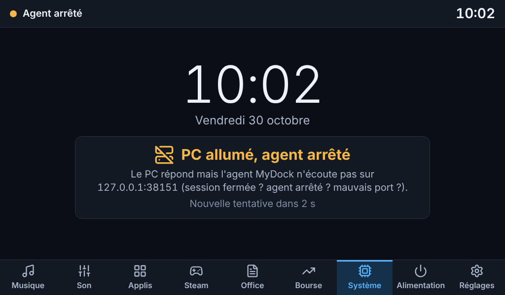
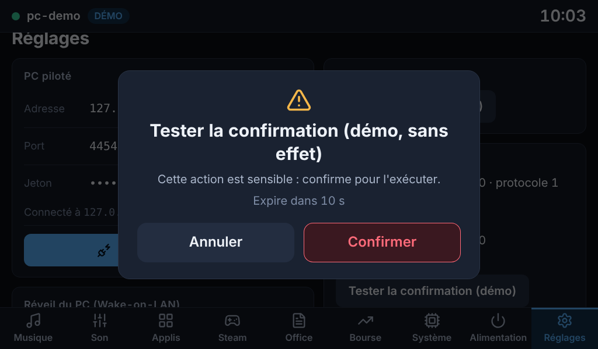
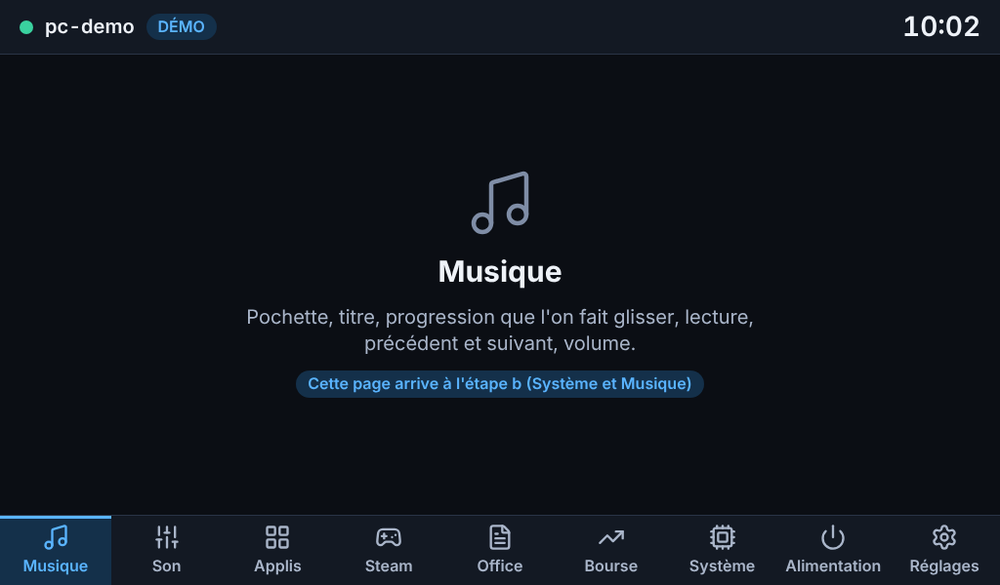

# Étape a — squelette : agent, dock, kiosque, connexion sécurisée

Livrée le 29 octobre 2026, branche `claude/jolly-dirac-5np79y`.
Toutes les captures de ce dossier sont en **mode démo** (fausses données), en 1024×600 tactile.

## Addendum du 30 octobre : retour d'installation et paquet `.deb`

**Constat sur ton installation** : l'agent répondait bien en local (`mydock-agent doctor` tout en ✔) mais le Pi affichait « PC hors ligne ». Avec l'adresse IP à la place de `ubuntu.local`, tout a fonctionné : c'était la **résolution du nom `.local` depuis le Pi** (mDNS), pas l'agent, pas le pare-feu, aucun port à ouvrir. Sur ton PC, `ubuntu.local` ne se résolvait d'ailleurs qu'en IPv6 (ton diagnostic), alors que l'agent n'écoute qu'en IPv4.

Ce que j'ai changé pour que ça ne se rejoue pas sans explication :

| Où | Changement |
|---|---|
| Écran du dock | Le message nomme l'adresse essayée : « Le PC ne répond pas sur `ubuntu.local (192.168.1.3:8765)` : … ». Un jeton refusé dit **quelle adresse du Pi l'agent a vue** (à comparer avec `allowed_clients`). Réglages affiche « Connecté à » ou « Dernière adresse essayée », et l'adresse du Pi. |
| Liaison dock → agent | Un nom qui donne plusieurs adresses IPv4 (Wi-Fi + Ethernet, pont docker…) : toutes sont essayées (3 au plus), la panne la plus parlante est retenue. Une panne n'est journalisée qu'une fois. |
| `mydock-dock doctor` (Pi) | Teste **chaque adresse** : port ouvert / refusé / muet ; pour un port muet, un ping distingue « pare-feu du PC » (le PC répond au ping) de « PC éteint ou Wi-Fi qui isole » ; donne la commande `ufw` prête à copier. |
| `mydock-agent doctor` (PC) | Section **pare-feu** (ufw, firewalld), alerte si l'agent n'écoute qu'en `127.0.0.1`, état du **service systemd**, et la commande `curl` à lancer depuis le Pi (404 = joint). |
| Installateurs | Ils donnent l'**adresse IP** du PC à saisir sur le Pi (plus `ubuntu.local`) et conseillent de la réserver dans la box. |

**Le logiciel du PC est maintenant un paquet `.deb`** (`mydock-agent`, 32 Ko, Python pur) :

- construit par `python3 packaging/build_deb.py` (seul `dpkg-deb` est requis, deux constructions donnent le même fichier) ;
- s'appuie sur les paquets `python3-*` d'Ubuntu — vérifiés dans l'archive de la 26.04 : fastapi 0.118, uvicorn 0.38, websockets 15.0.1, psutil 7.1, pydantic 2.12, tomli-w 1.2. Mon environnement de développement avait des versions bien plus récentes ; `make test-ubuntu` rejoue donc les tests avec **ces versions exactes** (417 tests passent) ;
- fournit le service systemd utilisateur (activé pour tous les utilisateurs, mais sans effet tant qu'on n'a pas lancé `mydock-agent setup`), le profil ufw « MyDock agent » et `mydock-agent enable-wol` ;
- **`mydock-agent setup --pi IP_DU_PI --open-firewall`** fait le reste : configuration en droits 600, jeton, démarrage du service, règle ufw, adresse et jeton à saisir sur le Pi. Il remplace aussi l'ancienne installation par script ;
- une mise à jour redémarre l'agent des sessions ouvertes ; une désinstallation l'arrête ; `apt remove` / `purge` laissent le système propre (essayés dans le conteneur : `dpkg -i`, `-r`, `-P`).

Ce qui n'a **pas** pu être essayé ici : `apt install` avec résolution des dépendances sur Ubuntu 26.04 (les versions sont lues dans l'archive, pas installées), et le démarrage du service dans une vraie session GNOME. À faire chez toi : `sudo apt install ./build/mydock-agent_*_all.deb`, puis `mydock-agent setup --pi 192.168.1.60 --open-firewall` et `mydock-agent doctor`.

## Ce qui est livré

- **Agent (PC)** : service WebSocket FastAPI, jeton obligatoire, filtrage par adresse **avant** le jeton, anti-force-brute, hub d'état qui n'envoie que les changements, registre d'actions à liste blanche avec confirmation à usage unique, collecteur `host` (identité, session, interfaces réseau et adresses MAC), `--demo`, `doctor`, `init`, `show-token`.
- **Serveur du dock (Pi)** : sert l'interface, relaie l'agent vers le navigateur (le jeton ne lui est jamais envoyé), reconnexion automatique avec diagnostic de la panne, Wake-on-LAN, configuration en droits 600, préférences persistantes, `doctor`.
- **Interface** : Svelte 5 + Vite + TypeScript, thème sombre, neuf onglets, écran « PC hors ligne », clavier tactile AZERTY intégré, Réglages (adresse, port, jeton, test de connexion, adresse MAC, mesure de latence), page Alimentation (Wake-on-LAN), fenêtre de confirmation. 84 Ko de JavaScript (31 Ko compressés), 280 Ko au total polices comprises.
- **Déploiement** : installateurs idempotents pour le PC et le Pi, unités systemd, kiosque (labwc + Chromium) en mode Desktop ou Lite, désinstallateurs, `diagnose.sh`, `enable-wol.sh`.
- Les pages Musique, Son, Applis, Steam, Office et Bourse existent et annoncent ce qu'elles offriront ; Système n'affiche encore que l'identité et le réseau du PC.

## Ce que ton diagnostic a changé

| Constat | Conséquence |
|---|---|
| Ubuntu 26.04.1, GNOME 50, Python 3.14.4 | Tests sous Python 3.13 **et 3.14** ; le code vise ≥ 3.11 ; dépendances à roues précompilées |
| Portable hybride Intel + RTX 4000 Ada | Étape b : ne pas réveiller la carte NVIDIA pour lire ses mesures (état « en veille » lu dans sysfs) ; batterie affichée |
| Ethernet **débranché**, Wi-Fi actif | Le réveil d'un PC **éteint** ne marchera pas tant qu'il n'est pas en Ethernet (voir README, section Wake-on-LAN). Le dock le dit à l'écran. `enable-wol.sh` règle la partie système |
| Nom de machine « ubuntu » ; `ubuntu.local` se résout en **IPv6** | L'agent n'écoute qu'en IPv4 et le dock ne résout qu'en IPv4 ; le script d'installation avertit du nom trop courant |
| Steam en .deb avec `~/.steam/steam` **et** `~/.local/share/Steam` | Étape d : dédoublonner par chemin réel, sinon chaque jeu apparaîtrait deux fois |
| Brave comme seul lecteur MPRIS (`brave.instance<pid>`) | Étape b : gérer des noms de lecteur qui changent à chaque lancement |
| LibreOffice en .deb (26.2) | Rien de particulier |

Manquaient dans ce que tu as collé : la ligne `type=` (Wayland ou X11 : très probablement Wayland, GNOME 50 ne proposant plus de session X11 à ma connaissance ; l'agent le détecte de toute façon au démarrage), la section Audio (`pactl`), l'environnement de `systemd --user`, le chemin de `soffice`, et les lignes « Wake-on » (elles demandent `sudo`). `./deploy/pc/diagnose.sh` les remontera.

## Tests exécutés

| Suite | Résultat | Ce qu'elle couvre |
|---|---|---|
| Python, agent + common + dock (3.14) | **358 réussis** | Protocole, jeton, droits 600, hub (diffusion sur changement, collecteurs paresseux, reprise après plantage), registre d'actions (confirmations liées à la connexion, à l'action, aux paramètres, expirées, rejouées), filtrage d'adresse, anti-force-brute, serveur WebSocket réel (jeton, trames invalides, messages trop gros, action lente), collecteur `host` sur faux `/sys`, liaison dock → agent (toutes les pannes, reconnexion, abonnements), relais navigateur → dock → agent, **le jeton n'atteint jamais le navigateur**, origines et `Host`, Wake-on-LAN (octets du paquet envoyé en UDP), CLI |
| Python, mêmes tests (3.13) | **358 réussis** | |
| Python, déploiement et hygiène du dépôt (3.14) | **50 réussis**, 1 ignoré (suppose un utilisateur non root) | Installations réelles dans un dossier temporaire (droits, idempotence, jeton jamais ailleurs que dans la config), simulation, refus, lanceur du kiosque avec faux Chromium, `shellcheck`, `systemd-analyze verify`, aucun secret suivi par git |
| Interface, tests unitaires (Vitest) | **44 réussis** | Formats, délais de reconnexion, clavier AZERTY et règles de saisie, ordre des pages |
| Interface, bout en bout (Playwright, 1024×600 tactile) | **18 réussis** | Voir ci-dessous |
| Qualité | propre | `ruff`, `svelte-check` (0 erreur, 0 avertissement), `shellcheck` |

Les 18 tests de bout en bout (vrai Chromium, vrai serveur dock, vrai agent de démo, appuis tactiles) vérifient : démarrage connecté sans défilement de la page ; les neuf onglets ; **toutes les cibles tactiles ≥ 48 px**, clavier compris ; page retrouvée au rechargement ; PC éteint → écran hors ligne → réveil (octets du paquet vérifiés) → reconnexion automatique ; agent arrêté seul → message dédié sans bouton de réveil ; Bourse et Réglages utilisables hors ligne ; l'écran ne clignote pas pendant les nouvelles tentatives ; saisie de l'adresse, du jeton (masqué) et de la MAC au clavier tactile ; refus d'une adresse invalide ; test de connexion ; latence ; confirmation annulée puis acceptée ; aucune erreur dans la console.

### Mesures (conteneur Linux de développement, boucle locale)

| Mesure | Valeur |
|---|---|
| CPU de l'agent au repos (processus réel, client abonné, 10 s) | **0,10 %** (objectif < 2 %), 52 Mo de RAM |
| Aller-retour d'une action jusqu'à l'agent (300 essais) | médiane 0,17 ms, p95 0,29 ms |
| Aller-retour mesuré dans l'interface (20 essais) | navigateur → dock : médiane 0,7 ms ; navigateur → agent : médiane 1,1 ms, p95 1,7 ms |
| Tâches longues pendant 18 changements de page, processeur ralenti ×4 | 0 |

Ces chiffres valident l'architecture, pas ton installation : ni Wi-Fi, ni Pi 4, ni vrai écran.

## Non testé — à vérifier chez toi

Rien de ce qui suit n'a pu l'être depuis le conteneur cloud (pas d'accès à ton PC ni à ton Pi, pas de systemd, pas d'écran).

1. **PC** — `./deploy/pc/install-agent.sh --pi <IP du Pi>` : attendu « Agent installé » et le jeton affiché une fois. Puis `~/.local/share/mydock/venv/bin/mydock-agent doctor` : tout en ✔ (un ⚠ sur le Wi-Fi est normal).
2. **PC** — fermer puis rouvrir la session : `systemctl --user status mydock-agent` doit montrer le service actif. *(Le service est lié à `graphical-session.target` ; jamais vérifié sur GNOME 50.)*
3. **Pi** — `sudo ./deploy/pi/install-dock.sh --pc <nom>.local`, coller le jeton, `sudo reboot` : l'écran doit afficher la page Système avec le nom de ton PC et **sans** pastille DÉMO. Les noms de paquets (`chromium`, `labwc`, `wlr-randr`…), la création des utilisateurs, l'unité du kiosque et le mode Desktop (autostart de labwc) n'ont jamais tourné sur un vrai Pi.
4. **Pi** — la résolution `<nom>.local` en **IPv4** : `getent ahostsv4 <nom>.local`. Si rien ne revient, utiliser l'adresse IP dans Réglages.
5. **Interface** — Réglages → **Tester la connexion** (attendu : réussie), puis **Mesurer** : relever les deux médianes et le p95 (objectif < 50 ms ; le Wi-Fi peut en ajouter).
6. **Fluidité** — ouvrir `http://127.0.0.1:8080/?debug=1` sur le Pi : relever les images par seconde en changeant de page (visé : 60). C'est le test que les ralentissements ×4 de Playwright ne remplacent pas.
7. **Écran et toucher** — la résolution 1024×600 est-elle reconnue sans réglage ? Le clavier tactile est-il confortable ? Les cibles sont prévues à 56 px (≈ 8 mm sur ce 7").
8. **Hors ligne** — éteindre le PC : « PC hors ligne » en une quinzaine de secondes ; le réveil ne marchera qu'en Ethernet avec le BIOS réglé.
9. **Coreutils** — Ubuntu 26.04 remplace les outils GNU par *uutils*. Les scripts n'utilisent que des options courantes (`install -D`, `stat -c`, `mktemp`, `cmp`), mais ils n'ont été essayés qu'avec GNU.

Non couvert non plus : Python 3.11 et 3.12, un navigateur autre que Chromium, la perte du serveur du dock côté navigateur (message « Dock injoignable » écrit mais pas exercé de bout en bout), le chiffrement TLS (prévu à l'étape f).

## Décisions prises par défaut (dis-moi si tu veux autre chose)

- Yahoo Finance sans clé par défaut pour la bourse (étape e), Binance pour la crypto, fournisseurs à clé optionnels.
- Pi OS Lite ou Desktop **détecté automatiquement** ; labwc comme compositeur.
- Interface compilée **commitée** (`dock/web/dist`) pour que le Pi n'ait pas besoin de Node ; `make web-check` vérifie qu'elle est à jour.
- Deux utilisateurs système sur le Pi : `mydock` (serveur, détient le jeton) et `mydock-kiosk` (navigateur).
- Ports : agent 8765, dock 8080 (local seulement).
- Aucun paquet n'est installé sur le PC sans le dire ; `sudo` n'est demandé que pour `apt` et `ufw`.

## Questions

1. Le Pi : image **Lite ou Desktop**, Bookworm ou Trixie, Ethernet ou Wi-Fi ?
2. Le PC est-il en général sur **Wi-Fi ou Ethernet** quand tu utilises le dock ? Cela décide si « Allumer le PC » peut fonctionner PC éteint.
3. Rejouer `./deploy/pc/diagnose.sh --anonyme` et coller la sortie (lignes manquantes ci-dessus).
4. Yahoo Finance par défaut pour la bourse : d'accord malgré son statut non officiel ?

## Captures

| | |
|---|---|
|  |  |
| Système | Réglages, après « Tester la connexion » |
|  |  |
| Alimentation et Wake-on-LAN | Mesure de latence |
|  |  |
| Clavier tactile | PC hors ligne |
|  |  |
| Réveil demandé | PC allumé, agent arrêté |
|  |  |
| Confirmation d'une action sensible | Page à venir |

## Suite

Étape **b** : Système (CPU global et par cœur, mémoire, GPU NVIDIA sans réveiller la carte, batterie, températures, réseau, disques, 60 s d'historique, processus avec arrêt confirmé) et Musique (MPRIS par D-Bus, pochette, progression glissable, mini-lecteur toujours accessible).
