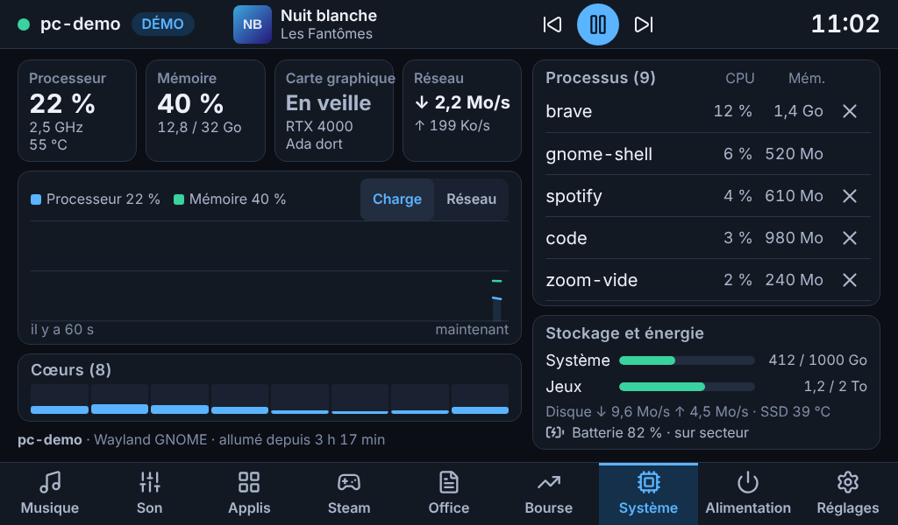
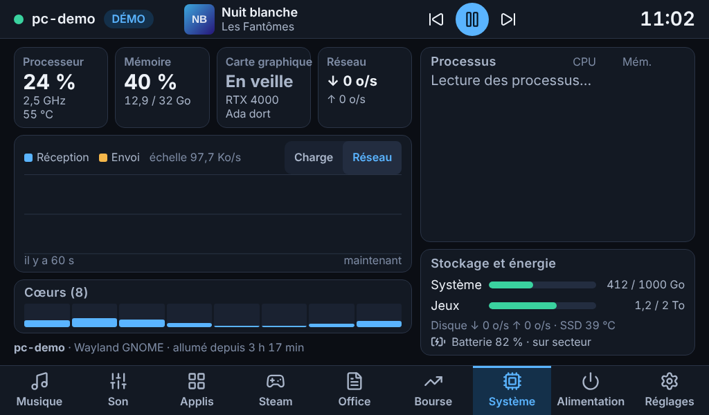
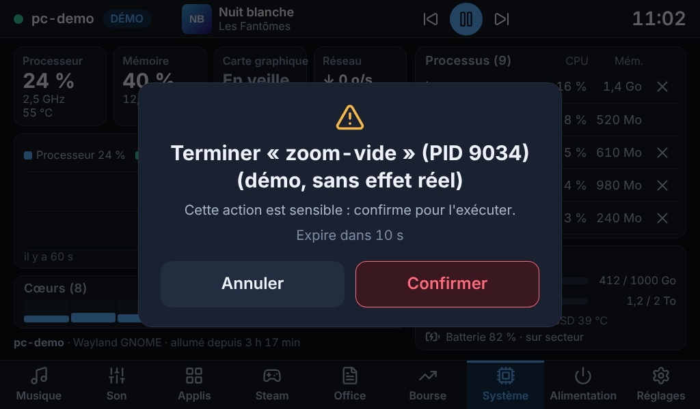
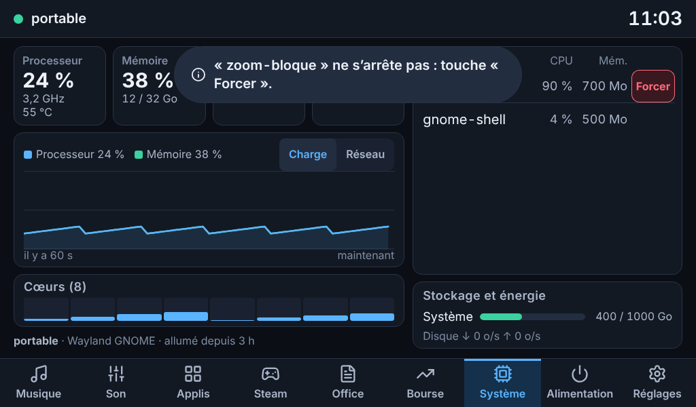
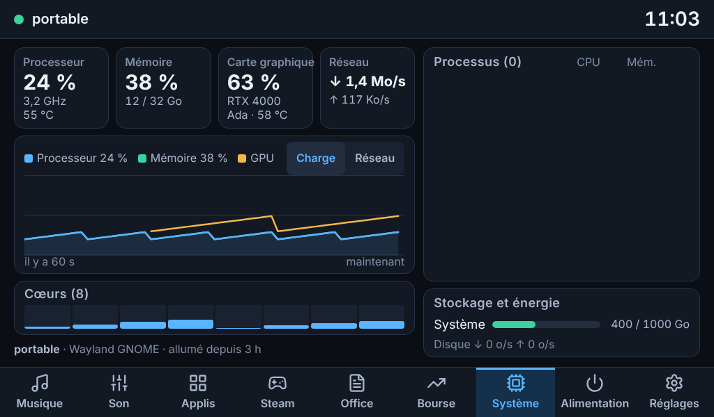
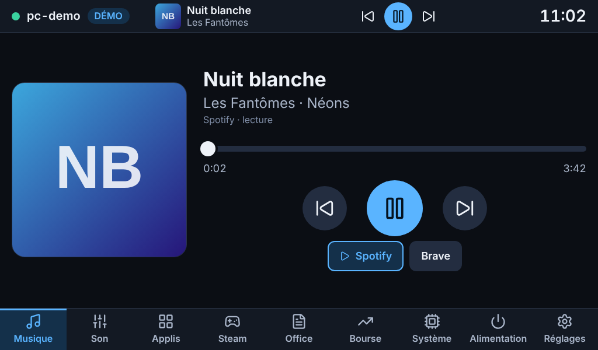
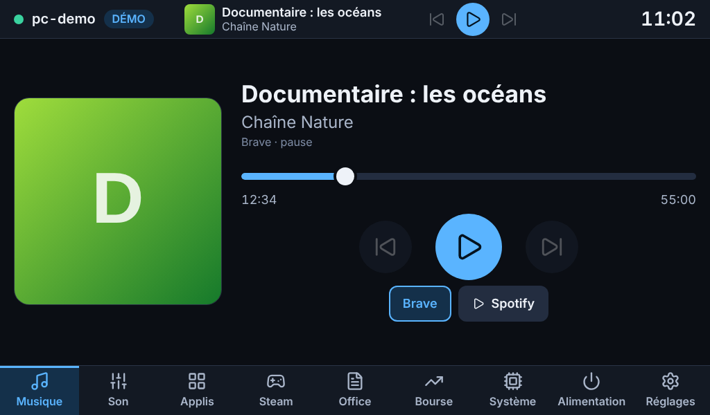
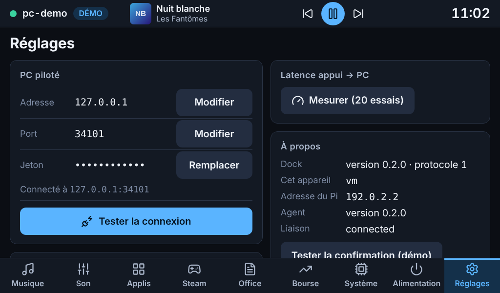
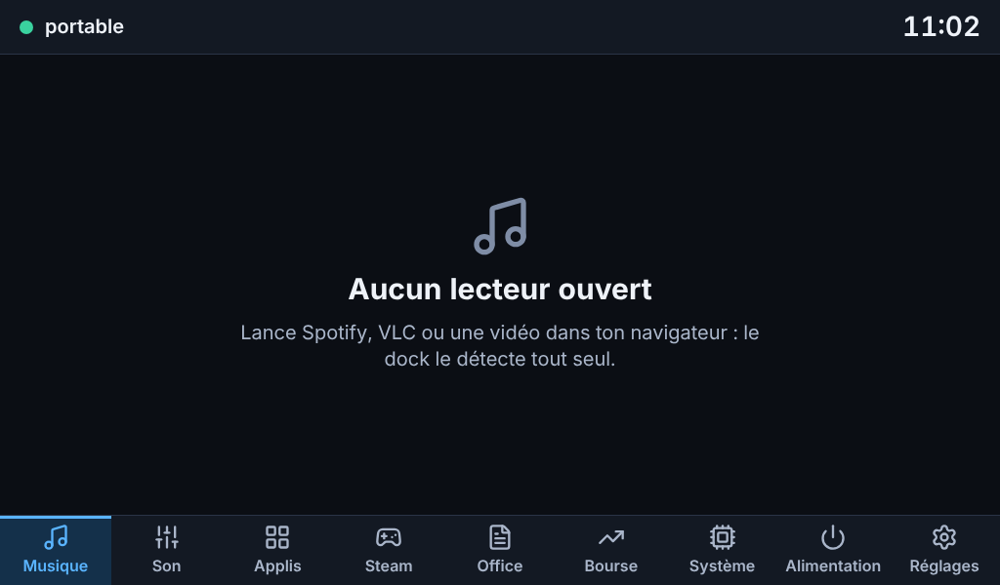
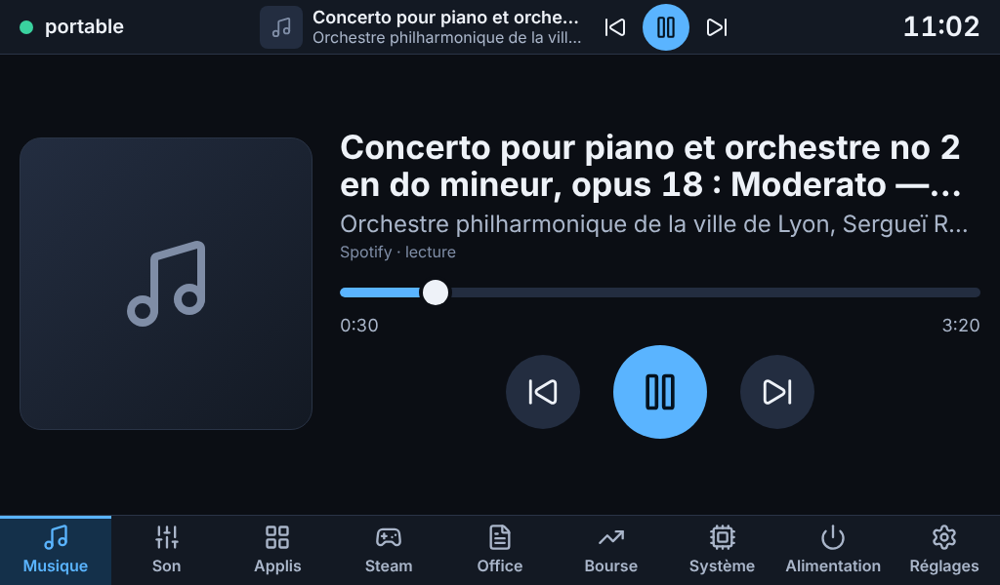

# Étape b — Système et Musique

Livrée le 30 octobre 2026, branche `claude/jolly-dirac-5np79y`, paquet `mydock-agent` 0.2.0.
Les captures de ce dossier sont en **mode démo** (fausses données, portable hybride fictif), en 1024×600 tactile, sauf mention.

## Ce qui est livré

### Page Système

| | |
|---|---|
| **Tuiles** | Processeur (charge, fréquence, température), Mémoire (utilisée / totale), **Carte graphique**, Réseau (↓ et ↑) |
| **Graphique de 60 s** | Charge CPU, mémoire et GPU ; bascule « Réseau » (réception, envoi, échelle automatique). L'agent garde l'historique : la courbe est pleine dès l'ouverture de la page. Un GPU qui dort fait une *coupure* dans la courbe, pas un faux 0 % |
| **Cœurs** | Une barre par cœur (8 ou 24), colorée selon la charge |
| **Stockage et énergie** | Disques locaux (sans doublons de sous-volumes ni snaps), débit disque, température du SSD, batterie |
| **Processus** | Les 8 plus gourmands (CPU, mémoire) ; bouton ✕ avec **confirmation à l'écran** ; « Forcer » si le processus ignore la demande polie |

**Carte NVIDIA et portable hybride.** La carte dédiée dort presque tout le temps, et la moindre ouverture de `/dev/nvidia*` (nvidia-smi, NVML) la réveille et l'empêche de se rendormir. L'agent procède donc ainsi : découverte par `/sys/bus/pci` et nom par `pci.ids` (aucun accès à la carte), état d'alimentation lu dans `power/runtime_status` (sans la réveiller), et **NVML n'est interrogée que si la carte est déjà active** — puis refermée aussitôt, pour ne rien retenir. Endormie, la tuile dit « En veille ». Une carte AMD endormie n'est pas lue non plus ; l'Intel donne sa fréquence.

**Arrêt d'un processus — les garde-fous.** Action sensible : confirmation à l'écran nommant la cible (« Terminer « firefox » (PID 1234) ») **et** jeton à usage unique côté agent (10 s, lié à la connexion, à l'action et aux paramètres). L'agent revérifie ensuite tout lui-même : le processus existe toujours et c'est le même (heure de démarrage identique : un PID réattribué n'est pas tué), il appartient à **l'utilisateur de l'agent**, ce n'est ni l'agent ni l'un de ses parents, ni un processus de session (gnome-shell, pipewire, Xwayland, systemd…, y compris leurs noms tronqués à 15 caractères). Ces processus n'ont même pas de bouton.

### Page Musique et mini-lecteur

- **Tous les lecteurs MPRIS** : Spotify, VLC, Firefox, Brave (`brave.instance<pid>` : le numéro change à chaque lancement, un même navigateur reste « le même »)… L'agent ne fait **aucune interrogation** : il écoute les signaux D-Bus (`NameOwnerChanged`, `PropertiesChanged`, `Seeked`) et regroupe les salves (Chromium en émet plusieurs d'affilée).
- **Lecteur piloté** : celui qui joue ; à égalité Spotify, puis le plus récemment joué. Un choix explicite (pastilles « Spotify · Brave ») est respecté jusqu'à ce qu'un autre lecteur démarre.
- **Page** : pochette 300 px, titre (2 lignes), artiste · album, **barre de progression que l'on fait glisser** (valeur appliquée au relâchement, sinon on toucherait le PC à chaque pixel), précédent / lecture-pause / suivant en 76–96 px.
- **Mini-lecteur** dans la barre du haut, **sur toutes les pages** : pochette, titre, précédent, lecture/pause, suivant (48 px) ; toucher le titre ouvre la page Musique. Absent quand le PC l'est.
- **Pochettes** : demandées une fois par morceau. `file://` (Brave/Chromium, VLC) lu seulement si le fichier *est une image* (reconnue à ses premiers octets : une clé privée n'en est pas une) ; `https://` seulement vers une machine **publique** (jamais le réseau local), sans redirection, 4 Mo au plus ; réduite à 480 px en JPEG si Pillow est installé (`python3-pil`, recommandé par le paquet).
- **États clairs** : « Aucun lecteur ouvert » ; « Musique indisponible » + raison si le bus D-Bus de session est injoignable (l'agent retente toutes les 10 s) ; un navigateur sans durée ni position est affiché sans barre glissable ; « Sans titre », titres très longs sur 2 lignes.

### Autour

- **`mydock-agent` 0.2.0** : nouveaux thèmes `system`, `procs`, `music`, nouvelles actions `music.*` et `system.kill` ; le protocole reste en version 1 (seuls des thèmes s'ajoutent). Dépendance nouvelle : `python3-dbus-fast` (dans Ubuntu 26.04, vérifié dans l'archive).
- **Le dock suit `system` en permanence** tant qu'il est connecté (c'est ce qui rend l'historique prêt à l'ouverture) ; `procs` seulement quand la page Système est ouverte ; `music` tant qu'un navigateur est connecté (mini-lecteur).
- **Mode démo** : portable hybride fictif (NVIDIA endormie ; `MYDOCK_DEMO_NVIDIA=awake` pour la voir active), deux lecteurs, huit processus dont un « tuable ». C'est le vrai code qui tourne par-dessus de faux capteurs, pas une imitation.
- **Une liste blanche vérifiée par test** : les actions du PC sont exactement `diag.ping`, `music.{art,next,play_pause,position,previous,seek,select}` et `system.kill`.

## Tests exécutés

| Suite | Résultat | Ce qu'elle couvre |
|---|---|---|
| Python, tout le dépôt (3.14, bibliothèques récentes) | **747 réussis**, 1 ignoré (suppose un utilisateur non root) | common 104, agent 341, dock 203, paquet .deb 47, scripts de déploiement 42, hygiène du dépôt 11 |
| Python avec les **versions exactes d'Ubuntu 26.04** (`make test-ubuntu`) | **706 réussis** | fastapi 0.118, uvicorn 0.38, websockets 15, psutil 7.1, pydantic 2.12, dbus-fast 4.0, Pillow 12.1 |
| Interface, unitaires (Vitest) | **124 réussis** | formats (octets, débits, durées), résumé du GPU, tracé du graphique (coupures), position du morceau, barre de progression |
| Interface, bout en bout (Playwright, 1024×600 tactile) | **44 réussis** | voir ci-dessous |
| Qualité | propre | `ruff`, `svelte-check` (0 erreur, 0 avertissement), `shellcheck` |

**Ce que les tests Python prouvent de nouveau**
- **D-Bus pour de vrai** : un `dbus-daemon` privé et de faux lecteurs MPRIS (dbus-fast côté lecteur) : découverte, métadonnées, `PlayPause`, `Next`, `SetPosition`, signaux de changement, lecteur qui arrive puis part, deux instances de navigateur, bus qui disparaît puis revient. C'est le plus proche possible de Spotify sans Spotify.
- **Vrais processus** : arrêt par SIGTERM, par SIGKILL pour un processus qui ignore SIGTERM, PID réattribué, processus déjà parti, autre utilisateur, l'agent et son parent, nom de session protégé, paramètres invalides.
- **Carte endormie** : NVML n'est jamais appelée (zéro appel compté sur la fausse bibliothèque) pour une carte `suspended`, `suspending` ou `resuming` ; elle l'est, puis refermée, pour une carte active ; les mises en page des structures C sont vérifiées.
- **Pochettes** : fichier non image, trop gros, dossier, machine distante, adresses privées/loopback/lien-local (IPv4 et IPv6), schémas non https, DNS en échec.
- **Bout en bout par le réseau** : l'agent de démonstration complet, avec abonnements paresseux, mesures, historique, musique et arrêt confirmé.

**Les 25 nouveaux tests Playwright** : Système (tuiles, historique qui grandit, graphique Réseau, processus protégés sans bouton, arrêt annulé puis confirmé, disparition et retour avec le PC), Musique (lecture/pause, suivant/précédent, toucher et glisser la barre, choix du lecteur, mini-lecteur sur toutes les pages, disparition avec le PC) et, avec un **dock simulé** pour produire des cas que la démo ne montre pas : aucun lecteur, bus D-Bus injoignable, titre démesuré, navigateur sans durée, pochette reçue ou en échec (demandée une seule fois), deux Brave numérotés, NVIDIA éveillée, 24 cœurs et 4 disques sans batterie ni GPU, processus têtu (« Forcer » en deux temps), refus de l'agent affiché tel quel. Le test « toutes les cibles tactiles ≥ 48 px » visite maintenant les neuf pages.

### Mesures (conteneur Linux de développement)

| Mesure | Valeur |
|---|---|
| CPU de l'agent au repos, démo, `host` seul (10 s) | **0,30 %**, 54 Mo |
| CPU du **vrai** agent suivant `host` + `system` (1 mesure/s) + `music` | **0,50 %**, 58 Mo (objectif < 2 %) |
| CPU du vrai agent, **page Système ouverte** (`procs` toutes les 2 s) sur une machine chargée de **383 processus** | **2,5 %**, 59 Mo |
| Aller-retour d'une action jusqu'à l'agent (300 essais) | p50 0,25 ms, p95 0,38 ms |
| Interface, page Système et page Musique, processeur ralenti ×4 | 60 i/s, aucune tâche longue, image la plus longue 17 ms |
| Interface compilée | 316 Ko en tout ; JavaScript principal 33 Ko compressé, page Système 5 Ko, page Musique 2,5 Ko |

Le coût de 2,5 % n'existe que page Système ouverte et sur une machine très chargée (le balayage des processus lit deux ou trois fichiers par processus) ; sur ton portable il sera plus bas. Si besoin, l'intervalle passe de 2 à 3 s d'un seul réglage (`procs.INTERVAL`).

## Non testé — à vérifier chez toi

Rien de ce qui suit n'a pu l'être depuis le conteneur cloud.

1. **Spotify et Brave réels** — l'agent a été essayé contre de faux lecteurs qui parlent le même protocole sur un vrai bus D-Bus, pas contre les vrais. À regarder : `playerctl -l` (ou `busctl --user list | grep mpris`) doit montrer `spotify` et/ou `brave.instance…` ; puis la page Musique. Points d'attention : Brave/Chromium ne donne pas toujours la position (alors pas de barre, c'est voulu), et l'emplacement de sa pochette `file://` n'est pas vérifié.
2. **La carte NVIDIA RTX 4000 Ada réelle** — le comportement « ne pas réveiller » repose sur `power/runtime_status`. Test simple : `cat /sys/bus/pci/devices/0000:01:00.0/power/runtime_status` (adapter l'adresse, voir `lspci | grep -i nvidia`) doit rester `suspended` quand la page Système est ouverte et que rien n'utilise la carte ; ouvrir un jeu ou un programme sur la carte doit faire apparaître sa charge. NVML elle-même n'a été essayée que sur une fausse bibliothèque.
3. **Températures, batterie, fréquence** — lues par psutil sur ton matériel (Raptor Lake : `coretemp`) ; la logique est testée avec de fausses valeurs.
4. **`mydock-agent setup` et le paquet** — `apt install` avec résolution des dépendances et le démarrage du service dans une vraie session GNOME (voir l'addendum de l'étape a).
5. **Fluidité sur le Pi 4** — les 60 i/s ci-dessus viennent de Chromium sans GPU avec processeur ralenti ×4 : un indicateur, pas une mesure sur Pi. Ouvrir `http://127.0.0.1:8080/?debug=1` sur le Pi, page Système, et relever les images par seconde.
6. **Toucher réel** — taille des cibles (48–96 px) et glissement de la barre de progression au doigt sur l'écran 7".

## Décisions prises par défaut (dis-moi si tu veux autre chose)

- **Seulement tes processus sont arrêtables**, et jamais ceux de la session. Les autres s'affichent sans bouton.
- La charge d'un processus est exprimée en **part de la capacité totale** du processeur (comme la tuile), pas en « % d'un cœur » comme `top`.
- **Carte endormie = on n'y touche pas.** Pas de réglage pour forcer la lecture (ce serait réveiller la carte et vider la batterie).
- Le volume du lecteur n'est pas sur la page Musique : il viendra avec la page **Son** (étape c), qui gère aussi le volume par application.
- Le mini-lecteur occupe le centre de la barre du haut ; il disparaît quand le PC est hors ligne.

## Questions

1. Quel(s) lecteur(s) utilises-tu vraiment : **l'application Spotify**, ou Spotify/YouTube **dans Brave** ? (`playerctl -l` sur le PC répond en une ligne.)
2. Huit processus et l'arrêt limité aux tiens te conviennent-ils, ou veux-tu aussi pouvoir arrêter un service de ton utilisateur protégé (gnome-shell…) — je déconseille.
3. On enchaîne sur l'étape **c** (Son : sorties, volume par sortie et par application, micro, `pactl subscribe`) ?

## Captures

| | |
|---|---|
|  |  |
| Système (démo : NVIDIA endormie) | Graphique « Réseau » |
|  |  |
| Confirmation avant d'arrêter un processus | Processus qui ignore la demande : « Forcer » |
|  |  |
| NVIDIA éveillée (dock simulé) | Musique |
|  |  |
| Un navigateur : pas de morceau suivant | Mini-lecteur sur une autre page |
|  |  |
| Aucun lecteur ouvert | Titre démesuré |

## Suite

Étape **c** : Son (sortie par défaut, volume et muet par sortie et par application, micro) par `pactl subscribe`, sans interrogation.
