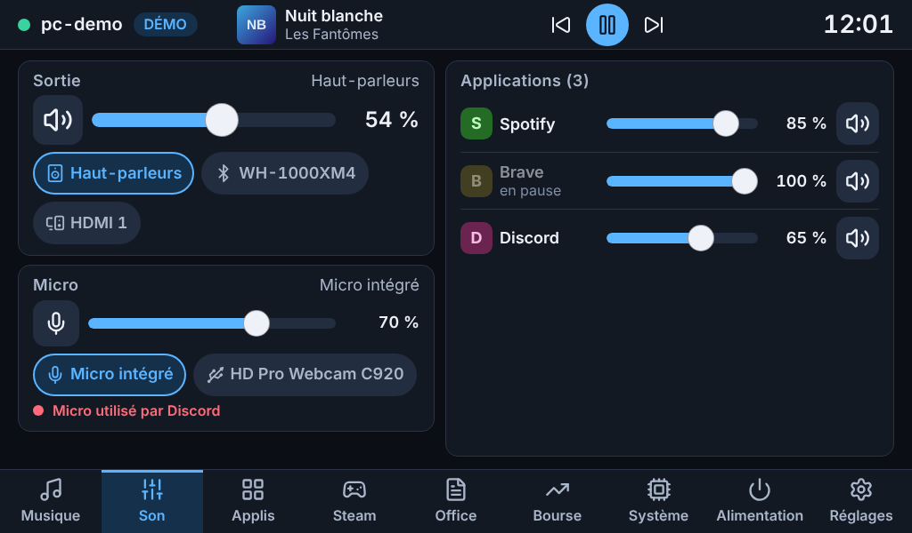
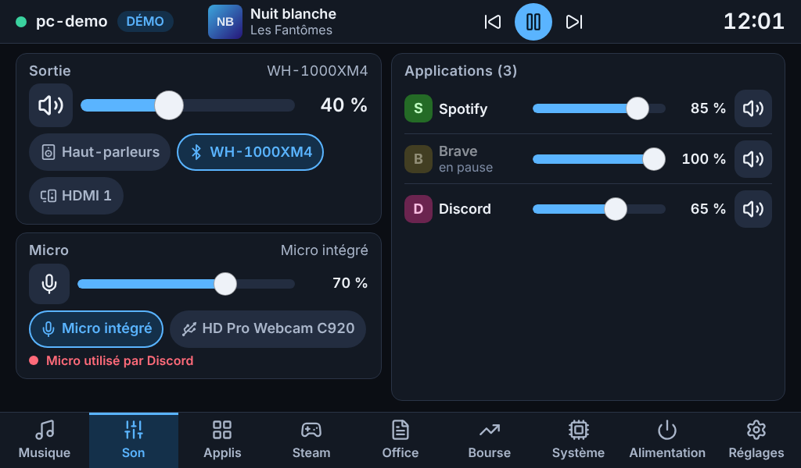
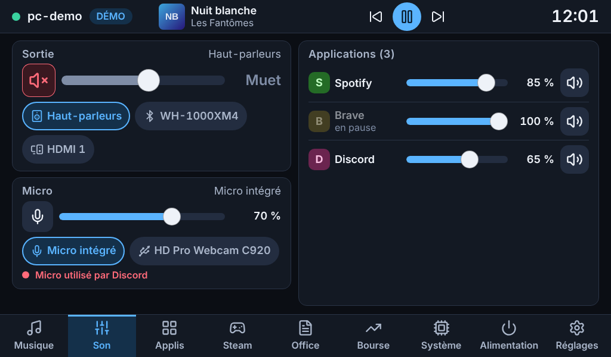
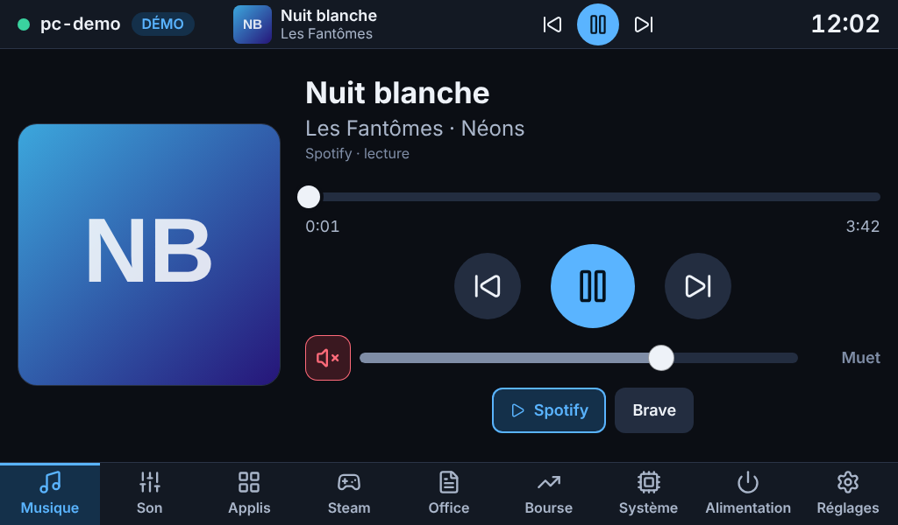
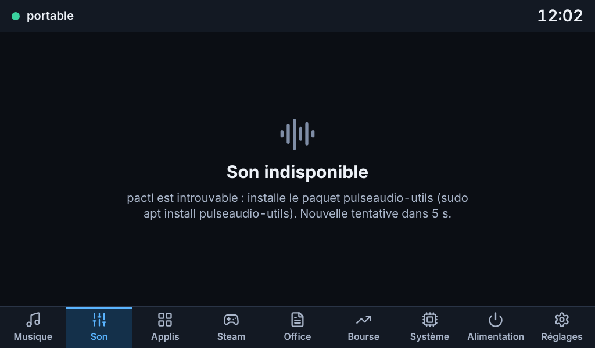
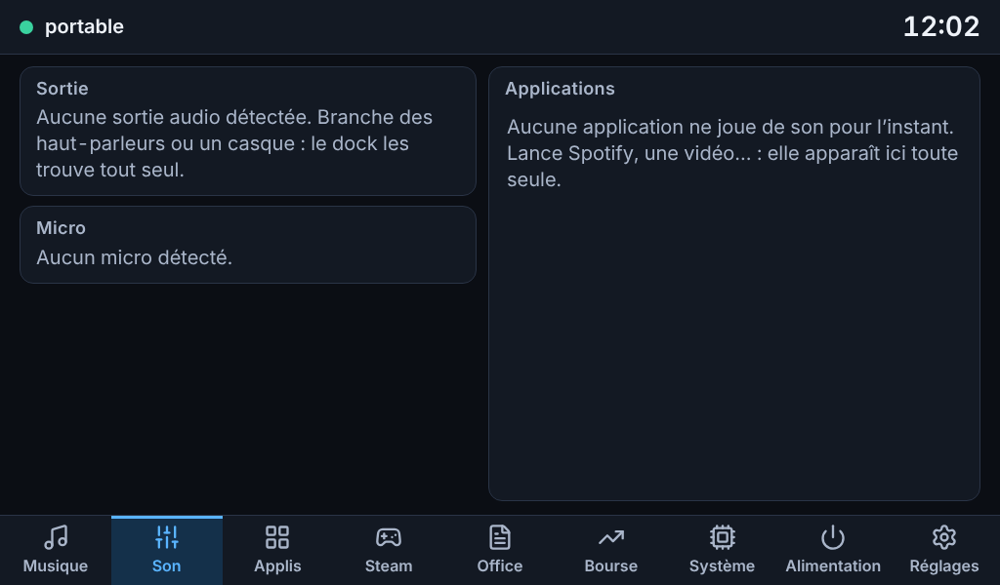
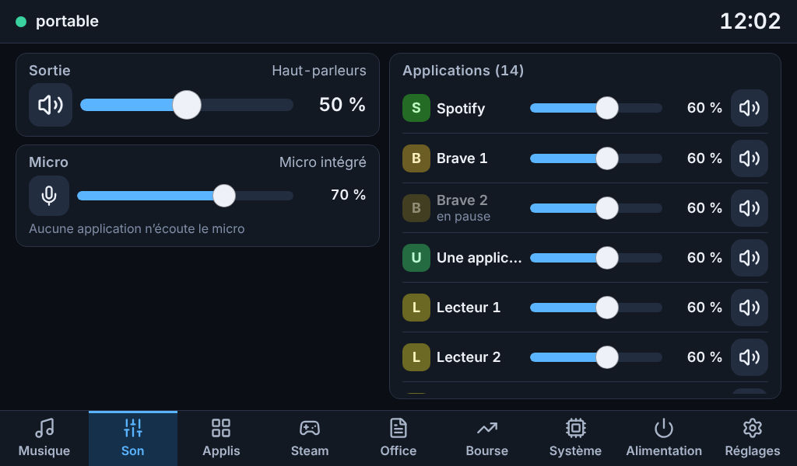
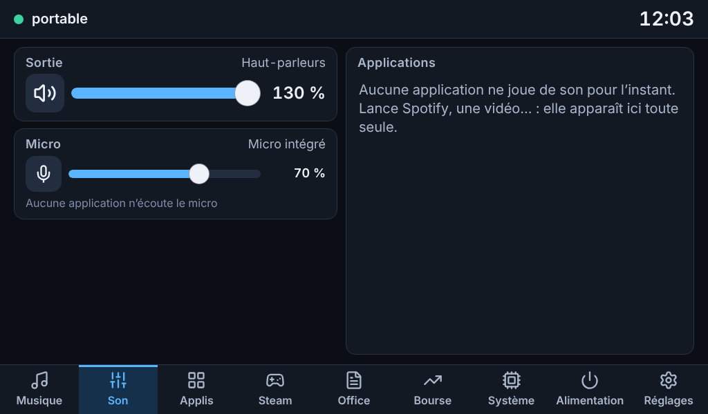

# Étape c — Son

Livrée le 30 octobre 2026, branche `claude/jolly-dirac-5np79y`, paquet `mydock-agent` 0.3.0.
Les captures de ce dossier sont en **mode démo** (fausses données : un portable avec haut-parleurs, un casque Bluetooth, un écran HDMI, un micro intégré et un micro de webcam), en 1024×600 tactile, sauf mention.

## Ce qui est livré

### Page Son

| | |
|---|---|
| **Sortie** | Volume au doigt (curseur de 56 px de haut), bouton muet, et une pastille par sortie pour changer la sortie par défaut : *Haut-parleurs*, *Casque*, un casque *Bluetooth* (par son nom), *HDMI 1*… La sortie qui n'a pas d'écran branché n'est pas proposée |
| **Micro** | Volume, muet, choix du micro (intégré, webcam…), et l'indicateur **« Micro utilisé par Discord »** en rouge quand une application l'écoute — ou « Aucune application n'écoute le micro » |
| **Applications** | Une ligne par application qui joue du son : pastille de couleur, nom, curseur, pourcentage, bouton muet. **Spotify toujours en tête**, les autres dans leur ordre d'arrivée (une ligne ne saute jamais sous le doigt quand une application se met en pause : elle est seulement grisée, « en pause »). Deux homonymes sont numérotés (« Brave 1 », « Brave 2 ») |

Aussi : **le volume de la sortie est sur la page Musique** (ligne sous les boutons de lecture), comme prévu à l'étape b ; c'est le même réglage que sur la page Son.

Comportements voulus :
- **Jamais plus de 100 %.** Un volume amplifié ailleurs (GNOME le permet) s'affiche tel quel (« 130 % », curseur en bout de course) mais le dock ne l'augmente pas.
- **Bouger le curseur d'un son coupé le rétablit** (on veut entendre ce qu'on règle).
- **Rien ne se fige pendant qu'on touche** : l'affichage suit le doigt, et le PC confirme une centaine de millisecondes plus tard. Un refus du PC remet l'ancien affichage et le dit à l'écran (un message, pas dix).
- **États clairs** : « Son indisponible » + la raison (pactl absent, serveur de son arrêté ; l'agent retente toutes les 5 s) ; « Aucune sortie audio détectée » ; « Aucun micro détecté » ; « Aucune application ne joue de son pour l'instant ».

### Côté PC (agent 0.3.0)

- **Thème `audio`** lu par `pactl`, qui parle à PipeWire (par sa couche PulseAudio, installée par défaut sur Ubuntu) comme à PulseAudio. **Aucune interrogation** : `pactl subscribe` signale chaque changement (volume réglé au clavier, casque branché, application qui démarre) ; l'agent regroupe les salves (50 ms) et ne relit que la partie concernée (sorties, micros, applications ou enregistrements). Fournisseur « paresseux » : pas de `pactl subscribe` tant qu'aucune page n'a besoin du son.
- **Trois actions**, sans confirmation (réversibles et sans danger) : `audio.set_volume` (0 à 100 %), `audio.set_mute`, `audio.set_default` (sortie ou micro). Elles n'agissent que sur **ce que l'écran montre** : une sortie sans écran, un moniteur, un son d'événement du bureau ne sont pas adressables. Les noms transmis à `pactl` sont validés (pas d'option déguisée, 200 caractères au plus), sans shell.
- **L'équilibre gauche/droite est conservé.** Régler « 60 % » met le canal le plus fort à 60 % et l'autre dans la même proportion qu'avant : un équilibre réglé dans les paramètres du bureau n'est pas effacé en silence.
- **La dernière valeur gagne.** Un curseur glissé envoie au plus 10 réglages par seconde (le dernier toujours) ; si le PC est plus lent, l'agent met les réglages en file et saute ceux qui sont déjà périmés. Le volume final est toujours celui du doigt.
- **Famille et nom des appareils** : *Haut-parleurs* / *Casque* / *HDMI n* / *Micro intégré* / *Micro du casque* / *Entrée ligne* sont déduits du type d'appareil et de la prise active (la prise change quand on branche un casque sur la prise jack), le reste garde le nom de l'appareil sans le suffixe de profil (« HD Pro Webcam C920 Analog Stereo » devient « HD Pro Webcam C920 »).
- **Mode démo** : l'agent de démonstration fait tourner **le vrai fournisseur** par-dessus un faux serveur de son qui parle comme `pactl` (même JSON, mêmes commandes, mêmes événements, et les applications suivent la sortie par défaut comme avec PipeWire).
- **`mydock-agent doctor`** : nouvelle section « Son » (serveur, sorties, micros, applications) avec des conseils précis si `pactl` manque ou si le serveur de son ne répond pas.

### Deux pièges de `pactl`, trouvés et traités

1. **`pactl` traduit sa sortie.** Les lignes de `pactl subscribe` (« Événement « change » sur… ») et la disponibilité des prises dans le JSON dépendent de la langue de la session : sur ton Ubuntu en français, un agent naïf n'aurait rien compris. Vérifié dans le code source de `pactl` 17 ; l'agent le lance donc toujours en `LC_ALL=C`.
2. **Le JSON de `pactl` ne sait pas écrire les accents.** Un nom accentué (« Écouteurs de Marie », une application, un titre) devient la chaîne `(null)`, quelle que soit la langue — vérifié contre un vrai PipeWire : le serveur connaît le bon nom, c'est `pactl` qui le perd. L'agent n'affiche jamais ce texte : il cherche un autre nom (produit, carte, binaire du programme), puis déduit un nom du nom technique (« Bluetooth 12:34:56 », « Focusrite Scarlett 2i2 USB », « Sortie audio »). Un test passe tous les textes libres à `(null)` et vérifie que rien ne s'en échappe vers l'écran.

## Tests exécutés

| Suite | Résultat | Ce qu'elle couvre |
|---|---|---|
| Python, tout le dépôt (3.14, bibliothèques récentes), **tests lents compris** | **887 réussis**, 1 ignoré (suppose un utilisateur non root) | common 104, agent 481, dock 203, paquet .deb et scripts de déploiement 100 |
| Python avec les **versions exactes d'Ubuntu 26.04** (`make test-ubuntu`) | **835 réussis** | fastapi 0.118, uvicorn 0.38, websockets 15, psutil 7.1, pydantic 2.12, dbus-fast 4.0, Pillow 12.1 |
| Dont le Son (agent) | **134 réussis** | 125 sur l'analyse de `pactl`, l'état publié et les actions ; **9 contre un vrai PipeWire** |
| Interface, unitaires (Vitest) | **134 réussis** | dont 10 nouveaux : volume, position du doigt, clavier, noms d'applications, résumé du micro utilisé |
| Interface, bout en bout (Playwright, 1024×600 tactile) | **69 réussis** | dont 25 nouveaux, voir ci-dessous |
| Qualité | propre | `ruff` (analyse et format), `svelte-check` (0 erreur, 0 avertissement), `shellcheck` |

**Ce que les tests Python prouvent de nouveau**
- **Un vrai PipeWire** : une pile privée (bus D-Bus, `pipewire`, `wireplumber`, `pipewire-pulse`) est lancée dans un dossier jetable, sans toucher au son du poste. Des sorties, un micro virtuel et des applications y sont créés pour de vrai ; chaque réglage de l'agent (volume, muet, sortie par défaut, volume d'une application) est **vérifié en interrogeant le serveur par un autre chemin** ; les changements faits « ailleurs » (un autre `pactl`) arrivent bien dans l'état publié ; une application qui démarre puis s'arrête apparaît puis disparaît ; un micro en cours d'utilisation est signalé puis oublié ; **le redémarrage de `pipewire-pulse`** (ce qui arrive à la reconnexion de session) est rattrapé tout seul ; l'agent complet est piloté par WebSocket contre ce vrai serveur.
- **De vraies réponses de `pactl` 16.1** sont versionnées (`agent/tests/data/pactl-16.1/`) et servent de référence à l'analyse.
- **Le vrai exécutable `pactl` (remplacé par un script)** : toujours `LC_ALL=C` et jamais `LANGUAGE`, `-f json` demandé, première ligne d'erreur reprise, « No such entity » reconnu, processus bloqué tué, `pactl` absent, version trop ancienne, flux d'événements lu ligne à ligne puis stoppé avec le contexte (le processus disparaît bien).
- **Matrice des appareils** : haut-parleurs (UCM ou prise active), casque (jack branché, UCM), HDMI avec et sans numéro (Intel, NVIDIA), Bluetooth, USB, micros intégré / webcam / casque / entrée ligne, noms qui se répètent, sorties débranchées cachées, sortie factice de PipeWire cachée.
- **Actions** : volumes, équilibre conservé, micro mono, muet, sortie par défaut, éléments inconnus ou cachés refusés (rien n'est envoyé à `pactl`), paramètres mal formés (101 %, texte, booléen, option déguisée, champ en trop…), 6 réglages simultanés d'un curseur (seuls le premier et le dernier partent), serveur de son absent, élément disparu entre la lecture et la commande.
- **Liste blanche** : les actions du PC sont exactement `audio.{set_default,set_mute,set_volume}`, `diag.ping`, `music.*` et `system.kill` ; la seule action sensible reste l'arrêt d'un processus.

**Les 25 nouveaux tests Playwright** : Son sur la vraie pile de démonstration (état de départ, sorties nommées en français et sortie sans écran cachée, toucher et glisser le curseur — la valeur affichée est bien celle du PC, vérifiée après rechargement —, muet, rétablissement en bougeant le curseur, clavier, changement de sortie, micro, une application sans toucher aux autres, **cibles tactiles ≥ 48 px**, aucun défilement de la page, volume de la page Musique partagé, disparition et retour avec le PC) et, avec un **dock simulé**, les cas que la démo ne montre pas : pactl absent, ni sortie ni micro ni application, volume amplifié ailleurs, 14 applications aux noms démesurés et deux « Brave », curseur glissé (peu de requêtes, la dernière est la valeur finale), refus du PC, réglage jamais confirmé, confirmation par l'état publié, micro écouté par plusieurs applications.

### Mesures (conteneur Linux de développement, vrai PipeWire)

| Mesure | Valeur |
|---|---|
| CPU du fournisseur Son **au repos**, abonné, 15 s, vrai PipeWire | **0,00 %** : un `pactl subscribe` qui attend, aucune interrogation |
| Pendant un **glissement de curseur** (8 réglages par seconde pendant 6 s) | ≈ 14 % d'un cœur (4 % l'agent, 10 % les `pactl` lancés), **seulement le temps du geste** |
| Changement venu d'ailleurs (clavier du PC, GNOME) → état publié | médiane **74 ms** (50 ms de regroupement + une relecture) |
| Réglage envoyé par le dock → état confirmé publié | médiane **70 ms**, 74 ms au plus |
| Interface, page Son au repos, puis curseur glissé pendant 8 s, **processeur ralenti ×4** | **60 i/s**, aucune tâche longue, image la plus longue 17 ms pendant le glissement |
| Interface compilée | page Son 5,7 Ko (2,3 Ko compressé) ; composants de volume partagés avec la page Musique 11 Ko (4,2 Ko compressé) |

## Non testé — à vérifier chez toi

Rien de ce qui suit n'a pu l'être depuis le conteneur cloud.

1. **Ton matériel et ton PipeWire 1.4 / `pactl` 17 d'Ubuntu 26.04.** Les essais ont eu lieu avec `pactl` 16.1 et PipeWire 1.0.5, sans carte son : les sorties étaient des sorties virtuelles. La forme du JSON est la même (vérifiée dans le code source de la 17), mais les prises réelles (haut-parleurs ⇄ casque jack, HDMI du portable et de la carte NVIDIA, Bluetooth) viennent de fixtures construites à la main d'après le format de `pactl`. À regarder : brancher puis débrancher un casque jack, connecter le casque Bluetooth, brancher un écran HDMI — la pastille correspondante doit apparaître, changer de nom ou disparaître. En cas de doute : `mydock-agent doctor` (section « Son »).
2. **Ton Spotify** (tu m'as confirmé que c'est l'application Spotify). Il doit apparaître sous le nom « Spotify » en tête de la liste, avec son volume propre, et sur la page Musique comme lecteur par défaut. Si son nom ressort autrement (paquet Snap ou Flatpak), dis-le-moi : c'est une ligne à ajouter.
3. **Le micro en cours d'utilisation** avec un vrai Discord, Zoom ou Brave : l'indicateur suit les flux d'enregistrement vus par `pactl` (les applications natives PipeWire y apparaissent aussi).
4. **Le toucher** : taille des curseurs et des boutons au doigt sur l'écran 7", surtout glisser sur un curseur dans la liste des applications (le curseur bloque le défilement de la liste ; on la fait défiler en touchant le nom).
5. **Fluidité sur le Pi 4** : même réserve qu'à l'étape b (60 i/s mesurés dans Chromium sans GPU, pas sur le Pi).

## Décisions prises par défaut (dis-moi si tu veux autre chose)

- **Plafond à 100 %** (pas d'amplification depuis le dock). Un plafond réglable plus bas (80 % par exemple, pour ne pas surprendre ses oreilles ni les haut-parleurs d'un portable) est facile à ajouter dans Réglages à l'étape f.
- **Le dock ne déplace pas une application d'une sortie à l'autre** (Spotify vers le casque, Discord vers les haut-parleurs). Avec PipeWire les applications suivent la sortie par défaut, ce qui suffit à l'usage courant.
- **Pas de mesure de niveau (vumètre)** : elle exigerait de capter le son du PC ou du micro, ce que je préfère éviter.
- **Les sons d'événements du bureau** (notifications) et les indicateurs de niveau des panneaux de réglage ne sont pas listés comme applications.

## Questions

1. Le plafond de **100 %** te va-t-il, ou veux-tu pouvoir amplifier (jusqu'à 150 %) ou, au contraire, fixer un plafond plus bas dans Réglages ?
2. Sur la page Musique, le curseur règle le **volume du PC** (ce que tu entends). Préfères-tu qu'il règle le volume de **Spotify seul** (celui de son propre curseur) ? Les deux existent déjà : le second est la première ligne de la page Son.
3. Veux-tu pouvoir **envoyer une application vers une autre sortie** depuis la liste (Spotify → casque, par exemple) ?
4. On enchaîne sur l'étape **d** (Lanceur d'applications, Steam, LibreOffice) ?

## Captures

| | |
|---|---|
|  |  |
| Page Son (démo) | Sortie changée : le casque Bluetooth, avec son propre volume |
|  |  |
| Sortie coupée (bouton rouge, « Muet ») | Volume sur la page Musique |
|  |  |
| `pactl` absent : la raison et la commande à taper | Ni sortie, ni micro, ni application |
|  |  |
| 14 applications, noms démesurés, deux « Brave » numérotés | Volume amplifié ailleurs (130 %) : affiché tel quel |

## Suite

Étape **d** : lanceur d'applications (fichiers `.desktop` du système, de l'utilisateur, Flatpak et Snap), Steam (bibliothèques VDF/ACF, jaquettes, jeu en cours) et LibreOffice (nouveau document, documents récents).
