# Étape d — Applications, Steam, LibreOffice

Livrée le 30 octobre 2026, branche `claude/jolly-dirac-5np79y`, paquet `mydock-agent` 0.4.0.
Les captures de ce dossier sont en **mode démo** (fausses données : de vrais fichiers `.desktop`, une vraie bibliothèque Steam et un vrai historique LibreOffice, tous dans un dossier jetable), en 1024×600 tactile, sauf mention.

## Ce qui est livré

### Page Applis (le lanceur)

| | |
|---|---|
| **Grille** | Les applications que **tu** as choisies, en grosses tuiles de 6 par rangée : l'icône du thème du PC (Yaru, Adwaita…) et le nom dans la langue de la session. Une application sans icône reçoit une pastille colorée à son initiale. Un toucher la lance |
| **Choisir** | Bouton **Modifier** (ou la carte « Lanceur d'applications » de Réglages) : à gauche toutes les applications du PC avec une **recherche au clavier tactile** (sans tenir compte des accents ni des majuscules, par nom ou par catégorie : « editeur » trouve « Éditeur de texte »), à droite celles du lanceur, avec **monter, descendre, retirer**. **24 au plus**. Le choix est mémorisé **par le Pi** (pas par le navigateur) : il survit à un redémarrage et se retrouve sur tout écran |
| **Pendant le lancement** | La tuile dit « Lancement… » et un message « « Firefox » se lance… » s'affiche ; **un second appui n'ouvre pas deux fenêtres** ; un refus du PC est affiché (« Le lancement de « Firefox » a échoué (code 1) ») et la tuile redevient disponible. La tuile **ne change pas de taille** pendant le lancement : la grille ne bouge pas sous le doigt |
| **Application désinstallée** | Elle garde sa place, grisée, « Introuvable » : réinstalle-la et elle revient d'elle-même |

### Page Steam

- **Tes jeux installés**, de toutes tes bibliothèques Steam (plusieurs disques), sans les outils (Proton, Steam Linux Runtime, Steamworks Common Redistributables), en grille de **jaquettes** (celles du cache de Steam, 2:3).
- **Jaquettes à la demande** : le dock ne demande une jaquette que quand elle approche de l'écran (150 jeux ne font pas 150 transferts). Un jeu sans jaquette garde une tuile colorée avec son nom, et on ne la redemande pas en boucle.
- **Ordre** : le jeu en cours d'abord, puis le plus récemment joué, puis l'ordre alphabétique français (« Éditeur » est à « E », pas après « Z »).
- **Un toucher lance le jeu** (`steam steam://rungameid/N`, comme le bouton « Jouer » de Steam ; si Steam n'est pas ouvert, il démarre d'abord). La jaquette dit « Lancement… » jusqu'à ce que le jeu soit vu en cours (30 s au plus).
- **Le jeu en cours** est détecté en regardant les processus (`reaper SteamLaunch AppId=N`) : bandeau « En cours : Hades », badge sur la jaquette, jeu en tête de liste. L'agent ne surveille les processus **que pendant que la page Steam est ouverte**.
- **États clairs** : « Steam indisponible — Steam n'est pas installé sur ce PC (aucun dossier Steam trouvé) » ; « Steam n'est pas lancé : toucher un jeu le démarre » ; « Aucun jeu installé pour l'instant » ; un jeu en cours que la liste ne connaît pas (jeu hors bibliothèque ajouté à la main) reste signalé « En cours : jeu n° 12345 ».

### Page Office

- Trois grands boutons **Nouveau texte**, **Nouveau tableur**, **Nouvelle présentation** (LibreOffice Writer, Calc, Impress, déjà ouverts sur un document vierge).
- La liste de tes **documents récents** : celle que LibreOffice tient lui-même (l'écran de démarrage), avec l'icône du type (texte, tableur, présentation, dessin), le dossier (`~/Documents/Travail`) et l'ancienneté (« il y a 1 h », « hier », « il y a 2 j »). Un toucher rouvre le document. Les noms démesurés sont coupés et la liste défile dans sa carte.
- Si LibreOffice n'a pas de liste (jamais ouvert, ou version Flatpak ou Snap qui range son profil ailleurs), l'agent se rabat sur la liste récente du bureau (`recently-used.xbel`) réduite aux documents bureautiques.
- **États clairs** : « LibreOffice indisponible — LibreOffice n'est pas installé sur ce PC » ; « Aucun document récent : ouvre un document dans LibreOffice, il apparaîtra ici » (les trois boutons restent utilisables).

### Côté PC (agent 0.4.0)

- **Trois nouveaux thèmes**, « paresseux » : `apps`, `steam` et `office` ne sont lus que pendant qu'une page (ou les Réglages) les regarde ; **rien ne tourne en arrière-plan** pour eux. Ils n'envoient leur état que s'il change.
- **Les applications** viennent des fichiers `.desktop` que le bureau lit lui-même : dossiers du système, de l'utilisateur, de Flatpak et de Snap, avec les règles de la spécification : la version de l'utilisateur est prioritaire, `Hidden`, `NoDisplay` (la « configuration initiale »), `OnlyShowIn` (une application réservée à KDE n'apparaît pas sous GNOME), `TryExec` (programme absent), nom et catégorie dans la langue de la session.
- **Les icônes** suivent la recherche du bureau : thème choisi dans GNOME (`gsettings`), puis sa chaîne `Inherits`, `hicolor`, `pixmaps`, icônes en chemin absolu, SVG compris ; une icône est identifiée par un **numéro opaque** (le dock ne donne jamais un nom de fichier), réduite à 192 px et gardée en mémoire.
- **Le lancement** passe par `gio launch` (le lanceur de GNOME : c'est lui, pas l'agent, qui interprète la ligne `Exec` et ses codes `%U`, `%f`…), dans un **scope systemd utilisateur** (`systemd-run --user --scope`) : **mettre le paquet à jour (donc redémarrer l'agent) ne ferme pas les applications que le dock a lancées**. Sans shell, sans rien lire de ce qui s'affiche ; un programme qui échoue tout de suite (moins de 0,6 s) est signalé à l'écran, un programme qui démarre est « lancé ». L'environnement graphique (Wayland, X11, bus de session) et la **langue de la session** sont repris de `systemctl --user` si le service de l'agent a démarré avant eux.
- **Six actions**, sans confirmation (rien de destructif) et **limitées à ce que l'agent a lui-même listé** : `apps.launch` et `apps.icon` (un fichier `.desktop` installé), `steam.launch` et `steam.cover` (un jeu de la bibliothèque), `office.new` (writer, calc, impress) et `office.open` (un document de la liste de LibreOffice **s'il existe encore**). Le dock n'envoie jamais un chemin ni une commande : l'agent les reconstruit. La liste blanche des actions du PC est vérifiée par un test (`REAL_ACTIONS`) ; la seule action sensible reste l'arrêt d'un processus.
- **Steam** : `libraryfolders.vdf` et `appmanifest_*.acf` lus par un analyseur VDF maison (guillemets, échappements, commentaires, accolades déséquilibrées refusées), bibliothèques dédoublonnées par leur chemin réel (le lien symbolique de `~/.steam/steam` ne compte pas deux fois), jeux dont l'installation est inachevée écartés, les deux dispositions du cache de jaquettes de Steam (l'ancienne `<id>_library_600x900.jpg` et la nouvelle `<id>/<hash>/library_600x900.jpg`, avec l'en-tête du jeu en dernier recours). Les jaquettes sont réduites à **240×360 JPEG** pour tenir dans un message.
- **LibreOffice** : liste lue dans `registrymodifications.xcu` (groupe `PickList`, dans l'ordre de LibreOffice), profils classique, **Snap** et **Flatpak** ; la liste n'est relue que si le fichier a changé. L'agent ne lit **jamais le contenu des documents**.
- **Mode démo** : l'agent de démonstration fait tourner **les vrais fournisseurs** sur de vrais fichiers créés dans un dossier temporaire (18 applications visibles dont Spotify, Steam, Discord, VLC, GIMP, LibreOffice ; 11 jeux avec leurs jaquettes ; 6 documents récents), et un faux lanceur qui ne lance rien.
- **`mydock-agent doctor`** : quatre nouvelles sections — « Lancement des programmes » (`gio`, `systemd-run`, environnement graphique), « Applications (lanceur) » (dossiers lus, nombre, icônes), « Steam » (dossiers, bibliothèques, jeux, jaquettes) et « LibreOffice » (profil lu, nombre de documents) — avec le conseil qui correspond à chaque panne.

### Côté Pi (dock)

- **`ui.pinned_apps`** dans `state.json` : la liste ordonnée des applications du lanceur, validée à l'entrée (au plus 24, sans doublon, un identifiant `*.desktop` de 200 caractères au plus, sans `/` ni espace ni option déguisée en nom). Un fichier d'état d'une version antérieure reçoit simplement une liste vide.

## Ce que cette étape a fait découvrir

1. **Un programme lancé par l'agent meurt avec lui.** Dans le même groupe de contrôle systemd, `systemctl --user restart mydock-agent` (donc chaque mise à jour du paquet) fermerait Firefox et Spotify avec l'agent. D'où le scope `systemd-run --user --scope` (comme GNOME pour les applications qu'il lance). Les tests vérifient la ligne de commande exacte et que le programme est détaché dans sa propre session ; qu'il survive réellement à un redémarrage de l'agent est à vérifier sur ton PC (voir plus bas).
2. **Le tri alphabétique ne connaît pas les accents.** « Éditeur d'images » passait après « Zotero » : trouvé par un test de bout en bout, corrigé par une clé de tri qui ignore accents et majuscules (applications côté agent, jeux et sélecteur côté interface).
3. **Steam a changé sa disposition du cache de jaquettes** (2023) : les jeux récents n'ont plus `<id>_library_600x900.jpg` mais `librarycache/<id>/<hash>/library_600x900.jpg`. Les deux sont lues.
4. **Une icône ou une jaquette qui n'est pas une image** ne doit jamais atteindre l'écran : l'agent reconnaît le type de l'image par ses premiers octets et l'interface refuse toute réponse qui n'est pas une image de la bonne forme (`pictureUrl`)  ; une réponse sans image ne fabrique plus d'adresse invalide.

## Tests exécutés

| Suite | Résultat | Ce qu'elle couvre |
|---|---|---|
| Python, tout le dépôt (3.14, bibliothèques récentes), **tests lents compris** | **1 099 réussis**, 1 ignoré (suppose un utilisateur non root) | common 104, agent 680, dock 216, paquet .deb et scripts de déploiement 100 |
| Python avec les **versions exactes d'Ubuntu 26.04** (`make test-ubuntu`) | **1 047 réussis** | fastapi 0.118, uvicorn 0.38, websockets 15, psutil 7.1, pydantic 2.12, dbus-fast 4.0, Pillow 12.1 |
| Dont les nouveautés de l'étape (agent) | **199 réussis** | lanceur 52 + 8, Steam 64, LibreOffice 65, diagnostic +8, session +2 |
| Interface, unitaires (Vitest) | **144 réussis** | dont le tri, la recherche sans accents, l'ordre du lanceur, `pictureUrl`, `formatAgo` |
| Interface, bout en bout (Playwright, 1024×600 tactile) | **98 réussis** | dont 29 nouveaux, voir ci-dessous |
| Qualité | propre | `ruff` (analyse et format), `svelte-check` (0 erreur, 0 avertissement), `shellcheck`, `dist/` à jour |

**Ce que les tests Python prouvent de nouveau**
- **Fichiers `.desktop`** : toutes les règles de la spécification (priorité de l'utilisateur, `Hidden`, `NoDisplay`, `OnlyShowIn`, `NotShowIn`, `TryExec`, noms localisés avec repli sur `fr` puis sur le nom par défaut, séquences d'échappement, fichiers trop gros ou illisibles ignorés), icônes (thème, héritage, `hicolor`, `pixmaps`, chemin absolu, identifiants opaques, vrais en-têtes d'images, images énormes ou corrompues refusées), liste qui suit les installations et les désinstallations, relecture sans changement quasi gratuite.
- **Lancement** : le vrai exécutable `systemd-run` (remplacé par un script qui note ses arguments) reçoit la bonne ligne, **sans shell** ; un programme introuvable, non exécutable, ou qui échoue dans la fenêtre de 0,6 s est signalé ; un programme qui continue est « lancé », détaché de l'agent (sa propre session) et récolté à sa fin, sans processus zombie.
- **Steam** : analyseur VDF (échappements, commentaires, ordre, accolades en trop ou manquantes, valeurs vides, fichiers énormes), plusieurs bibliothèques, lien symbolique dédoublonné, outils filtrés, installation inachevée, les deux caches de jaquettes, jeu en cours (processus réels lancés par le test, arrêt détecté), un jeu inconnu de la liste, lancement par `steam steam://rungameid/N`, jaquette qui n'est pas une image refusée, identifiant hors de la liste refusé.
- **LibreOffice** : historique réel de LibreOffice (schéma `Histories.xcs` : `PickList`, `ItemList`, `OrderList`), ordre conservé, famille déduite de l'extension ou du filtre, secours `recently-used.xbel`, profils Snap et Flatpak, document disparu refusé, dossier abrégé en `~`, fichier XML démesuré ou piégé refusé, `office.new` avec chaque module.
- **Liste blanche** : les actions du PC sont exactement `apps.{icon,launch}`, `audio.*`, `diag.ping`, `music.*`, `office.{new,open}`, `steam.{cover,launch}` et `system.kill`.
- **Dock** : les applications du lanceur sont validées (liste, doublons, 25 éléments, noms piégés) et ne changent rien quand elles sont refusées.

**Les 29 nouveaux tests Playwright** : sur la vraie pile de démonstration (état vide, sélecteur, recherche au clavier tactile, ajout, ordre, retrait, mémorisation après rechargement, icônes du thème et pastilles, lancement et double appui, toutes les cibles tactiles ≥ 48 px, Steam, jeu en cours, Office, ouverture d'un document, disparition et retour avec le PC) et, avec un **dock simulé**, les cas que la démo ne montre pas : application désinstallée, refus du PC, double appui, 24 applications aux noms démesurés, icône qui échoue, sélecteur plein, Steam absent ou sans jeu, 150 jeux dont les jaquettes ne sont demandées qu'au défilement, jaquette manquante, jeu en cours en tête, refus de lancement, LibreOffice absent, aucun document récent, noms de document démesurés.

### Mesures (conteneur Linux de développement)

| Mesure | Valeur |
|---|---|
| Lecture complète des `.desktop` de cette machine | 20 ms pour 9 applications ; **vérifier qu'il n'y a rien de nouveau : 0,05 ms** (date des dossiers) |
| CPU de la surveillance Steam (page ouverte, 85 processus sur la machine, un balayage toutes les 3 s) | **0,20 % d'un cœur** (5,5 ms par balayage) ; **0 %** page fermée (rien ne tourne) |
| Interface, page Applis (12 tuiles) au repos, **processeur ralenti ×4** | **60 i/s**, aucune tâche longue, image la plus longue 17 ms |
| Interface, navigation Applis → Steam → Office → Applis → Steam → Office (icônes et jaquettes chargées en route), **processeur ×4** | **59 i/s**, aucune tâche longue, image la plus longue 67 ms |
| Interface, page Steam (11 jaquettes) au repos, **processeur ×4** | **60 i/s**, aucune tâche longue |
| Interface compilée | pages Applis, Steam et Office : Applis 3,1 Ko (1,6 Ko compressé), Steam 3,5 Ko (1,6 Ko), Office 3,5 Ko (1,5 Ko) ; le sélecteur est chargé avec l'application |

## Non testé — à vérifier chez toi

Rien de ce qui suit n'a pu l'être depuis le conteneur cloud.

1. **Le vrai lancement sur ton GNOME** (Wayland). Les essais ont lieu avec de faux `gio` et `systemd-run` qui notent leurs arguments : la ligne de commande est la bonne, mais l'ouverture réelle d'une fenêtre ne peut se voir que sur ta session. À regarder : toucher Firefox, Spotify, Nautilus ; l'application doit s'ouvrir **sur l'écran du PC** (pas dans un terminal), puis rester ouverte après `systemctl --user restart mydock-agent`. En cas d'échec : `mydock-agent doctor`, sections « Lancement des programmes » et « Applications ».
2. **Spotify** (« mon app Spotify ») : son lanceur doit apparaître dans le sélecteur (« Spotify »), avec son icône. Dis-moi s'il s'agit du paquet Snap ou Flatpak : son fichier `.desktop` porte alors un nom différent (`spotify_spotify.desktop`), déjà géré mais jamais vu.
3. **Ta bibliothèque Steam réelle** : disposition de tes dossiers, jaquettes déjà en cache (seules celles que Steam a **déjà téléchargées** sont affichées ; les autres montrent le nom du jeu), jeux Proton (processus `reaper`), lancement quand Steam est fermé. `mydock-agent doctor` (section « Steam ») liste les dossiers lus, le nombre de jeux et de jaquettes.
4. **Tes documents LibreOffice** : l'ordre de la liste sur ton écran de démarrage doit être celui de la page Office ; un document sur un disque non monté doit être refusé avec un message clair.
5. **Le toucher** : tailles des tuiles, des jaquettes (7 par rangée, ≈ 130 px de large) et des boutons du sélecteur au doigt sur l'écran 7" ; le défilement de la grille des jaquettes.
6. **Fluidité sur le Pi 4** : même réserve qu'aux étapes précédentes (mesures dans Chromium sans GPU, pas sur le Pi).

## Décisions prises par défaut (dis-moi si tu veux autre chose)

- **Les applications du lanceur sont choisies**, pas toutes affichées : 24 au plus, dans l'ordre voulu, pour une grille lisible à 50 cm.
- **Steam : seulement les jeux installés**, avec les jaquettes **déjà en cache sur le PC**. Pas de téléchargement depuis Internet (le PC n'a besoin d'aucun accès extérieur pour cette page). La liste de tous les jeux possédés exigerait une clé d'API Steam.
- **Pas de bouton « Fermer le jeu »** : l'arrêt d'un processus reste dans la page Système, avec sa confirmation.
- **Office : trois modules** (texte, tableur, présentation). Pas de Draw ni de Base dans les boutons, mais leurs documents apparaissent dans les récents.
- **Aucune confirmation** pour lancer une application, un jeu ou un document : rien de destructif, et l'agent ne lance que ce qu'il a listé.

## Questions

1. Veux-tu que le dock **télécharge les jaquettes manquantes** depuis le réseau de Steam (le Pi s'en chargerait, le PC n'aurait rien à faire) ? Le défaut actuel est « seulement celles de ton cache ».
2. Souhaites-tu des **raccourcis de dossiers** (Documents, Téléchargements…) ou des **actions d'application** (nouvelle fenêtre privée de Firefox, par exemple) sur la page Applis ? Les fichiers `.desktop` les déclarent, c'est faisable.
3. On enchaîne sur l'étape **e** (Bourse) ? J'ai vu dans `dashboard_crypto` que tes accès sont **Yahoo Finance** (`v8/finance/chart`, sans clé) pour les cours et **Binance** (API publique, sans clé) pour les bougies de cryptos : je m'en inspire. Il me faut ta liste de **valeurs et cryptos** à suivre (symboles Yahoo : `MSTR`, `BTC-USD`, `^FCHI`…) et la **devise** (euros ou dollars).

## Captures

| | |
|---|---|
| 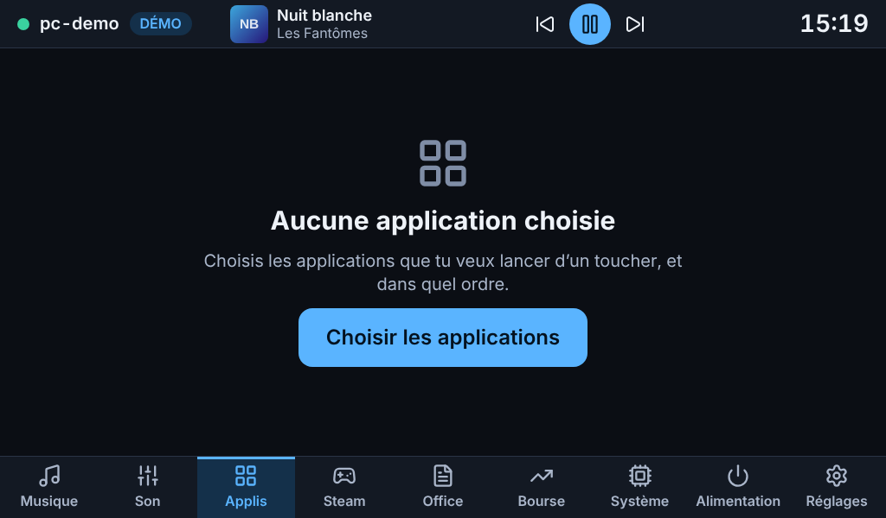 | 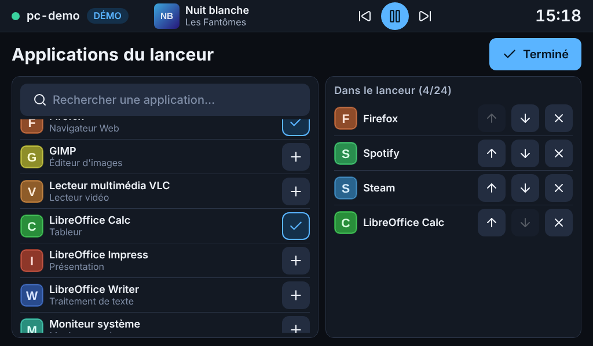 |
| Aucune application choisie | Sélecteur : recherche, ajout, ordre |
| 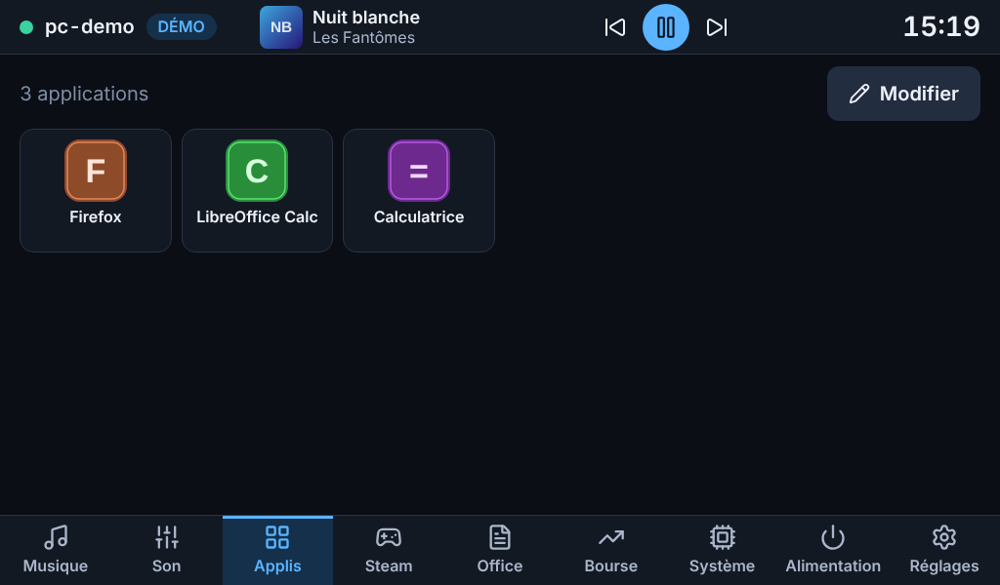 | 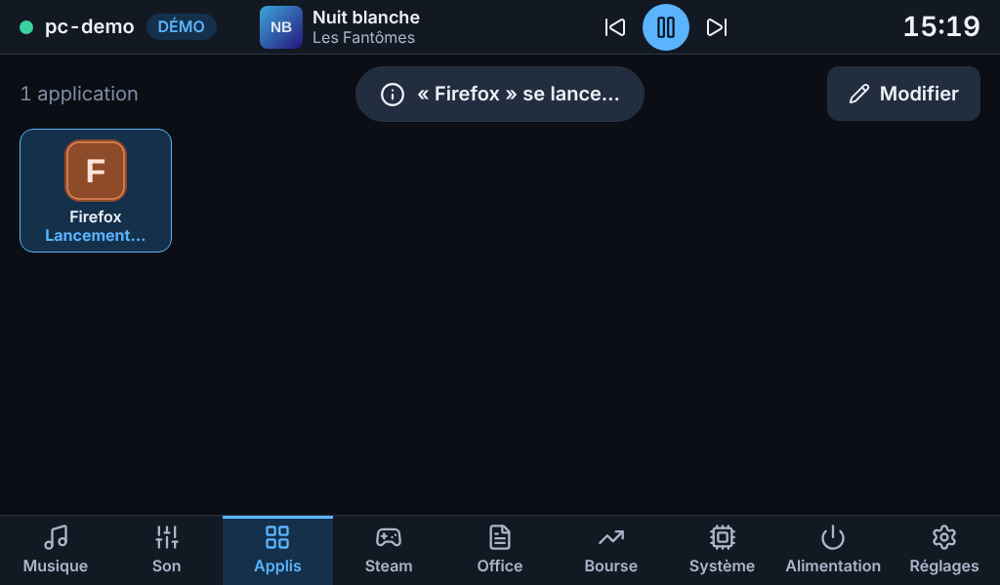 |
| Applis : icônes du thème du PC et pastilles | Un toucher lance : message et tuile « Lancement… » |
| 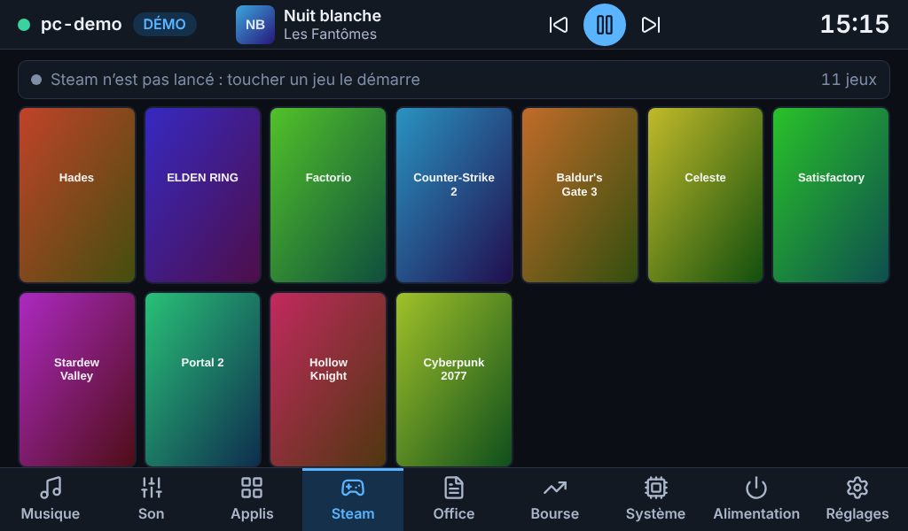 | 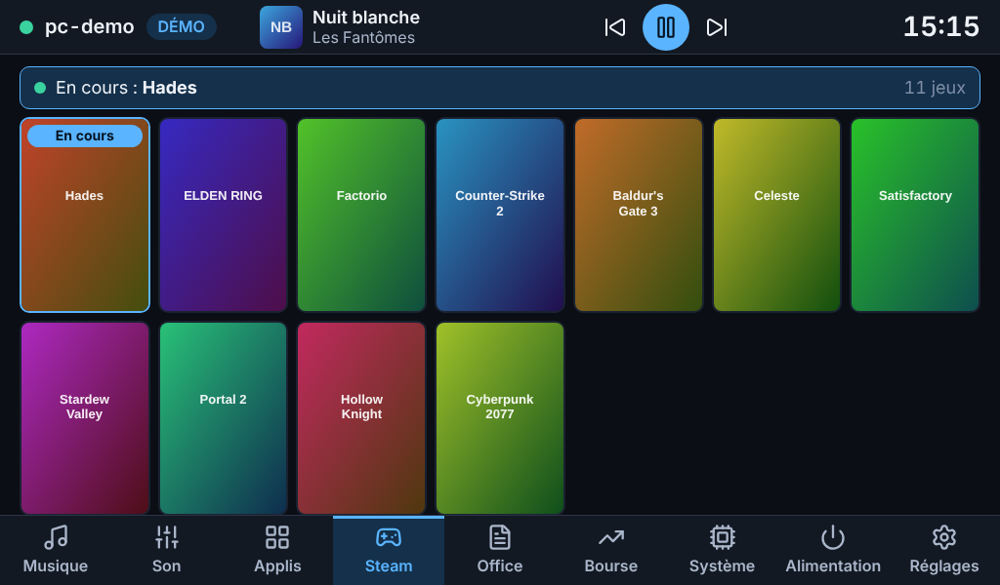 |
| Steam : 11 jeux, Steam fermé | Un jeu en cours : bandeau, badge, en tête |
| 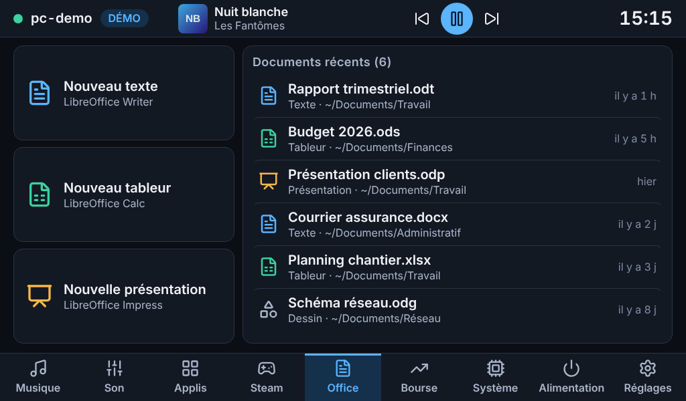 | 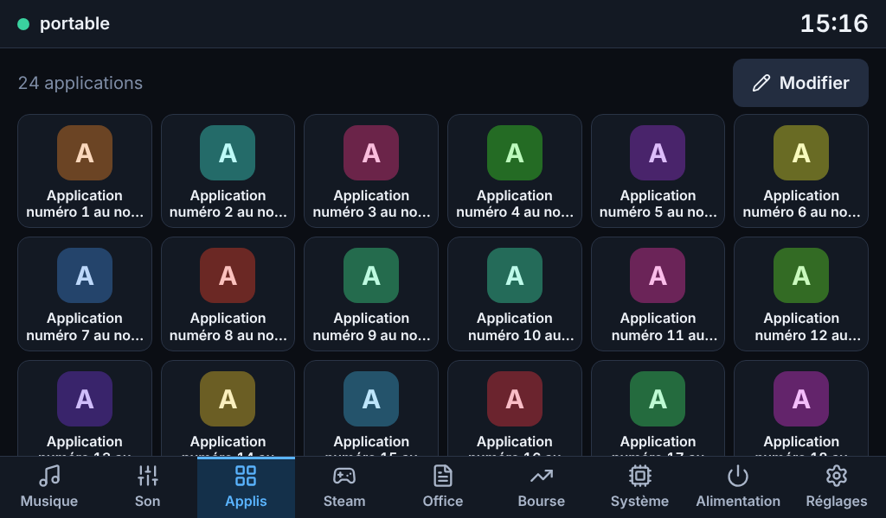 |
| Office : trois boutons et les récents | 24 applications aux noms démesurés |
| 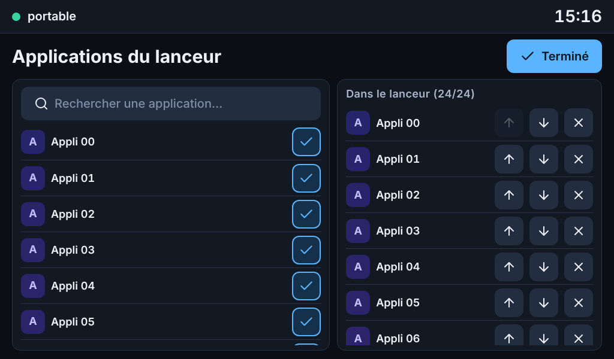 | 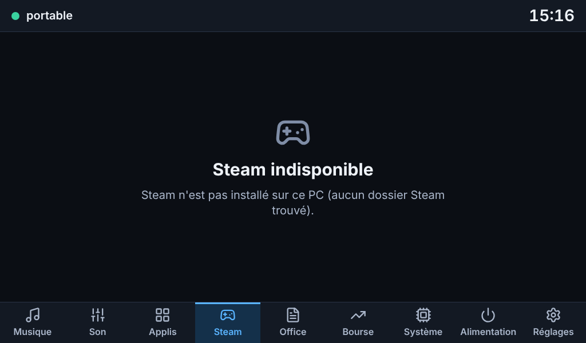 |
| Sélecteur plein (24/24) : on ne peut plus que retirer | Steam non installé |
| 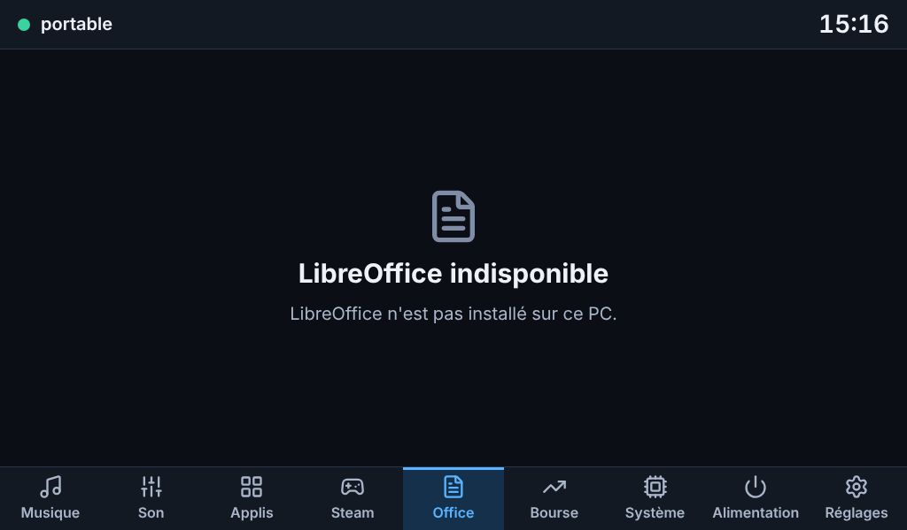 | |
| LibreOffice non installé | |

## Suite

Étape **e** : Bourse (cryptos et actions), côté Pi, utilisable PC éteint : fournisseurs derrière une interface (Yahoo Finance et Binance sans clé, un fournisseur à clé en option), cache, limites de débit, clés dans le fichier de configuration du Pi en droits 600.
