# Étape e — Bourse

Livrée le 30 octobre 2026, branche `claude/jolly-dirac-5np79y`, versions 0.5.0 (le paquet `mydock-agent` ne change pas : la bourse tourne sur le Pi).
Les captures de ce dossier sont en **mode démo** (cotations calculées, aucun accès à Internet) en 1024×600 tactile, sauf les trois états de panne (dock simulé).

> **À lire d'abord — ce que je n'ai pas pu vérifier.** Le conteneur où je développe **n'a pas accès à Yahoo Finance, Binance, Finnhub, OKX, CoinGecko ni Stooq** (sa politique réseau répond « 403 » à la connexion). Le code qui lit ces services est donc écrit d'après leur documentation et d'après ton dépôt `dashboard_crypto`, et testé sur des **réponses construites à la main** au format de ces API (dossier `dock/server/tests/data/markets/`, avec son avertissement), **pas sur de vraies réponses**. La première chose à faire chez toi est lancée en une commande, voir « Non testé » plus bas.

## Ce qui est livré

### Page Bourse

| | |
|---|---|
| **Liste** | Tes valeurs en cartes de deux colonnes : nom, symbole, **prix**, **variation toujours écrite avec son signe** (+1,41 %, −0,32 %, avec une flèche : jamais seulement la couleur) et mini-graphique des dernières 24 h. Une action dit son marché (**Marché ouvert** / **fermé** / avant ou après la séance) |
| **Détail** | Un toucher ouvre la valeur : prix en grand, variation en pourcentage et en monnaie, plus haut et plus bas du jour, âge et source de la cotation, et un **graphique sur 1 jour, 5 jours, 1 mois ou 1 an** (échelle de prix à gauche, heures ou dates dessous). Les périodes déjà vues ne sont pas redemandées pendant 30 s |
| **Actualiser** | Redemande tout maintenant (au plus une fois toutes les 3 s : un second appui dit que c'est déjà fait) |
| **Modifier** | Une fenêtre à deux colonnes. À gauche : **Crypto** ou **Action, indice…**, puis une **recherche par nom ou par symbole** au clavier tactile (`apple`, `strategy`, `bitcoin`, `mstr`, `^fchi`, `eurusd=x` : touches `^` et `=` comprises). Le dock interroge Yahoo Finance (recherche `v1/finance/search`) et connaît d'avance les cryptos courantes (« bit » trouve Bitcoin et Bitcoin Cash **sans réseau**). **Un résultat s'ajoute d'un toucher** : le dock vérifie d'abord son prix. Sans résultat (ou sans réseau), un texte court ou à signes de symbole se vérifie « tel quel » ; des suggestions (BTC, ETH, SOL… / MSTR, AAPL, NVDA, ^FCHI…) montrent le nom, le prix et la source avant **Ajouter**. À droite : la liste, avec monter, descendre, retirer. En haut : la **devise des cryptos**, euro ou dollar. **20 valeurs au plus** |
| **Réglages** | Une carte « Bourse » : combien de valeurs, quelle devise, la **fréquence des mises à jour** (15 s, 30 s, 1 min ou 5 min pour une crypto ; une action au double, une place fermée 5 min au moins), si une clé de secours est configurée, et le même bouton |

Comportements voulus :
- **La page marche PC éteint** : c'est le Pi qui lit les cotations (test de bout en bout : le PC est éteint, la Bourse continue).
- **Rien n'est demandé à Internet tant que la page n'est pas ouverte.** À l'ouverture, la dernière cotation connue s'affiche tout de suite (gardée dans un fichier : elle survit à un redémarrage du Pi) et la mise à jour part aussitôt.
- **Cours différés** : une action en séance dont le dernier échange date de plus de 5 minutes affiche « dernier échange il y a 15 min » (Yahoo diffuse certaines places avec un quart d'heure de retard ; une valeur peu échangée donne la même mention, qui reste vraie). Jamais pour une crypto ni une place fermée.
- **Rien d'inventé** : un champ que le fournisseur ne donne pas reste « — » (pas de variation inventée sans clôture de la veille, pas de prix sans cotation). Une réponse inattendue du dock n'affiche jamais une carte vide.
- **Quand un fournisseur ne répond plus**, un bandeau orange dit **lequel, pourquoi, et dans combien de secondes le dock réessaie** ; les cours affichés sont **les derniers connus, avec leur âge** (« il y a 3 h ») ; si aucune cotation n'est connue, la carte dit « — » et la raison, et la barre d'état « Cotations indisponibles ».
- **Un nom démesuré est coupé**, une devise que le navigateur ne connaît pas (« GBp » : les pence de Londres) s'écrit telle quelle, zéro n'est ni vert ni rouge, vingt valeurs défilent dans leur zone sans faire défiler la page.

### Côté Pi (dock 0.5.0)

- **Trois fournisseurs derrière une même interface**, essayés dans cet ordre pour chaque valeur : **Binance** (cryptos : une seule requête pour toutes, en euros ou en USDT), **Yahoo Finance** (tout : actions, indices, ETF, devises ; et les cryptos en secours sous la forme `BTC-EUR`), **Finnhub** (actions américaines, **seulement si tu configures une clé**). Un fournisseur en panne ou qui ne connaît pas une valeur laisse la place au suivant.
- **Sans clé.** Yahoo Finance (`v8/finance/chart`, avec un `User-Agent` de navigateur sinon il répond 429) et Binance (API publique du marché au comptant) sont les accès de `dashboard_crypto`. Si Binance coupe ton pays (HTTP 451), son **miroir de données** `data-api.binance.vision` prend le relais, puis Yahoo.
- **Limites de débit et pauses.** Chaque fournisseur a sa « porte » : un écart minimal entre deux requêtes, un nombre de requêtes simultanées borné. Après un refus (429, 403, 5xx, réseau), le fournisseur est mis en pause : 5 s, 10 s, 20 s… **15 min au plus**, et `Retry-After` est respecté. La pause compte **une fois par passe**, pas une fois par valeur.
- **Rythme** (page ouverte seulement) : 15 s pour une crypto, 30 s pour une valeur dont la place cote, 60 s avant et après la séance, 5 min place fermée ; le mini-graphique des cryptos est redemandé toutes les 5 min.
- **La clé d'API** (Finnhub, facultative) va dans la section `[markets]` de `/etc/mydock/dock.toml` (droits 600), part dans un **en-tête** (jamais dans l'adresse, donc jamais dans un journal), n'est **jamais envoyée à l'écran** ni affichée par `mydock-dock doctor`, et sa forme est vérifiée au démarrage.
- **Un accès HTTPS réduit au nécessaire** : bibliothèque standard (aucune dépendance de plus sur le Pi), délai, réponse limitée à 2 Mo (décompression comprise : une « bombe » gzip est refusée), pas de redirection hors du site, jamais de retour en clair. Les symboles qui y entrent sont validés (lettres, chiffres, `. ^ = - _`) puis échappés.
- **Cinq actions locales** (`dock.markets.set`, `check`, `search`, `refresh`, `history`) : paramètres stricts (un champ en trop, une fréquence qui n'est pas l'une des quatre, un texte de plus de 60 caractères sont refusés), le symbole est vérifié par le dock avant d'être ajouté, l'historique n'est servi que pour une valeur de la liste.
- **Fréquence réglable** : un seul réglage (15 s, 30 s, 1 min, 5 min) multiplie tous les rythmes ; une place fermée n'est jamais redemandée plus vite que toutes les 5 min.
- **Thème `markets` à la demande** : poussé seulement aux navigateurs qui le demandent, et **seulement quand l'état change**. Le résumé de la bourse (nombre, devise, clé présente ou non) voyage dans le thème `dock`, sans abonnement, pour les Réglages.
- **`mydock-dock doctor`** : nouvelle section « Bourse » (liste, devise, âge du cache, présence de la clé sans l'afficher) qui **teste chaque fournisseur** par une vraie requête et dit ce qui répond, en combien de millisecondes ; `--offline` saute ces requêtes.
- **Mode démo** (`mydock-dock run --demo-markets`, utilisé par `make demo` et les captures) : dix valeurs calculées (5 cryptos, 5 valeurs dont deux marchés fermés), toujours les mêmes à un instant donné.

### Un défaut trouvé par les tests, corrigé

- **Une demande d'historique en échec se redemandait en boucle** : l'effet qui charge le graphique relisait son propre résultat. Un test du dock simulé (« l'historique en erreur est expliqué, Réessayer le redemande ») l'a montré ; la demande ne dépend plus que du choix de la valeur et de la période, et un échec s'affiche et attend le toucher « Réessayer ».
- **Zéro s'affichait « 0,000000 € »** (un prix si petit qu'on lui donne six décimales) : trouvé par un test unitaire, corrigé.

## Tests exécutés

| Suite | Résultat | Ce qu'elle couvre |
|---|---|---|
| Python, tout le dépôt (3.14, bibliothèques récentes), **tests lents compris** | **1 331 réussis**, 1 ignoré (suppose un utilisateur non root) | common 104, agent 680, dock 448, paquet .deb et scripts de déploiement 100 |
| Python avec les **versions exactes d'Ubuntu 26.04** (`make test-ubuntu`) | **1 243 réussis** à la livraison initiale | fastapi 0.118, uvicorn 0.38, websockets 15, psutil 7.1, pydantic 2.12, dbus-fast 4.0, Pillow 12.1 |
| Dont la bourse (dock) | **212 réussis** | modèle, limites, accès HTTP, fournisseurs, service, dock complet, diagnostic, recherche par nom, fréquence |
| Interface, unitaires (Vitest) | **167 réussis** | dont 20 pour les formats et les courbes de la bourse, 3 pour le clavier de symboles |
| Interface, bout en bout (Playwright, 1024×600 tactile) | **127 réussis** à la livraison initiale, puis **les 75 tests de la Bourse** après les compléments | dont 30 nouveaux (12 sur la vraie pile de démonstration, 18 avec un dock simulé) à la livraison initiale ; les compléments (recherche, fréquence, dernier échange) en ajoutent d'autres |
| Qualité | propre | `ruff` (analyse et format), `svelte-check` (0 erreur, 0 avertissement), `shellcheck`, `dist/` à jour |

> Chiffres remis à jour après les compléments de la Bourse (recherche par nom, fréquence réglable, dernier échange) : ils n'avaient pas été reportés ici. La suite complète est **rejouée en entier à l'étape f** (voir son rapport), qui inclut tous les tests de la Bourse.

**Ce que les tests Python prouvent de nouveau**
- **Symboles** : normalisation (`btc`, `^fchi`, `cw8.pa`, `BTC-EUR`), et refus de tout ce qui ressemble à une adresse ou une option (`../etc`, `AAPL?x=1`, `a b`, 21 caractères, accents…).
- **Accès HTTP**, contre un **vrai serveur local** : en-têtes et paramètres échappés, décompression, bombe gzip, réponse démesurée, code d'erreur rendu comme une réponse, `Retry-After` lu, redirection vers un autre site refusée, délai dépassé, port fermé, DNS, certificat.
- **Limites** : pauses 5-10-20 s… plafonnées à 15 min, `Retry-After` obéi, départs espacés dans l'ordre, requêtes simultanées bornées, une place rendue si l'attente est annulée.
- **Yahoo** (réponses au format de l'API) : prix, clôture de la veille, plus haut et plus bas, états du marché (ouvert, avant, après, fermé, sans horaires), indice en euros, crypto, trous dans la courbe, prix manquant (retombe sur le dernier point), clôture manquante (pas de variation inventée), erreurs `Not Found` et autres, une valeur inconnue sans gâcher les autres, 429 / 403 / 503 / réponse illisible / réseau, symboles échappés dans l'adresse, historique par période.
- **Binance** : une requête pour toute la liste, paire en USDT pour le dollar, mini-graphique redemandé après 5 min seulement, mini-graphique en échec sans gâcher la cotation, **paire inconnue isolée** par des requêtes à l'unité, pays refusé → miroir (et le miroir devient le premier choix), réseau coupé → miroir, 429 avec son délai, bougies mal formées, historique par période.
- **Finnhub** : clé dans l'en-tête et nulle part ailleurs, symbole inconnu (réponse pleine de zéros), 401 / 403 / 429 / 500, pas d'historique.
- **Service** : rien demandé tant que personne ne regarde, arrêt dès que la page se ferme, un rythme par type de valeur, relais entre fournisseurs, fournisseur en pause laissé tranquille, valeur inconnue du premier mais connue du second, **dernière cotation gardée avec son âge et la raison** quand tout échoue, pause comptée une fois par passe, fournisseur qui plante ou qui ne répond pas, nom et courbe conservés quand le nouveau fournisseur ne les donne pas, bouton « Actualiser » limité, vérification d'un symbole (trouvé, inconnu, fournisseurs en panne), historique mis en cache et partagé entre demandes simultanées, liste et devise changées en route, **cache sur disque** (revient après un redémarrage, ignoré si la devise change, trop vieux, mal formé ou hors liste), annonces seulement quand l'écran doit changer.
- **Dock complet** (navigateur simulé → vrai serveur → faux fournisseurs) : thème à la demande, PC éteint, plusieurs pages ouvertes, liste enregistrée et poussée, listes refusées (doublon, 21 valeurs, devise inconnue, champ en trop) sans rien changer, vérification, historique, panne affichée avec la dernière cotation, mode démo, cache après redémarrage, clé d'API absente de tout ce qui sort.

**Les 30 nouveaux tests Playwright** : sur la vraie pile de démonstration (liste de départ, signes, mini-graphiques, **PC éteint**, actualiser, ajout par suggestion et mémorisation après rechargement, saisie au clavier tactile avec `^` et `=`, symbole inconnu, doublon, ordre et retrait, liste vide, devise, détail et périodes, carte Réglages, **cibles tactiles ≥ 48 px** et aucun défilement de la page avec huit valeurs) et, avec un **dock simulé**, les cas que la démo ne montre pas : aucune valeur, avant la première cotation, **cotation ancienne**, **aucun fournisseur**, devise inconnue, variation absente, noms démesurés, vingt valeurs, mise à jour en direct, refus d'actualiser, abonnement et désabonnement du thème, historique en erreur puis « Réessayer », trop peu de points, périodes déjà vues, valeur retirée pendant qu'on la regarde, liste complète envoyée dans l'ordre, vérification refusée, liste pleine, réponse sans prix, carte Réglages (singulier, dollars, clé de secours, aucune valeur).

### Mesures (conteneur Linux de développement)

| Mesure | Valeur |
|---|---|
| Page fermée, 5 s | **0 requête** |
| Page ouverte 65 s, 2 cryptos et 4 actions, **vrais rythmes**, réseau simulé | **19 requêtes** : 5 cours Binance (une requête pour les deux cryptos), 2 mini-graphiques, 12 Yahoo (4 actions × 3 passes), soit **17,5 par minute** ; mises à jour de l'écran toutes les 2,4 à 15 s |
| CPU du service de cotations, même essai | **0,02 % d'un cœur** (la part du dock : analyse et diffusion ; le réseau n'est pas simulé en temps) |
| Interface, page Bourse (8 valeurs) au repos, vitesse normale puis **processeur ralenti ×4** | **60 i/s** dans les deux cas, aucune tâche longue, image la plus longue 17 ms puis 33 ms |
| Interface, détail d'une valeur avec changement des quatre périodes, **processeur ×4** | **60 i/s**, aucune tâche longue |
| Interface, navigation Bourse → Système → Réglages → Bourse, **processeur ×4** | **59 i/s**, une tâche longue de 54 ms (le chargement d'une page) |
| Interface compilée | page Bourse 13 Ko (5 Ko compressé) plus 6 Ko de styles ; la fenêtre de modification est dans le chargement initial |

## Non testé — à vérifier chez toi

1. **La toute première chose : les fournisseurs depuis ton Pi.**
   ```bash
   sudo -u mydock /opt/mydock/venv/bin/mydock-dock doctor
   ```
   La section « Bourse » doit afficher « Binance répond (BTC : … EUR, … ms) » et « Yahoo Finance répond (AAPL : … USD, … ms) ». Si l'un répond autrement, copie-moi la ligne : la page, elle, ne dira jamais un faux chiffre à sa place (elle affiche « — » et la raison).
2. **Les formats réels.** Si Yahoo ou Binance ont changé un champ depuis leur documentation (`meta.regularMarketPrice`, `chartPreviousClose`, `currentTradingPeriod` ; `lastPrice`, `priceChangePercent` ; `quotes[].quoteType`…), on le verra à des « — » plutôt qu'à des erreurs : dis-moi lequel.
3. **Tes valeurs européennes** : symboles Yahoo (`CW8.PA`, `MC.PA`, `^FCHI`…) ; les actions de Londres sont cotées en pence (`GBp`, affiché tel quel) ; les jours fériés ne sont pas connus (l'état du marché vient des horaires que Yahoo donne).
4. **Ce que « variation » veut dire** : sur 24 h glissantes pour une crypto (Binance), depuis la clôture de la veille pour une valeur (Yahoo) : à comparer avec ton application de courtage.
5. **Le fuseau horaire du Pi**, qui décide des heures de l'axe du graphique (comme l'horloge du haut).
6. **Fluidité sur le Pi 4** : même réserve qu'aux étapes précédentes (mesures dans Chromium sans GPU, pas sur le Pi).
7. **Le clavier au doigt pour chercher** (touches `^` et `=` en bas à droite de la ligne des symboles).
8. **La recherche par nom** : elle repose sur `v1/finance/search` de Yahoo, dont le format de réponse est lui aussi construit d'après la documentation (les cryptos courantes, elles, sont trouvées sans réseau). Si elle ne répond pas, on peut toujours **vérifier un symbole tel quel**.

> **Pour que je teste en vrai à la prochaine session** : dans l'environnement cloud de ce projet (menu de l'environnement dans la barre de titre de la session → Modifier → *Accès réseau*), autorise les domaines `query2.finance.yahoo.com`, `api.binance.com` et `data-api.binance.vision` (ou passe à un niveau d'accès plus large). Je pourrai alors comparer les vraies réponses aux formats attendus.

## Décisions prises par défaut (dis-moi si tu veux autre chose)

- **Liste de départ : Bitcoin et Ethereum, en euros.** À toi de composer la tienne.
- **20 valeurs au plus**, un mini-graphique de 24 h par valeur, quatre périodes de détail (1 j, 5 j, 1 mois, 1 an) ; pas de zoom ni de curseur sur le graphique.
- **La devise d'une action est celle de sa place** (dollars à New York, euros à Paris) : pas de conversion. Seules les cryptos suivent ton choix euro / dollar.
- **Un seul fournisseur par valeur** (le premier qui répond), jamais une moyenne.
- **Pas de CoinGecko ni de CoinMarketCap** : ils demandent une clé ou limitent fortement le gratuit ; Binance et Yahoo suffisent à ce besoin.
- **Rien n'est demandé en arrière-plan** : la page fermée, le dock ne dit rien à Internet. Contrepartie : l'ouverture de la page montre des cours qui peuvent dater (avec leur âge) pendant une seconde ou deux, le temps de la mise à jour.
- **L'ancienne page « à venir » est supprimée** : plus aucune page n'en a besoin.

## Questions

1. **Ta liste** : quelles cryptos, actions, indices ou ETF veux-tu suivre (symboles Yahoo : `MSTR`, `BTC-USD`, `^FCHI`…) ? Je les mettrai en liste de départ à la place de Bitcoin et Ethereum.
2. **Euros ou dollars** pour les cryptos ? Et veux-tu que les actions américaines soient **converties en euros** ?
3. **Les indicateurs de `dashboard_crypto`** (Fear & Greed, MVRV, halving…) t'intéressent-ils sur le dock ? Les sources (alternative.me, bitcoin-data.com) répondent sans clé ; ce serait une page ou une carte de plus.
4. **Alertes de prix** (un seuil franchi fait afficher un message) ou **portefeuille** (quantités détenues, valeur totale) ?
5. Le **cours du Bitcoin dans la barre du haut**, à côté de l'horloge ?
6. On enchaîne sur l'étape **f** (Alimentation : verrouiller, veille, redémarrer, éteindre avec confirmation ; Réglages complets ; finitions) ?

## Captures

| | |
|---|---|
| 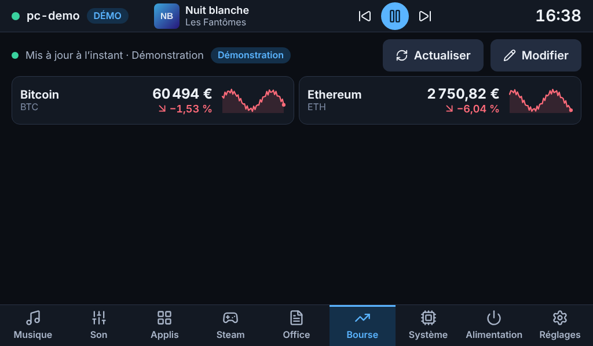 | 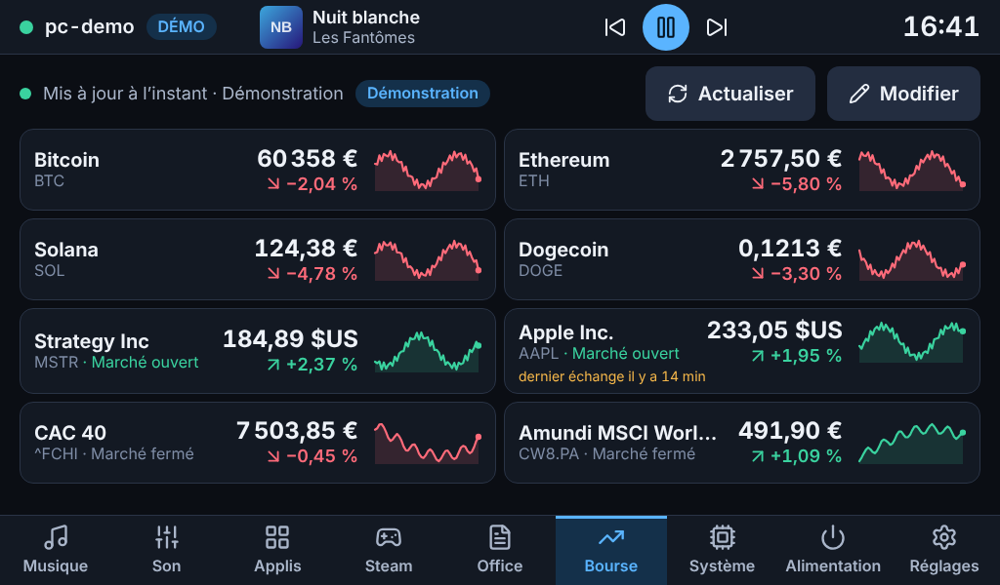 |
| Liste de départ (démo) | Huit valeurs : cryptos, actions, deux marchés fermés |
| 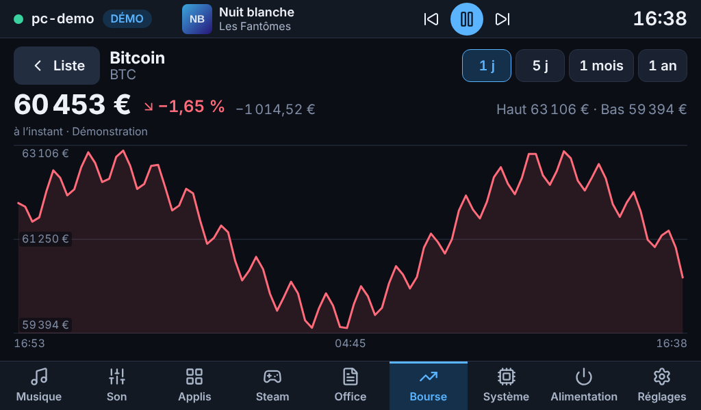 | 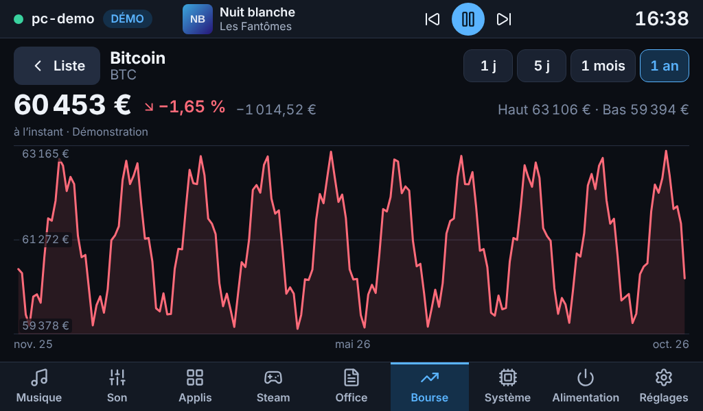 |
| Détail, 1 jour | Détail, 1 an |
| 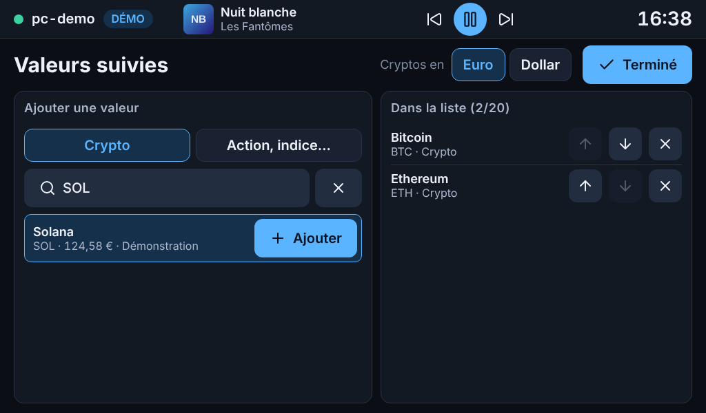 | 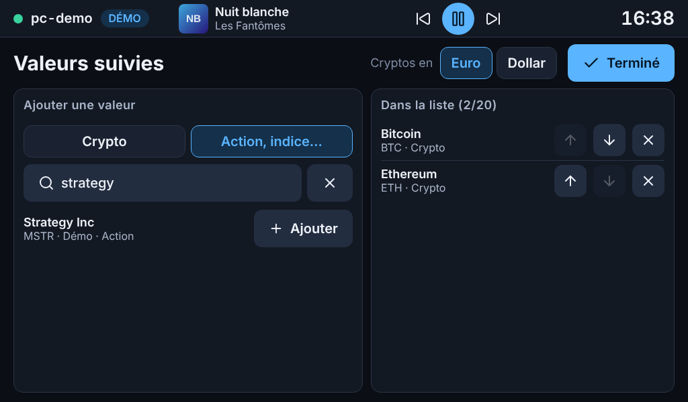 |
| Ajouter une suggestion : la valeur est vérifiée avant d'être proposée | Recherche par nom : un résultat s'ajoute d'un toucher |
| 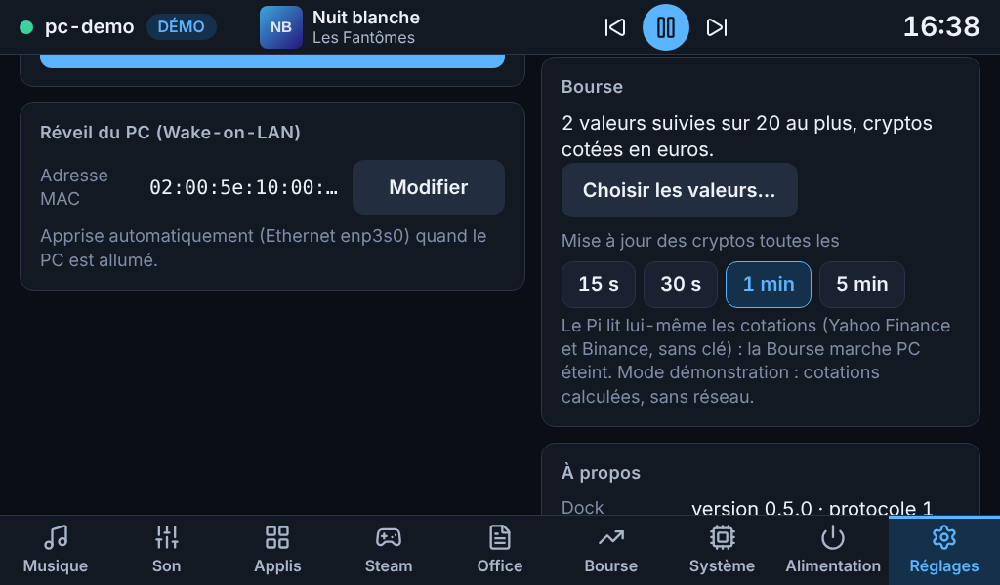 | 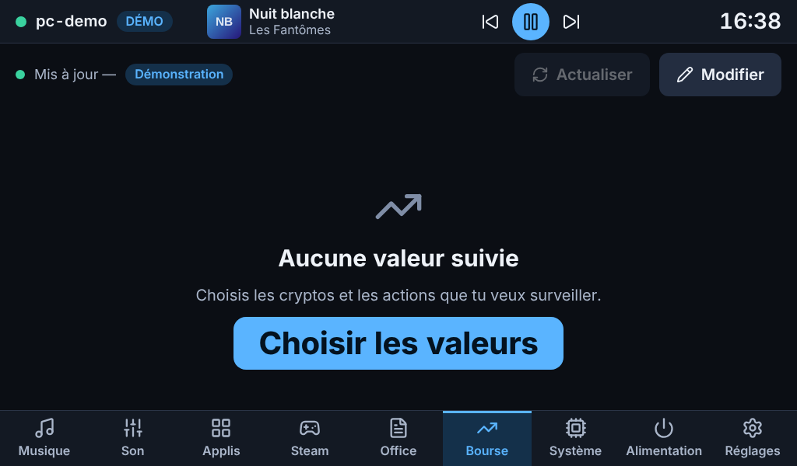 |
| Carte « Bourse » des Réglages | Aucune valeur suivie |
| 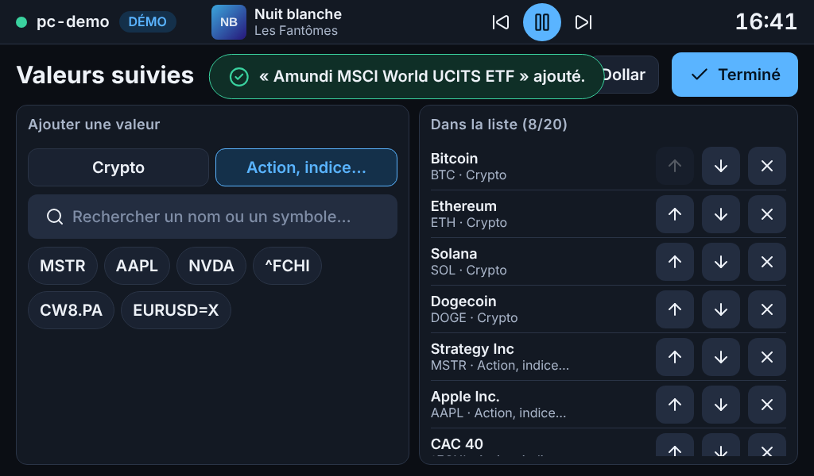 | 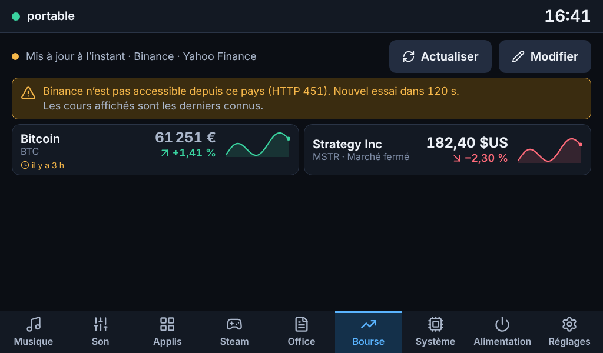 |
| Huit valeurs dans la fenêtre de modification | Cotation ancienne : âge, bandeau, derniers cours connus |
| 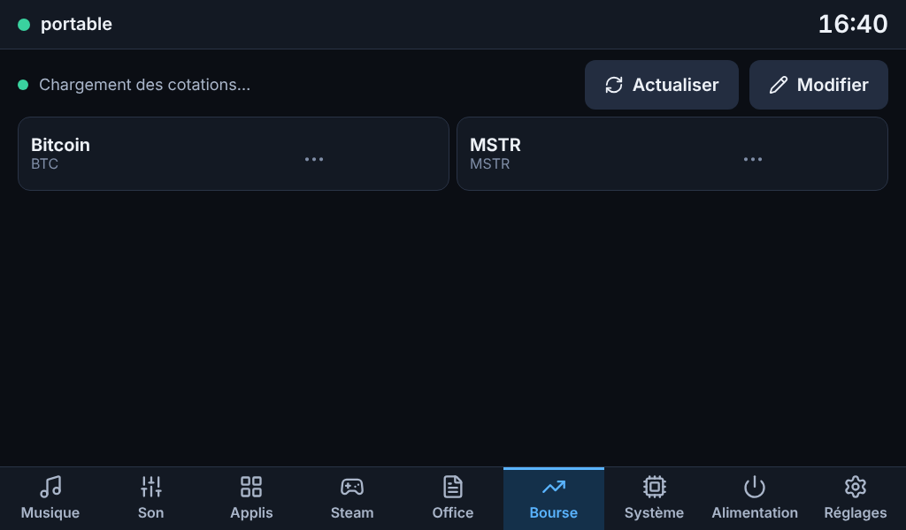 | 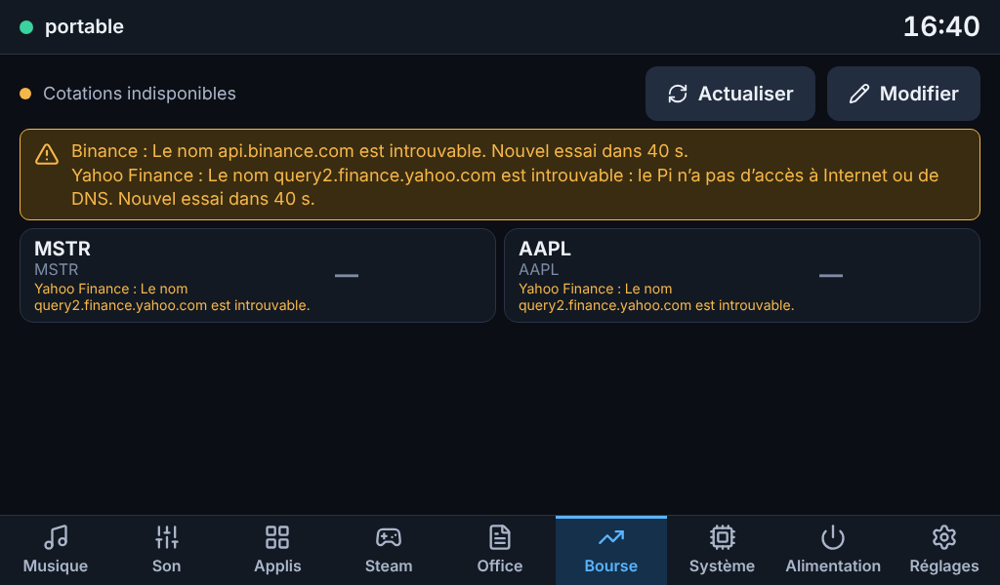 |
| Avant la première cotation | Aucun fournisseur ne répond, aucune cotation connue |

## Suite

Étape **f** : Alimentation (verrouiller, mettre en veille, redémarrer, éteindre, chacune avec **confirmation à l'écran**), Réglages complets, finitions (et, si tu le souhaites, TLS à certificat épinglé entre le dock et l'agent).
