# Étape f — Alimentation, Réglages complets, finitions

Livrée le 30 octobre 2026, branche `claude/jolly-dirac-5np79y`, versions 0.6.0 (agent, dock et paquet `.deb`).
Les captures de ce dossier sont en **mode démo** (fausses données) en 1024×600 tactile ; les états que la démo ne montre pas (droits limités, agent ancien, refus du système) viennent d'un **dock simulé**.

> **À lire d'abord — ce que je n'ai pas pu vérifier.** Je n'ai ici ni vrai GNOME ni vrai logind ni vrai Raspberry Pi, et je n'ai évidemment **jamais éteint, redémarré ni mis en veille** la machine de développement. Les ordres d'alimentation sont donc testés contre un **faux logind sur un vrai bus D-Bus** (un `dbus-daemon` privé : mêmes noms de méthodes, mêmes signatures, mêmes erreurs que le vrai), et la veille de l'écran avec de **faux `swayidle`, `wlopm`, `wlr-randr` et `curl`**. Le comportement sur ton PC et sur ton Pi est à vérifier : la liste est dans « Non testé », avec la commande pour chaque point.

## Ce qui est livré

### Alimentation (page Alimentation + agent)

| | |
|---|---|
| **Quatre commandes** | **Verrouiller**, **Mettre en veille**, **Redémarrer**, **Éteindre**, en grands boutons à droite du réveil (Wake-on-LAN, inchangé à gauche). Redémarrer et éteindre sont teintés de rouge. |
| **Confirmation à l'écran** | Veille, redémarrage et extinction ouvrent la fenêtre de confirmation avec **le nom du PC et ce qui va arriver** (« Éteindre « portable » (les programmes ouverts seront fermés) ») : 10 s pour confirmer, sinon l'ordre expire. Verrouiller n'en demande pas (on le défait avec son mot de passe). |
| **Ce que le système permet** | L'agent lit chez logind (`CanSuspend`, `CanReboot`, `CanPowerOff`, `ListInhibitors`, la session graphique de l'utilisateur) tant que la page est ouverte, toutes les 5 s, et **le dock grise ce qui est refusé avec la raison, sous le bouton** : *PC hors ligne*, *Indisponible sur ce PC*, *Refusé par le système*, *Mot de passe exigé par le système*, *Bloqué par « Mises à jour logicielles »*. Un programme qui s'oppose à l'extinction ou à la veille est **nommé sur la page** avec sa raison. |
| **Un seul ordre à la fois** | Après un ordre, toutes les commandes restent suspendues quelques secondes (le PC met un moment à réagir), la touchée dit « En cours… ». Un échec ne verrouille rien. |
| **Une liaison coupée n'est pas une erreur** | Si la connexion tombe juste après un ordre qui coupe le PC (le cas normal d'une extinction), le message dit « la commande est probablement partie, regarde son écran » au lieu d'une erreur. Pour verrouiller, qui ne coupe rien, c'est une vraie panne. |
| **PC éteint ou agent ancien** | Boutons grisés avec « PC hors ligne » (le réveil reste actif) ; un agent trop ancien pour connaître le thème affiche « Pas encore disponible dans cette version de l'agent » et grise tout, sans casser la page. |

Côté agent (`agent/mydock_agent/collectors/power.py`) :
- **Par logind, par D-Bus** (bus système), **sans commande ni shell** : `Suspend`, `Reboot`, `PowerOff` avec `interactive = false` (jamais de mot de passe demandé, jamais de fenêtre d'authentification sur le PC), `LockSession` pour la session graphique de l'utilisateur (propriété `Display`) avec l'écran de verrouillage de GNOME (`org.gnome.ScreenSaver.Lock`) en repli.
- **Rien n'est jamais forcé** : pas de `--ignore-inhibitors`. Si un programme bloque, l'erreur le nomme (« « Copie de fichiers » empêche l'extinction. »).
- **Les refus sont expliqués d'après le *nom* de l'erreur D-Bus**, jamais d'après son texte : mot de passe exigé, opération déjà en cours, veille non gérée, logind absent.
- **Quatre actions** `power.lock`, `power.suspend`, `power.reboot`, `power.poweroff`, **sans aucun paramètre** (un champ en trop est refusé : rien à détourner), dont **trois sensibles** (confirmation à l'écran **et** jeton à usage unique lié à la connexion et à l'action : le jeton de la veille n'éteint pas le PC, une autre connexion ne le rejoue pas). Jamais deux ordres en même temps. Chaque ordre est écrit dans le journal avec l'adresse qui l'a demandé.
- **Thème `power` paresseux** : rien ne tourne tant que la page Alimentation n'est pas ouverte.
- **`mydock-agent doctor`**, section « Alimentation » : les droits **tels que l'agent en marche les voit** (le doctor se connecte à l'agent et lit son thème : le service systemd de l'utilisateur n'a pas toujours les droits d'un terminal) et, si le système demande un mot de passe, la **règle polkit prête à copier** pour ton utilisateur.

### Réglages : pages visibles et ordre

- Carte **Pages du dock** (« 7 pages visibles sur 9 (cachées : Steam, Office). ») et une fenêtre **Pages et ordre** : les neuf pages numérotées en deux colonnes, chacune avec **monter**, **descendre** et **œil** (cacher / montrer), et « Ordre d'origine » pour tout rétablir. Les **Réglages ne peuvent pas être cachés** (sans eux, plus de retour possible : le bouton est grisé « toujours visible », et le dock refuse aussi côté serveur).
- La barre d'onglets suit **aussitôt** ce que le Pi enregistre ; le choix est gardé **par le Pi**, pas par le navigateur (il survit à un rechargement, et un second navigateur le voit).
- **Si la page de départ est cachée** (réglage fait depuis un autre navigateur), le dock ouvre la première page visible au lieu d'une page sans onglet.

### Réglages : veille de l'écran du dock

- Carte **Écran du dock** : *Jamais* (**choix de départ** : le dock ne coupe rien sans que tu l'aies demandé), 1, 5, 10 ou 30 minutes ; un bouton **Éteindre maintenant (essai)**.
- **L'interface** (indépendante de tout) : après le délai sans toucher, un **voile noir** couvre l'écran. **Le premier toucher le rallume sans rien déclencher** : l'image revient dès que le doigt se pose, mais le voile, devenu invisible, **avale le reste du geste** (relâchement, clic synthétique du navigateur) pendant 450 ms. Testé en touchant juste au-dessus d'un onglet : la page ne change pas. Un seul minuteur, réarmé pour le temps restant : chaque toucher ne fait que noter l'heure.
- **Le Pi** (`deploy/pi/screen-sleep.sh`, lancé par le compositeur à côté du navigateur) : lit la durée auprès du dock (`GET /api/screen`, un entier), lance `swayidle`, **le relance si la durée change**, éteint avec `wlopm` (ou `wlr-randr`) et rallume au premier toucher ; à l'arrêt du script, l'écran est rallumé (on ne laisse jamais l'écran éteint sans personne pour le rallumer). `install-dock.sh` installe `swayidle`.
- **`mydock-dock doctor`**, section « Écran du dock (veille) » : délai choisi, `swayidle`, `wlopm`/`wlr-randr`, script en marche.

### Finitions

- **Versions 0.6.0** (agent, dock, common, paquet) et entrée de changelog du paquet.
- **README** : Alimentation (avec la règle polkit), Veille de l'écran, dépannage (8 nouvelles lignes), sécurité (les quatre actions d'alimentation et leurs garde-fous), et une **correction d'honnêteté** : le chiffrement TLS annoncé « pour l'étape f » **n'est pas fait** ; le README le dit.
- **Rapport de l'étape e** : chiffres remis à jour (ajoutés après son livrable : recherche, fréquence, dernier échange).
- **Une erreur de test corrigée avant livraison** : un test de diagnostic écrivait dans le vrai `/var/lib/mydock` au lieu d'un dossier temporaire (la clé du chemin était mal écrite, donc ignorée). Le test vérifie maintenant son isolement, et le dossier créé par erreur a été supprimé.

### Défauts trouvés par les tests, corrigés

- **Logind absent mais bus système joignable** (conteneur, service arrêté) : la lecture des droits disait trois fois « Réponse inattendue du système » au lieu de « logind ne répond pas » ; trouvé par un test sur un vrai bus sans logind, corrigé (les trois lectures muettes comptent comme « logind absent »).
- **Un texte « démo » en double parenthèse** dans la fenêtre de confirmation : remplacé par un tiret.
- **Un test de l'étape d échouait une fois sur une exécution complète** : il lisait la grille des applications à l'instant où la navigation se terminait, sans attendre le chargement de la page (chargée à la demande). Il attend maintenant la grille, et passe dix fois de suite. Aucun test n'a été désactivé ni assoupli.

## Tests exécutés

| Suite | Résultat | Ce qu'elle couvre |
|---|---|---|
| Python, tout le dépôt (3.14, bibliothèques récentes), **tests lents compris** | **1 417 réussis**, 1 ignoré (suppose un utilisateur non root) **** | common 104, agent 730, dock 473, paquet .deb et scripts de déploiement 111 |
| Python avec les **versions exactes d'Ubuntu 26.04** (`make test-ubuntu`) | **1 354 réussis** | dont dbus-fast 4.0 (la version d'Ubuntu) contre le faux logind |
| Interface, unitaires (Vitest) | **205 réussis** | dont 38 nouveaux : 14 pour l'alimentation, 12 pour l'ordre des pages, 12 pour la veille de l'écran |
| Interface, bout en bout (Playwright, 1024×600 tactile) | **167 réussis** | dont 32 nouveaux |
| Qualité | propre | `ruff` (analyse et format), `svelte-check` (0 erreur, 0 avertissement), `shellcheck`, `dist/` à jour |

**Ce que les tests Python prouvent de nouveau**
- **Droits** : chaque réponse de logind (`yes`, `challenge`, `no`, `na`, erreur) devient le bon texte ; un verrou « block » sur l'extinction grise redémarrer et éteindre mais pas la veille ; les verrous « delay » et ceux qui ne touchent pas à l'extinction sont ignorés ; les noms de programmes inconnus sont nettoyés et tronqués ; logind absent, bus injoignable, session graphique absente.
- **Ordres**, contre un **vrai `dbus-daemon`** avec un faux logind : `Suspend`/`Reboot`/`PowerOff` reçus avec `interactive = false`, `GetUser` par numéro d'utilisateur puis `LockSession` avec l'identifiant lu dans `Display`, repli sur l'écran de verrouillage de GNOME quand logind n'a pas de session, erreurs traduites d'après leur nom, programme bloquant nommé quand logind refuse.
- **Garde-fous des actions** : seules trois actions sont sensibles, aucun paramètre n'est accepté (`{"command": "rm -rf /"}` est refusé), un jeton de confirmation ne sert qu'une fois, pour une connexion, pour une action (celui de la veille n'éteint pas), deux ordres simultanés refusés, le nom du PC (nettoyé) dans la fenêtre. **La liste blanche** de l'agent est complète à l'unité près.
- **Démonstration par le réseau** : un navigateur simulé abonné à `power` reçoit les droits, verrouille sans confirmation, demande puis confirme une extinction.
- **Diagnostic** : droits vus par l'agent en marche (lecture réelle de son thème par WebSocket), repli sur la vue du terminal, règle polkit seulement quand elle sert.
- **Dock (Pi)** : la durée de veille est une des cinq valeurs (45, `"300"`, `true`, `-1` refusés sans rien changer), survit à un redémarrage, retombe sur « jamais » si le fichier est abîmé ou ancien, est partagée entre navigateurs et lisible par `GET /api/screen` (refusé pour un autre nom d'hôte : « DNS rebinding »).
- **Script de veille du Pi**, lancé pour de bon avec de faux programmes : bon appel `swayidle`, durée zéro, **relance quand la durée change** avec écran rallumé entre les deux, dock qui ne répond pas, `swayidle` qui plante puis est relancé, arrêt propre, `wlopm` puis `wlr-randr` pour chaque écran, messages quand `swayidle` ou l'outil d'extinction manque.

**Les nouveaux tests Playwright** : sur la vraie pile de démonstration (quatre commandes et nom du PC, verrouiller sans confirmation, annuler une extinction, confirmer un redémarrage et voir toutes les commandes suspendues, veille confirmée, **PC éteint** puis rallumé, pages cachées et mémorisées après un rechargement, ordre et « ordre d'origine », impossibilité de cacher les Réglages même en cachant tout le reste, durée de veille et ce que lit le script du Pi, **voile noir après une minute (horloge du navigateur avancée), premier toucher avalé au-dessus d'un onglet, chaque toucher repousse l'extinction**, essai immédiat, jamais sans réglage) et, avec un **dock simulé**, droits limités avec raisons et programme bloquant, agent ancien, logind muet, refus du système affiché tel quel, liaison coupée après l'ordre, commande inconnue de l'agent, double appui, abonnement au thème seulement page ouverte, fenêtre des pages (numérotation, cibles ≥ 48 px, aucun défilement), listes envoyées au dock, refus du dock, page de départ cachée, dock sans réglage d'écran, réglage venu d'un autre navigateur.

### Mesures (conteneur Linux de développement)

| Mesure | Valeur |
|---|---|
| Lecture des droits d'alimentation par l'agent (vrai bus D-Bus, faux logind) | médiane **2,0 ms**, p95 2,6 ms ; **1,5 ms** de processeur par lecture, soit **0,03 % d'un cœur** page ouverte (une lecture toutes les 5 s) ; page fermée : rien ne tourne (thème paresseux) |
| Un ordre (connexion au bus, appel, déconnexion) | 1,2 ms (contre le faux logind) |
| Interface, page Alimentation au repos, vitesse normale puis **processeur ralenti ×4** | **60 i/s** dans les deux cas, aucune tâche longue, image la plus longue 17 ms |
| Interface, fenêtre « Pages et ordre » : 16 modifications (monter, descendre, cacher, montrer), **processeur ×4** | **60 i/s**, aucune tâche longue, image la plus longue 33 ms |
| Interface, navigation Alimentation → Système → Réglages → Alimentation, **processeur ×4** | **59 i/s**, aucune tâche longue, image la plus longue 67 ms |
| Interface, écran noirci (voile), **processeur ×4** | **60 i/s** |
| Interface compilée | page Alimentation 6,6 Ko (3,2 Ko compressé) ; le chargement initial passe de 62,6 à 68,8 Ko (20,8 à 22,3 Ko compressé) : fenêtre « Pages et ordre », voile de veille et assistants y sont inclus |

## Non testé — à vérifier chez toi

1. **L'alimentation réelle, sur ton PC** (le plus important). Page Alimentation, un bouton après l'autre :
   - **Verrouiller** : l'écran de verrouillage de GNOME apparaît-il ? (sinon : `journalctl --user -u mydock-agent -e`)
   - **Mettre en veille**, puis réveil par le bouton du PC ou **Allumer le PC** ; le dock se reconnecte-t-il seul ?
   - **Redémarrer** et **éteindre** : le PC le fait-il sans qu'une fenêtre de mot de passe s'affiche ?
   - Si un bouton est grisé « Mot de passe exigé par le système » : `mydock-agent doctor` (section « Alimentation ») et la règle polkit du README. **C'est le point le plus probable** : polkit décide d'après le processus qui appelle, et l'agent est un service de ta session, pas un programme de ta session.
2. **La veille de l'écran sur le Pi** : régler 1 minute, ne pas toucher. L'image noircit (interface), puis le **rétroéclairage s'éteint** (swayidle). Un toucher rallume-t-il l'écran **et** l'interface du premier coup ? Sur certains écrans, le premier toucher ne sert qu'à réveiller l'écran physique ; un second suffit (le README le note). Vérifications : `pgrep -a swayidle`, `sudo -u mydock /opt/mydock/venv/bin/mydock-dock doctor` (section « Écran du dock »), `wlopm --off '*'` à la main.
3. **Les fournisseurs de la bourse depuis ton Pi** (inchangé depuis l'étape e) : `sudo -u mydock /opt/mydock/venv/bin/mydock-dock doctor` ; le conteneur de développement n'a toujours pas accès à Yahoo Finance ni à Binance.
4. **Fluidité sur le Pi 4** : mesures dans Chromium sans GPU, pas sur le Pi.
5. **Session X11** : le verrouillage passe par logind et marche aussi sous X11 ; je ne l'ai pas essayé.

> **Pour que je teste la bourse en vrai à la prochaine session** : dans l'environnement cloud de ce projet (menu de l'environnement dans la barre de titre de la session → Modifier → *Accès réseau*), autorise les domaines `query2.finance.yahoo.com`, `api.binance.com` et `data-api.binance.vision`.

## Décisions prises par défaut (dis-moi si tu veux autre chose)

- **Verrouiller sans confirmation, veille avec confirmation.** Le cahier des charges demande la confirmation pour redémarrer et éteindre ; j'ai ajouté la veille (elle coupe la liaison avec le dock), pas le verrouillage. Dis-moi si tu veux la veille sans confirmation.
- **Aucun forçage** : si un programme s'oppose à l'extinction, le dock le dit et n'insiste pas.
- **Veille de l'écran : jamais** au départ (le cahier des charges demande « pas de mise en veille non voulue »).
- **Les Réglages ne se cachent pas.**
- **Pas de TLS** entre le dock et l'agent (annoncé pour l'étape f dans les README précédents) : le trafic reste protégé par le jeton et la liste des adresses autorisées, mais pas chiffré. À décider selon la confiance que tu as dans ton réseau.
- **Pas de plafond de volume** : je l'avais envisagé à l'étape c, le cahier des charges ne le demande pas.

## Questions

1. **Ta liste de valeurs de bourse** (symboles Yahoo : `MSTR`, `BTC-USD`, `^FCHI`…), euros ou dollars ? Je l'installe à la place de Bitcoin et Ethereum.
2. **La veille sans confirmation** te convient-elle mieux ? Et un **délai par défaut** pour l'écran (10 minutes ?) à la place de « jamais » ?
3. Veux-tu le **chiffrement TLS** (certificat épinglé) entre le dock et l'agent ?
4. Les **indicateurs de `dashboard_crypto`** (Fear & Greed, MVRV, halving…), des **alertes de prix** ou un **portefeuille** sur le dock ? Le **cours du Bitcoin dans la barre du haut** ?
5. Une fois tout vérifié chez toi : veux-tu que je regarde les **mesures sur le vrai Pi** (réglage de Chromium, accélération GPU) ?

## Captures

| | |
|---|---|
| 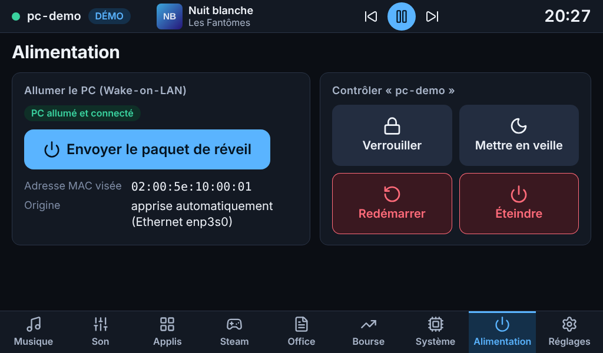 | 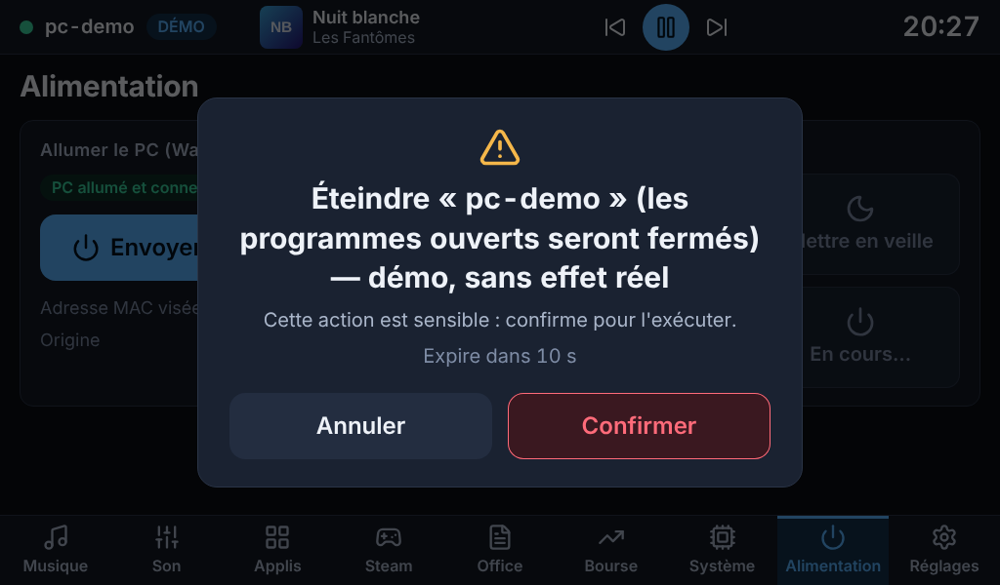 |
| Les quatre commandes, le réveil à gauche | Éteindre : la confirmation nomme le PC et dit ce qui va arriver |
| 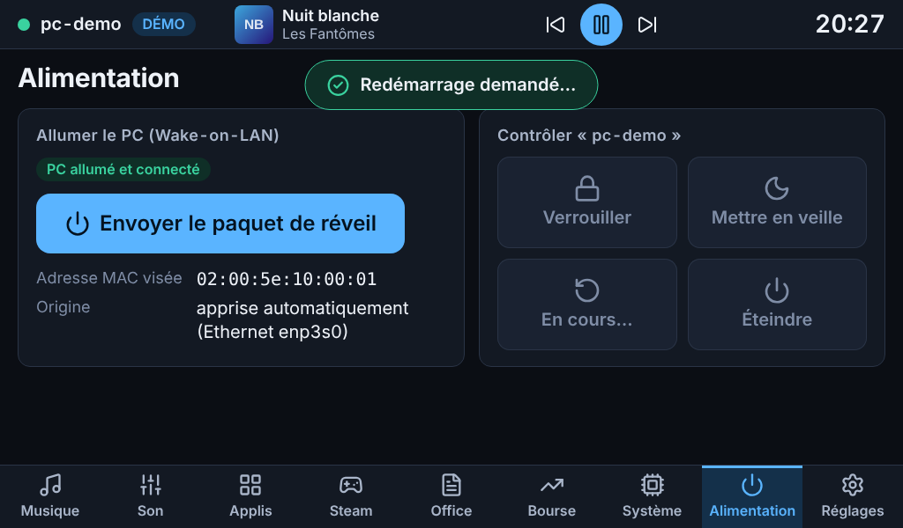 | 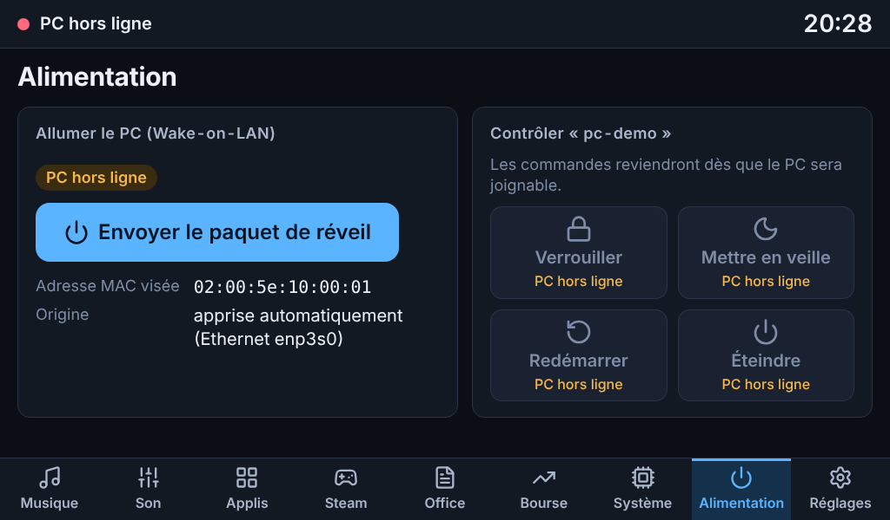 |
| Ordre accepté : les commandes restent suspendues, « En cours… » | PC éteint : tout est grisé, le réveil reste possible |
| 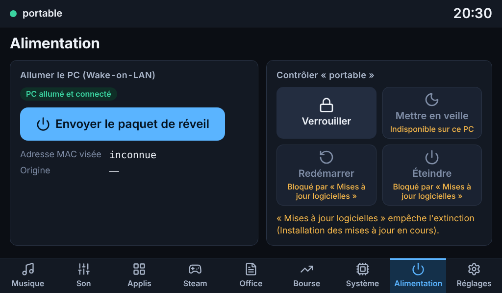 | 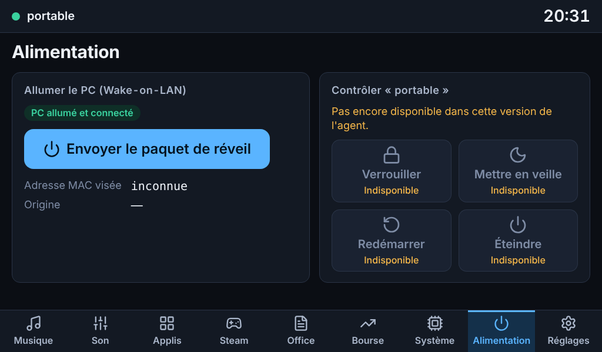 |
| Droits limités : raisons sous les boutons, programme bloquant nommé | Agent trop ancien pour connaître le thème |
| 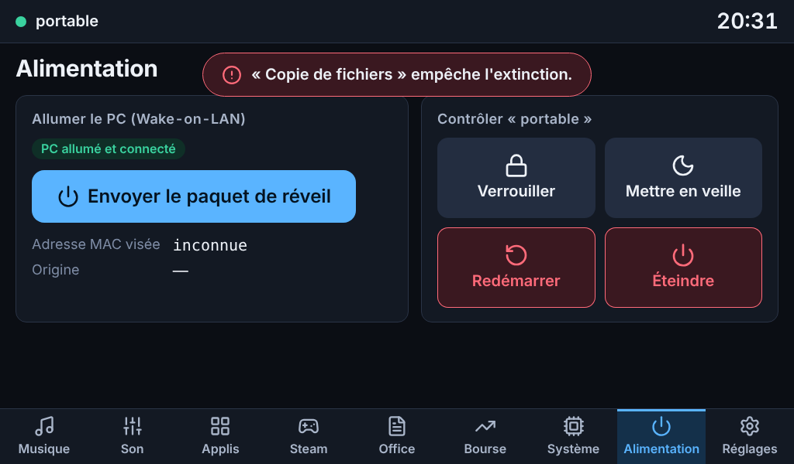 | 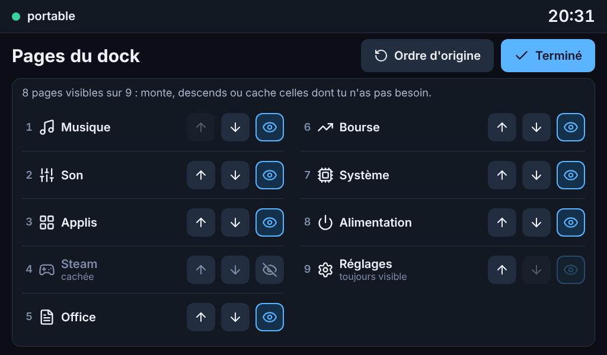 |
| Refus du système affiché tel quel | Pages et ordre : numérotées, cachées en grisé, Réglages toujours visible |
| 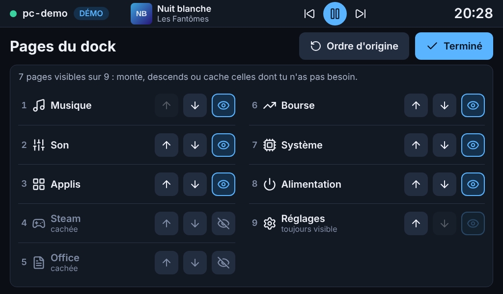 | 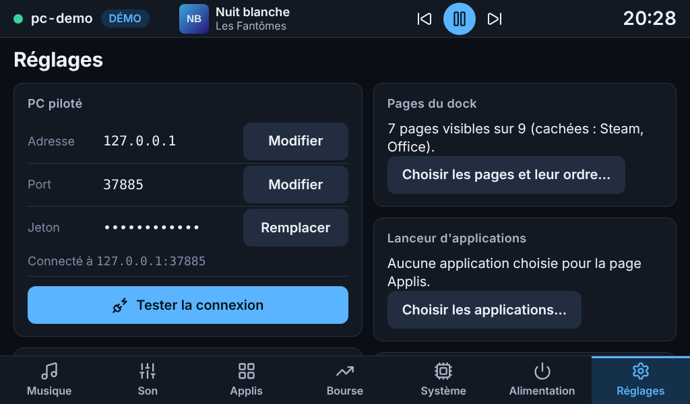 |
| Steam et Office cachés | La carte « Pages du dock » et la barre d'onglets à sept pages |
| 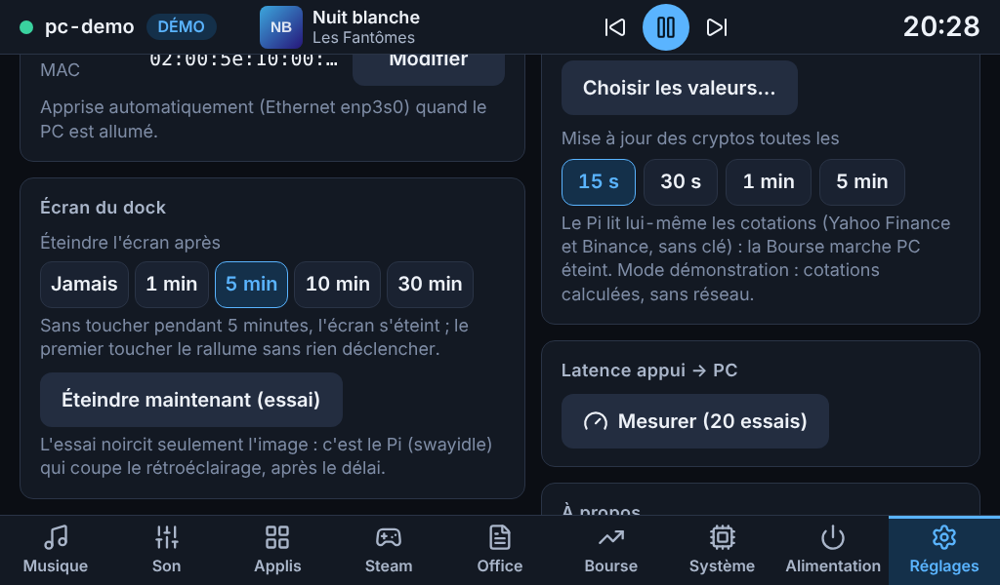 |  |
| Réglage de la veille de l'écran | L'écran noirci (le premier toucher le rallume sans rien déclencher) |

## Suite

Le cahier des charges est livré. Il reste à **vérifier chez toi** les points ci-dessus, puis, selon tes réponses : ta liste de valeurs, TLS, alertes et indicateurs, réglages fins sur le Pi.
