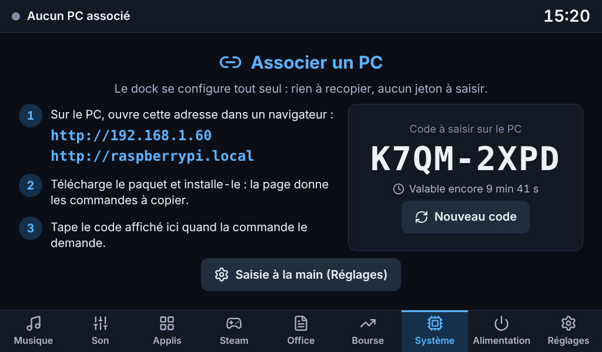
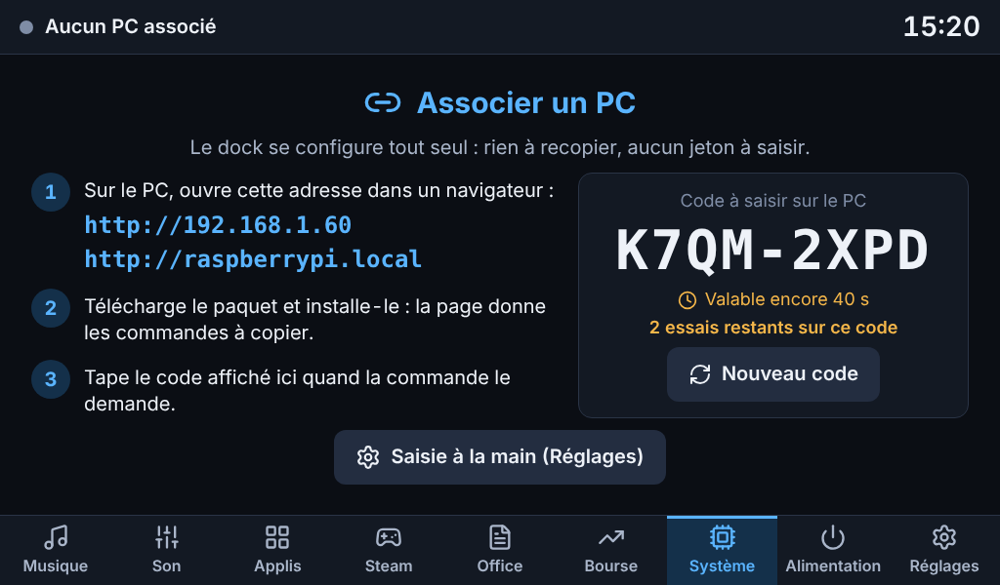
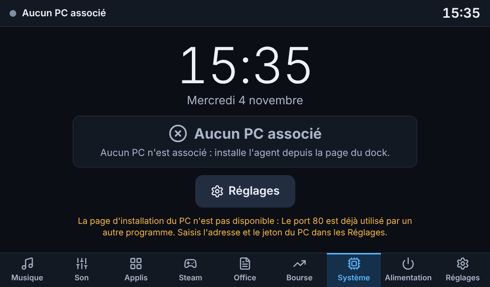
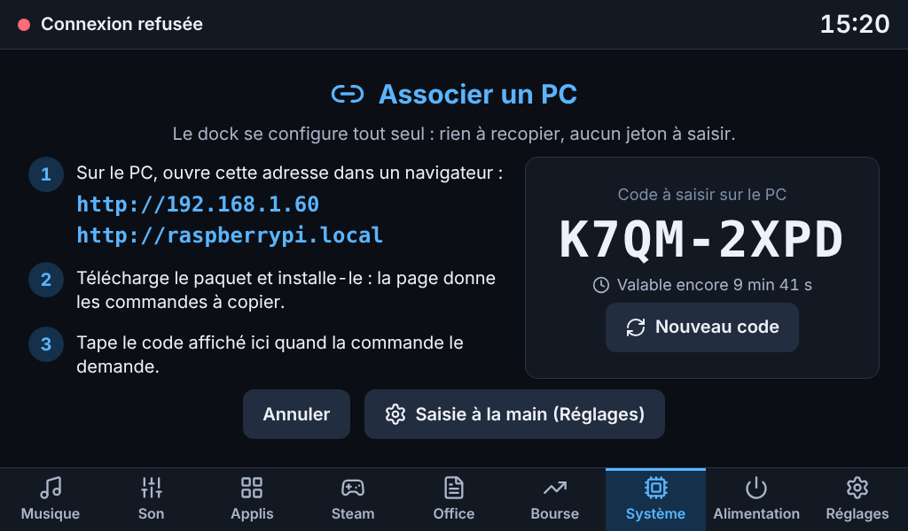
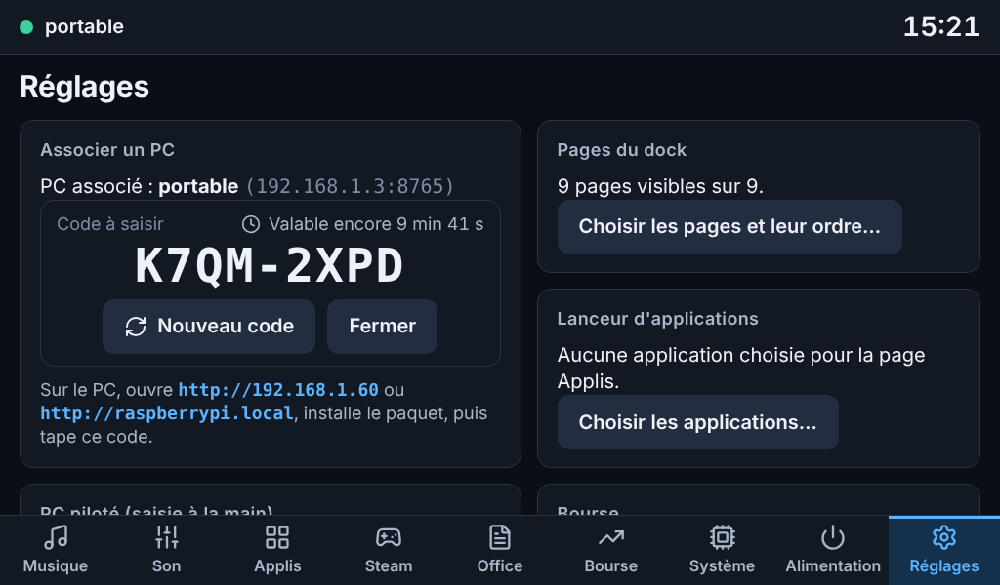
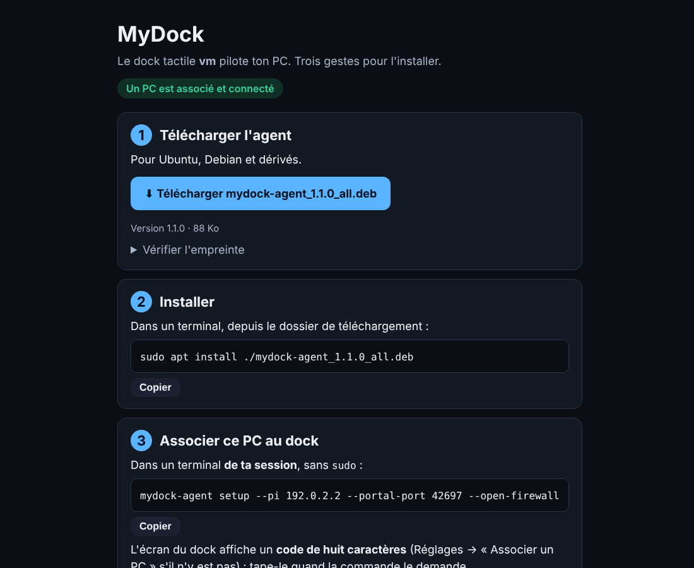
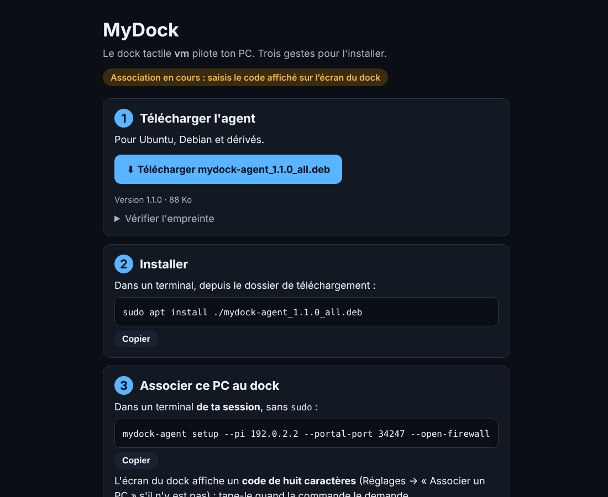

# Étape g — Une seule installation : le Pi sert une page web, le PC s'installe et s'associe

Livrée le 4 novembre 2026, branche `claude/jolly-dirac-5np79y`, **versions 1.1.0** (agent, dock, protocole inchangé, et les deux paquets `.deb`).
Les captures de ce dossier sont en **mode démo** (fausses données) en 1024×600 tactile ; les états que la démo ne produit pas (portail en panne, code qui s'épuise, jeton refusé, dock plus ancien) viennent d'un **dock simulé**. La page d'installation (`06`, `07`) est la vraie page, servie par le vrai portail de la pile de démonstration, vue dans un navigateur de PC.

> **À lire d'abord — ce que je n'ai pas pu vérifier.** Je n'ai ici ni vrai Raspberry Pi, ni Raspberry Pi OS « Trixie », ni ton réseau. Les dépôts Debian sont inaccessibles depuis le conteneur de développement : **je n'ai pas pu confirmer que les paquets dont dépend `mydock` existent à la version voulue dans Debian 13** (c'est le premier point à contrôler, voir « Non testé »). Tout le reste a été essayé aussi près du réel que possible : voir « Vérifié en vrai dans le conteneur » (vrai `dpkg`, vrai `postinst`, vrai utilisateur système `mydock` avec la seule capacité `CAP_NET_BIND_SERVICE`, vrai port 80, vraie association).

## Ce que tu demandais, et ce que j'ai fait

> « Une app unique à installer sur le Raspberry. Le Raspberry délivre un service web. Ainsi le client Ubuntu ou autre se connecte sur l'interface web du Raspberry et peut télécharger son app (deb). Donc l'installation est simplifiée. »

Avant : deux installations différentes (un script avec environnement Python sur le Pi, un paquet sur le PC) et un jeton de 43 caractères à recopier d'une machine à l'autre. **Maintenant :**

1. **Sur le Pi** : `sudo apt install ./mydock_*.deb`. C'est tout. Le paquet contient le serveur, l'interface, le kiosque, la veille de l'écran **et le paquet du PC**.
2. **Sur le PC** : ouvrir `http://<adresse du Pi>/` (l'adresse est affichée sur l'écran du dock), télécharger le paquet, copier-coller les deux commandes de la page. La seconde, `mydock-agent setup --pi …`, demande **le code affiché sur l'écran du dock**.
3. Le dock se configure tout seul : adresse du PC, port et jeton. **Plus rien à recopier.**

## Ce qui est livré

### Le paquet unique du Pi (`mydock`)

| | |
|---|---|
| **Contenu** | `/usr/bin/mydock-dock`, le code Python du dock et du protocole commun, l'**interface compilée** (`/usr/share/mydock/web`), le **paquet du PC** (`/usr/share/mydock/clients/mydock-agent_<version>_all.deb`, **identique à l'octet près** à celui qu'on construit seul), le kiosque, la veille de l'écran, l'unité systemd du dock et le script de mise en place `/usr/lib/mydock/setup`. |
| **Dépendances** | Déduites des `pyproject.toml` (une seule source de vérité) : les paquets `python3-*` de la distribution, plus `labwc`, `chromium`, `swayidle`, `wlr-randr`, les polices, `avahi-daemon` et `libnss-mdns` (pour que `raspberrypi.local` se résolve depuis le PC). `wlopm` est recommandé. **Raspberry Pi OS « Trixie » (Debian 13) est requis** : voir « Décisions ». |
| **Installation** | Le `postinst` crée l'utilisateur système `mydock` (sans connexion possible), puis lance `setup`, qui peut aussi être relancé à la main : configuration en **droits 600** (un dock neuf n'a ni PC ni jeton), service `mydock-dock`, kiosque. **Il ne demande jamais rien**, et un échec n'empêche pas l'installation (il dit comment réessayer). |
| **Kiosque** | Détecté tout seul : image **bureau** (labwc : le kiosque démarre avec la session ; l'`autostart` d'origine est sauvegardé une fois en `.avant-mydock`), image **Lite** (service systemd `mydock-kiosk` sur la console 1, utilisateur `mydock-kiosk` séparé du jeton), ou `--kiosk none`. `--force-mode 1024x600@60` force le mode de l'écran. |
| **Mise à jour** | Même commande. La configuration et le jeton sont conservés ; le navigateur du kiosque se relance sur la nouvelle interface. Le portail propose aussitôt le nouveau paquet du PC. |
| **Depuis l'ancienne installation** (`install-dock.sh`, `/opt/mydock`) | Reprise automatique : la configuration et le jeton sont gardés, les chemins mis à jour, l'ancienne unité retirée (elle masquerait celle du paquet), et le message dit quoi supprimer (`sudo rm -r /opt/mydock`). **Le PC déjà associé continue de marcher sans rien refaire.** |
| **Retrait** | `apt remove` : le kiosque et les services s'arrêtent, l'`autostart` d'origine est restauré, **la configuration et le jeton restent**. `apt purge` : tout part, utilisateurs compris. |
| **Construction** | `python3 packaging/build_deb.py` (ou `make deb`) construit les deux, `--target pi` seulement celui du Pi. Seul `dpkg-deb` est requis. **Reproductible** : deux constructions donnent le même fichier, octet pour octet. |

### La page web du Pi (le « portail »)

Un **second serveur**, à côté de celui de l'écran : il écoute le réseau local (port 80), et c'est la **seule** écoute du Pi hors de `127.0.0.1`. Il ne dit que quatre choses, tout le reste répond 404 :

| Adresse | Rôle |
|---|---|
| `GET /` | La page d'installation, vue sur la capture `06` : le paquet à télécharger (nom, taille, empreinte SHA-256), la commande d'installation, la commande d'association **avec l'adresse du Pi déjà écrite**, un bouton *Copier* à chaque commande, et un bandeau qui dit où en est le dock (« Association en cours : saisis le code affiché sur l'écran du dock », « Un PC est associé et connecté »…). Autonome : aucune ressource externe. |
| `GET /clients/<fichier>` | Le téléchargement. Le nom doit être **exactement** celui d'un paquet que le Pi a lui-même listé (jamais un chemin construit à partir de la requête). |
| `GET /api/portal` | L'état public : version, nom du Pi, un PC est-il associé et connecté, un code est-il ouvert (**oui ou non, jamais le code**), paquets proposés. |
| `POST /api/pair` | L'association par code (voir plus bas). |

Mesures de sécurité : pas de WebSocket (refusé), **politique de sécurité du contenu stricte** (seuls le script et le style de la page, par empreinte), `nosniff`, pas d'iframe, corps de requête limité à 4 Ko, JSON exigé, au plus 32 connexions à la fois, **rien de la requête n'est jamais recopié dans la page**, le nom et l'adresse du Pi viennent du Pi lui-même. Un port 80 pris ou refusé **n'arrête pas le dock** : le portail le dit (`portal.error`), l'écran l'affiche, tout le reste fonctionne. Le service du dock n'a qu'une capacité Linux, `CAP_NET_BIND_SERVICE`. Tout se règle (ou se coupe) dans la section `[portal]` de `dock.toml`.

### L'association par code

| | |
|---|---|
| **Le code** | **Huit caractères** d'un alphabet sans ambiguïté (ni 0/O, ni 1/I/L) : `K7QM-2XPD`, environ 40 bits. Il n'apparaît **que sur l'écran du Pi** : il prouve qu'on est devant le dock. Jamais sur le portail ni dans son état public (testé). |
| **Garde-fous** | Valable **dix minutes**, **à usage unique**, **annulé après cinq erreurs**, au plus douze demandes par minute et par adresse, comparaison à temps constant. Un dock **sans PC** garde toujours un code affiché ; un dock **déjà associé** n'en montre un que sur demande. |
| **Ce que fait le PC** | Il présente le code **avec le jeton qu'il a lui-même généré**, son port et son nom. Le Pi **vérifie qu'il joint bien l'agent** avec ce jeton avant d'enregistrer quoi que ce soit : une association qui ne marcherait pas n'est jamais enregistrée, et le code n'est alors pas consommé. Le jeton n'est **jamais renvoyé** ni journalisé. |
| **Si le dock ne joint pas le PC** | Pare-feu, autre adresse (Pi en Ethernet **et** en Wi-Fi) : la réponse porte les adresses du Pi ; `mydock-agent` ajoute **tout seul** les adresses privées annoncées à ses clients autorisés, redémarre, et réessaie une fois. Sinon il dit la règle `ufw` exacte. |
| **Changer de PC** | **Réglages → Associer un PC…** affiche un nouveau code. Une nouvelle association **remplace** l'ancienne (le dock pilote un PC à la fois) ; l'adresse MAC du réveil et l'état propre à l'ancien PC sont oubliés, sinon le dock réveillerait le mauvais. |

### Côté PC (`mydock-agent`)

- **`mydock-agent setup --pi ADRESSE`** fait, en plus de ce qu'il faisait (configuration 600, service, pare-feu), l'**association** : il demande le code (trois essais), ou `--code CODE` pour le donner d'avance, `--no-pair` pour s'en passer, `--portal-port` si le portail n'est pas sur le port 80. Réussi, **il n'affiche plus le jeton** (plus rien à recopier). Raté, il dit pourquoi et retombe sur la saisie à la main dans Réglages, comme avant.
- **Nouveau : `mydock-agent pair --pi ADRESSE`** ne refait que l'association : changement de dock, code manqué, ou **PC installé sans paquet**. Il ne touche ni au service ni au pare-feu.
- **`mydock-agent doctor`**, nouvelle section « Dock (portail du Pi) » : le portail répond-il (adresse et version), un PC est-il déjà associé à ce dock.
- Le client HTTP de l'association n'utilise que la bibliothèque standard et **ignore les variables de proxy** (le Pi est sur le réseau local).
- **Autre distribution** : la page ne propose que le `.deb`. `deploy/pc/install-agent.sh` (depuis les sources) reste, et s'arrête sur `mydock-agent pair --pi …` ; il n'affiche plus le jeton non plus.

### Côté dock (interface)

- **Dock neuf : écran « Associer un PC »** (capture `01`) : l'adresse à ouvrir sur le PC (les adresses IP d'abord, puis `raspberrypi.local`), les trois gestes, **le code en grand** avec son compte à rebours (il passe à l'orange sous une minute), « Nouveau code », et la saisie à la main (Réglages) toujours possible. Il tient dans l'écran sans défilement, boutons ≥ 48 px.
- **Les erreurs sont comptées à l'écran** (« 2 essais restants sur ce code », capture `02`). Quand le PC s'associe, un message le dit et les pages arrivent ; le message n'est **pas rejoué** si la page se recharge plus tard.
- **Jeton refusé** (« Connexion refusée ») : un bouton **Associer à nouveau** affiche un code à la place du diagnostic, **Annuler** y revient (capture `04`). Un PC simplement éteint ne propose pas d'association : ce n'est pas le problème.
- **Portail en panne** : l'écran le dit avec la raison (« Le port 80 est déjà utilisé… ») et renvoie vers la saisie à la main (capture `03`) ; aucun code n'est proposé sans portail pour le recevoir.
- **Réglages → Associer un PC** (capture `05`) : le PC actuel nommé, le code en version compacte avec « Nouveau code » et « Fermer », ce qui est arrivé au dernier code (expiré, annulé). **À propos** donne l'adresse de la page d'installation et le paquet qu'elle propose.
- **Un dock plus ancien** (qui ne parle pas encore du portail) garde l'ancien écran, sans erreur ; et une ancienne configuration sans section `[portal]` se charge avec les valeurs par défaut (vérifié).

### Retiré

`deploy/pi/install-dock.sh`, `deploy/pi/uninstall-dock.sh` et leur unité systemd (l'environnement virtuel dans `/opt/mydock`) : le paquet les remplace entièrement.

### Défauts trouvés en chemin, corrigés

- **`setup --remove` s'interrompait si systemd était injoignable** (conteneur, chroot) et ne rendait alors pas l'`autostart` d'origine. Trouvé en lançant le **vrai** `dpkg -r` ; corrigé, et revérifié par un nouveau cycle réel.
- Une adresse du portail terminée par `/` (`/clients/<nom>/`) était redirigée au lieu de répondre 404 : les redirections automatiques sont coupées.
- **Rendu de l'interface, vu sur les captures** : le temps restant du code passait à la ligne dans les Réglages, un point en double suivait le message d'erreur du portail, « celui-ci » se coupait au trait d'union. Corrigés ; le code et ses boutons tiennent maintenant dans la carte.
- Les refus du dock envoyaient le PC vers « touche Associer un PC » sans dire où : ils disent maintenant **Réglages → « Associer un PC »**.
- **Un test de l'étape c** (`test_volume_mute_and_default_really_change_on_the_server`, contre un vrai serveur de son) a échoué **une fois** sur une exécution complète : il attend qu'un instantané soit publié et ne laissait que 3 s, trop peu quand la machine est chargée. Je l'ai relancé à vide plusieurs fois (toujours vert) et j'ai porté ses attentes à 10 s ; l'assertion n'est pas assouplie (la condition doit toujours être vraie), seule la patience l'est.

## Tests exécutés

| Suite | Résultat | Ce qu'elle couvre |
|---|---|---|
| Python, tout le dépôt (3.14, bibliothèques récentes), **tests lents compris** | **1 672 réussis**, 1 ignoré (suppose un utilisateur non root) | common 104, agent 779, dock 612, paquets .deb et scripts de déploiement 178 |
| Python avec les **versions exactes d'Ubuntu 26.04** (`make test-ubuntu`) | **1 607 réussis** | agent, dock, common et les deux paquets, dont dbus-fast 4.0 et uvicorn/fastapi d'Ubuntu |
| Interface, unitaires (Vitest) | **221 réussis** | dont 16 nouveaux (adresses à montrer, compte à rebours, essais restants, annonce d'une association) |
| Interface, bout en bout (Playwright, 1024×600 tactile) | **188 réussis** | dont **21 nouveaux** (`stage-g.spec.ts`) |
| Qualité | propre | `ruff` (analyse et format), `svelte-check` (0 erreur, 0 avertissement), `shellcheck` (scripts et scripts des paquets), `dist/` à jour |

**Ce que les tests prouvent de nouveau**
- **Portail** (serveur réel, requêtes réelles) : les quatre adresses et rien d'autre ; téléchargement identique au fichier, refus de tout nom qui n'est pas exactement un paquet listé (chemins, `..`, liens symboliques, noms presque justes) ; en-têtes de sécurité sur chaque réponse, y compris les erreurs ; corps trop gros, mauvais type, JSON invalide refusés ; **aucune donnée de la requête recopiée dans la page** (en-têtes `Host` hostiles) ; WebSocket refusé ; port pris sans arrêter le dock.
- **Association** : bon code, mauvais code (compté), code annulé après cinq erreurs, code expiré, code à usage unique, limitation par adresse, casse et séparateurs libres, concurrence de deux associations, PC injoignable (la session reste ouverte, aucun essai consommé), **jeton jamais présent dans une réponse ni dans les journaux**, configuration remplacée et état de l'ancien PC oublié.
- **Agent** : le client HTTP face à un faux portail (corps envoyé, erreurs du dock reprises mot pour mot, aucun proxy), `setup` (code donné, demandé, faux, vide, sans terminal, portail muet, dock sans code, adresse corrigée puis réessai, adresses privées seulement et trois au plus), **et la nouvelle commande `pair`**.
- **Paquets** (`dpkg-deb` réel) : métadonnées et dépendances déduites des `pyproject.toml`, chaque fichier et ses droits, `md5sums`, aucune configuration ni secret dans le paquet, **paquet du PC embarqué identique à celui construit seul et reconnu par le portail**, construction reproductible, version du changelog = version du code, interface absente = construction refusée, scripts du paquet (syntaxe, `shellcheck`, comportement avec de faux `adduser`, `install`, `rm`…), unité systemd valide (`systemd-analyze verify`) et **une seule capacité**.
- **Le dock extrait du paquet**, sans le dépôt : tous ses modules s'importent, il démarre, sert l'interface sur son port local et, sur le portail, la page et **le paquet du PC octet pour octet** ; son script de mise en place trouve sa bibliothèque à l'emplacement du paquet.
- **`setup` du Pi** (installation dans un dossier, sans toucher au système) : configuration privée sans PC ni jeton, kiosque lisible par le navigateur mais jamais le jeton, idempotence, **reprise d'une ancienne installation** (PC et jeton conservés, chemins mis à jour, ancienne unité retirée, jamais une unité qui n'est pas la sienne), mode bureau avec sauvegarde unique, **retrait qui restaure l'`autostart`**, simulation, options refusées.
- **Interface** (faux dock) : écran d'accueil, « Nouveau code », compte à rebours qui avance, erreurs comptées, portail en panne, dock ancien, jeton refusé → associer → annuler, Réglages (code, fermer, expiré, annulé, portail indisponible, À propos), annonce d'une association une seule fois ; **(vraie pile)** un dock neuf affiche un code, un faux code est refusé et compté à l'écran, le bon code associe, **les pages du PC arrivent toutes seules**, le même code ne sert pas deux fois, cinq codes faux l'annulent et un nouveau apparaît, le code **n'apparaît ni sur la page du portail ni dans son état public**, associer un autre PC depuis les Réglages, la page du portail vue depuis un PC **sans aucune erreur de politique de sécurité** et son lien qui télécharge bien le paquet.

### Vérifié en vrai dans le conteneur (au-delà des tests)

Un conteneur n'est pas un Pi, mais ces points ont été **exécutés pour de bon**, pas simulés :

1. **`dpkg` réel** : installation, retrait, purge des **deux** paquets. Après `remove`, la configuration et l'utilisateur restent ; après `purge`, plus rien (`/etc/mydock`, `/etc/mydock-kiosk`, `/var/lib/mydock`, unités, utilisateurs `mydock` et `mydock-kiosk`). `lintian` : **aucune erreur** (avertissements de forme seulement : lignes longues du changelog, `lib.sh` volontairement non exécutable).
2. **Le vrai `postinst` et le vrai `setup`** (seul `systemctl` est remplacé par un faux, il n'y a pas de systemd ici) : `/etc/mydock` en `750` et `dock.toml` en **`600`, propriétaire `mydock`** ; la configuration du kiosque en `644`, propriétaire `root` (rien de secret) ; l'utilisateur `mydock-kiosk` créé dans les groupes `video`, `render`, `input` ; l'unité du kiosque rendue ; la bonne suite d'appels à `systemctl`.
3. **Le dock du paquet, lancé sous l'utilisateur `mydock` avec pour seule capacité `CAP_NET_BIND_SERVICE`** (comme l'unité systemd : `CapEff = CapBnd = CapAmb = 0x400`) : il **écoute bien le port 80** et sert la page et le paquet du PC (89 752 octets, identique à celui du paquet).
4. **Une vraie association par le port 80** avec un agent de démonstration : mauvais code → `403` ; bon code → `200` ; même code une seconde fois → `409` ; la configuration est réécrite **par l'utilisateur `mydock`** (`600`) avec l'adresse, le port et le jeton, et le dock se connecte aussitôt à l'agent.

### Mesures (conteneur Linux de développement, processeur x86)

| Mesure | Valeur |
|---|---|
| Serveur du dock au repos, **portail actif**, aucun navigateur : dock neuf (code affiché) / dock associé et connecté | **0,40 %** / **0,50 %** d'un cœur, 57 Mo |
| Coût du portail | environ **+0,1 %** d'un cœur et **+2 Mo** (0,32 et 0,36 % sans portail, 0,40 et 0,44 % avec ; deux mesures de chaque) |
| Taille des paquets | le Pi : **360 Ko** (il embarque les 88 Ko du paquet du PC ; l'interface compilée pèse 389 Ko avant compression, polices comprises) ; le PC : **88 Ko** |
| Construction des deux paquets | **environ 1 s** |

## Non testé — à vérifier chez toi

1. **L'installation du paquet sur ton Pi** (le plus important) : `sudo apt install ./build/mydock_*_all.deb`. Je n'ai pas pu confirmer que **Debian 13 fournit** `python3-fastapi (>= 0.115)`, `python3-uvicorn (>= 0.30)`, `python3-websockets (>= 13)`, `python3-psutil (>= 6)`, `python3-pydantic (>= 2.7)`, `python3-tomli-w`, ni `labwc`, `wlr-randr`, `swayidle`, `chromium`. Si `apt` refuse, **copie-moi son message** (et `apt-cache policy python3-fastapi python3-uvicorn python3-websockets python3-psutil python3-pydantic python3-tomli-w labwc chromium`) : j'ajuste les bornes ou les noms. Sur Raspberry Pi OS « Bookworm » ça **ne marchera pas** (voir « Décisions »).
2. **Le kiosque après l'installation** : `sudo reboot`, puis l'écran affiche-t-il « Associer un PC » en plein écran ? Image bureau ou Lite ? (`sudo journalctl -u mydock-kiosk -e` en Lite.) La **veille de l'écran** (étape f) fonctionne-t-elle toujours avec les nouveaux chemins ?
3. **Le service sous systemd** : `systemctl status mydock-dock` et `journalctl -u mydock-dock -e`. J'ai vérifié la capacité et le port 80 sous l'utilisateur `mydock`, mais **pas** les protections de l'unité (`ProtectSystem=strict`, `PrivateTmp`, `RestrictAddressFamilies`…) : elles sont reprises de l'ancienne unité sauf le port 80 et la capacité.
4. **L'association sur ton réseau** : `http://<IP du Pi>/` s'ouvre-t-elle depuis le PC ? et `http://raspberrypi.local/` (mDNS) ? Le pare-feu du PC laisse-t-il le Pi joindre l'agent (`--open-firewall`) ? Un Wi-Fi qui **isole les appareils** empêchera tout, comme avant.
5. **Le paquet du PC sous Ubuntu 26.04** : `sudo apt install ./mydock-agent_*_all.deb` depuis le fichier téléchargé sur la page (inchangé depuis l'étape f, toujours à confirmer chez toi), puis `mydock-agent setup --pi …` et le code.
6. **La reprise de ton installation actuelle** : sur le Pi, `sudo apt install ./mydock_*.deb` sans rien désinstaller. Le PC doit rester connecté sans nouvelle association. Je l'ai testé sur des dossiers de test et avec le vrai `dpkg`, **pas sur une vraie ancienne installation**.
7. **La page d'installation dans Firefox, Safari, Edge** : testée dans Chromium seulement (sa politique de sécurité n'a qu'un script et un style par empreinte, ce que tous les navigateurs courants respectent).

> **Pour que je teste la bourse en vrai à la prochaine session** (inchangé) : dans l'environnement cloud de ce projet (menu de l'environnement dans la barre de titre de la session → Modifier → *Accès réseau*), autorise les domaines `query2.finance.yahoo.com`, `api.binance.com` et `data-api.binance.vision`. **Et, pour la même raison, `deb.debian.org`** : je pourrais alors vérifier moi-même les dépendances du paquet du Pi contre Debian 13.

## Décisions prises par défaut (dis-moi si tu veux autre chose)

- **Raspberry Pi OS « Trixie » (Debian 13) obligatoire pour le Pi.** Le paquet s'appuie sur les paquets Python de la distribution (c'est ce qui permet un `.deb` de 360 Ko, sans environnement virtuel ni accès à Internet à l'installation) ; ceux de « Bookworm » (Debian 12) sont trop anciens (fastapi 0.92). Raspberry Pi Imager installe Trixie depuis octobre 2025.
- **Un seul PC piloté à la fois** : une nouvelle association remplace l'ancienne. (Le cahier des charges parlait d'« un PC » ; plusieurs PC seraient un autre chantier.)
- **Le portail écoute tout le réseau local (`0.0.0.0:80`) en permanence.** Il ne donne ni jeton ni configuration, et l'association exige le code lu sur l'écran. Pour le limiter à une adresse ou le couper : section `[portal]` de `/etc/mydock/dock.toml` (`listen_host`, `port`, `enabled = false`), puis `sudo systemctl restart mydock-dock`.
- **Dix minutes et cinq essais par code** ; un dock sans PC affiche toujours un code, un dock associé seulement sur demande.
- **La page ne propose que le `.deb`** (Ubuntu, Debian et dérivés). Une autre distribution passe par `deploy/pc/install-agent.sh` puis `mydock-agent pair`.
- **L'ancien installateur du Pi est supprimé**, pas gardé à côté : deux chemins d'installation feraient deux sources de panne.
- **Le jeton n'est plus affiché à l'installation du PC** (ni par `setup` quand l'association réussit, ni par `install-agent.sh`) : `mydock-agent show-token` reste pour la saisie à la main.
- **Version 1.1.0**, tous composants alignés (après la 1.0.0 que tu as étiquetée).

## Questions

1. **Ton Pi est-il sous « Trixie » ou « Bookworm » ?** (`cat /etc/os-release`.) Sous Bookworm, il faut soit le réinstaller (Raspberry Pi Imager, 10 minutes, la configuration du dock se refait par une association), soit que je fasse un paquet **autonome** (avec son propre environnement Python, plus gros, spécifique à l'architecture du Pi). Je préfère Trixie, mais c'est ton Pi.
2. **« Ubuntu ou autre »** : quels autres systèmes veux-tu pouvoir installer depuis la page ? Je peux ajouter un **paquet `.rpm`** (Fedora), un **script d'installation pour toute distribution**, ou, si tu parles de **Windows ou macOS**, ce serait un chantier à part (l'agent repose sur systemd, D-Bus et PipeWire).
3. **Le portail doit-il rester ouvert en permanence**, ou ne répondre que pendant qu'un code est affiché (donc jamais sur un dock associé qui n'a pas demandé d'association) ? C'est plus strict, mais la page d'installation ne serait plus joignable « à froid ».
4. Mêmes questions qu'avant, toujours ouvertes : **TLS** entre le dock et l'agent (le jeton voyage en clair sur le réseau local, y compris pendant l'association) ; **ta liste de valeurs de bourse** ; **les indicateurs de `dashboard_crypto`**, alertes ou portefeuille ; des **mesures sur le vrai Pi** une fois tout vérifié.

## Captures

| | |
|---|---|
|  |  |
| Dock neuf : l'adresse à ouvrir sur le PC, les trois gestes, le code | Deux essais restants, moins d'une minute : le temps passe à l'orange |
|  |  |
| Portail en panne : la raison est dite, la saisie à la main reste | Jeton refusé : « Associer à nouveau » affiche un code, « Annuler » revient |
|  |  |
| Réglages → Associer un PC : le PC actuel, le code, « Nouveau code » et « Fermer » | La page d'installation vue depuis le PC (un PC est déjà associé et connecté) |
|  | |
| La même page sur un dock neuf : le bandeau renvoie vers le code de l'écran | |

## Suite

Le cahier des charges et ta demande d'architecture sont livrés. Il reste à **vérifier chez toi** les points ci-dessus (surtout le premier : `apt install` sur ton Pi), puis, selon tes réponses : un paquet pour Bookworm, d'autres systèmes pour la page, un portail plus fermé, TLS, ta liste de valeurs, alertes et indicateurs, réglages fins sur le Pi.
