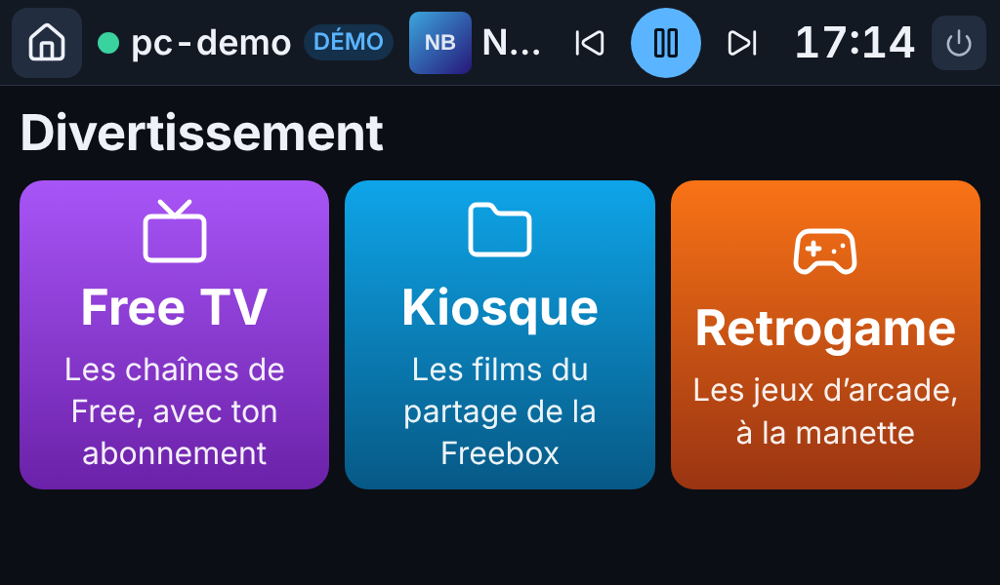
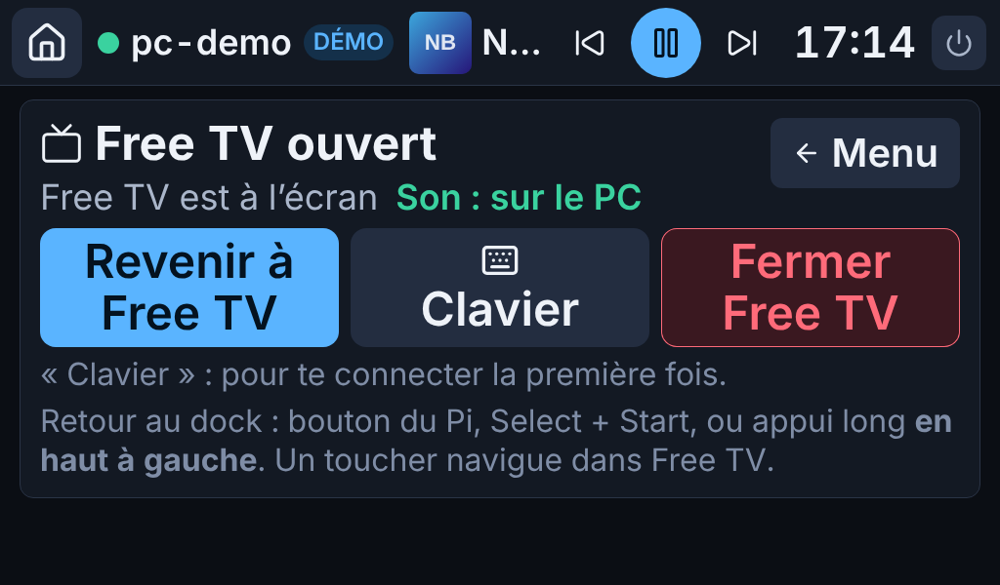
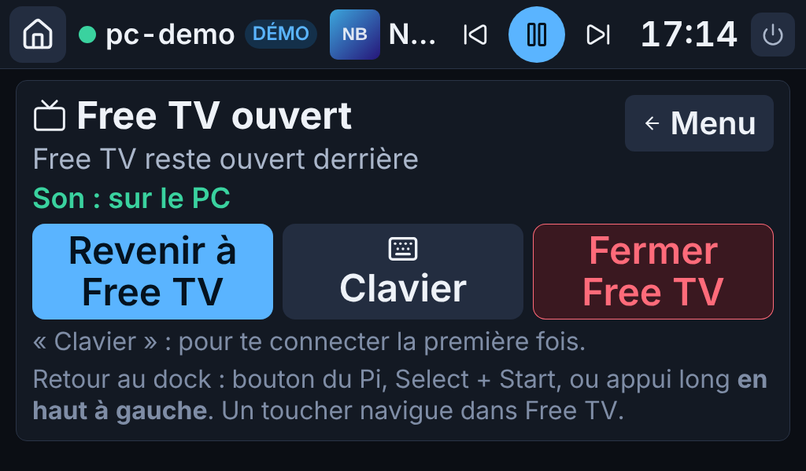
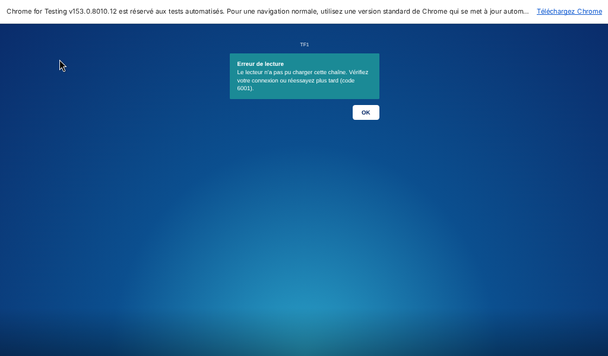
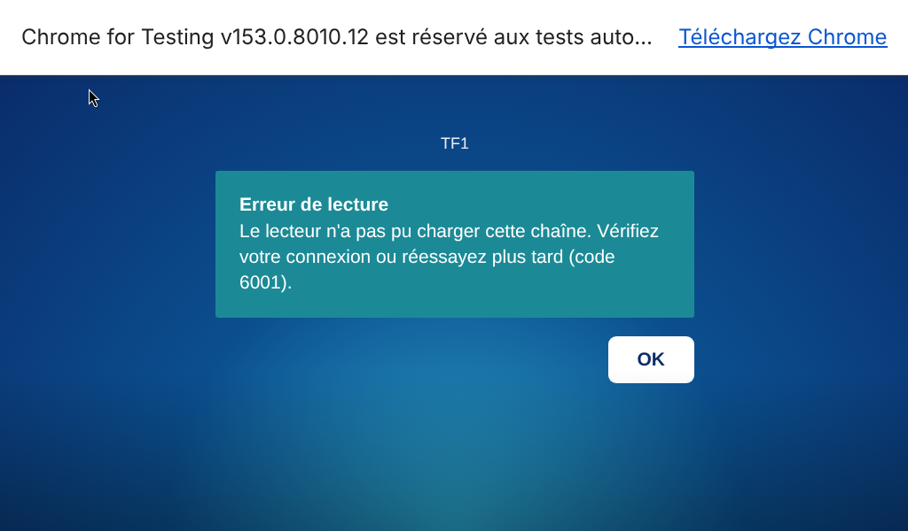
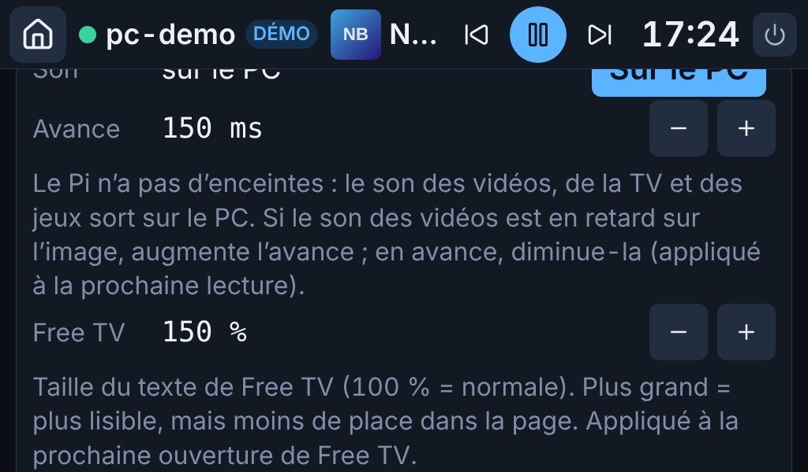

# Étape n — Free TV remplace Freetv

Livrée le 16 novembre 2026, branche `claude/jolly-dirac-5np79y`, **version 1.9.0** (dock, protocole, et les deux paquets `.deb`).

> Certaines chaînes manquent au flux local de la Freebox (droits de diffusion), alors que Free TV (tv.free.fr) les donne, avec mon abonnement. Remplacer Freetv par **Free TV, dans une fenêtre de Chromium sur l'écran du dock**. Kiosque et Retrogame ne changent pas.

Les captures de ce dossier sont de deux sortes, dites à chaque fois :

- **Mode démo** (1024×600 tactile, texte doublé) : l'interface du dock avec une *fausse* fenêtre de Free TV (aucun Chromium sur l'écran du Pi) : [00](00-divertissement-free-tv.png) à [06](06-reglages-divertissement.png).
- **Vraie fenêtre** : un vrai Chromium sous un vrai labwc sans écran, réglé à 1024×600, ouvert par le vrai code de l'assistant sur une **page factice** servie en local (*pas* tv.free.fr, que je ne peux pas atteindre ni lire) : [07](07-fenetre-reelle-plein-ecran.png) et [08](08-fenetre-reelle-clavier-fenetre-maximisee.png). Le bandeau « Chrome for Testing… » en haut est celui du Chromium d'essai (il n'existe pas sur le Chromium de ton Pi).

## Ce que ça fait

| Free TV : l'entrée du menu | Free TV ouvert | Retour au dock : Free TV reste derrière |
|---|---|---|
|  |  |  |

- **Dans Divertissement**, l'entrée « Freetv » devient **« Free TV »**, au même endroit, avec la même forme. La toucher **ouvre Free TV en plein écran**. Le dock affiche alors **« Free TV ouvert »** avec **Revenir à Free TV**, **Clavier** et **Fermer Free TV**, où sort le son, et comment revenir au dock.
- **Revenir au dock ne ferme pas Free TV** : la fenêtre reste derrière, prête à revenir, comme une vidéo aujourd'hui. Les autres pages (Spotify, Système…) restent accessibles ([02](02-free-tv-derriere-le-dock.png)) ; la tuile Divertissement de l'accueil dit « Free TV ».
- **Un seul occupant à la fois** (ton choix : *fermer*) : ouvrir Free TV **ferme** la vidéo du Kiosque ou le jeu en cours ; lancer une vidéo ou un jeu **ferme** Free TV. Un test e2e fait l'aller-retour.
- **Si ça ne peut pas s'ouvrir**, l'écran le dit sur place, avec la commande à taper : Widevine absent ([04](04-widevine-absent.png)), Chromium absent, Chromium qui s'arrête ou qui n'ouvre pas sa fenêtre en 40 s ([05](05-free-tv-ne-s-ouvre-pas.png)).
- **Réglages → Divertissement** ne parle plus de la liste des chaînes ; la carte dit où régler Free TV (`dock.toml`, `[freetv]`) ([06](06-reglages-divertissement.png)).

## Comment ça marche

```
tape « Free TV » ──► dock ──► assistant de l'écran (session labwc) ──► Chromium --app=https://tv.free.fr
 (aucun paramètre)  (« ouvre Free TV »)   │                              profil à lui, identité de bureau x86_64
                                          ├─ fenêtre : identifiant contenant « tv.free.fr » (≠ fenêtre du dock)
                                          ├─ retour au dock : bouton GPIO · Select+Start · appui long dans un coin (evdev)
                                          └─ son : puits « mydock_pc » ──► capture ──► dock ──► agent du PC (étape m)
```

- **Un troisième occupant** : `freetv_playback.py` suit le même contrat que VLC et MAME (`start`, `status`, `stop`, `finished`, `error`), si bien que le chien de garde de 40 s, le retour au dock, le journal et l'économie de veille servent aux trois.
- **Chromium en mode application** (`--app`), avec : `--ozone-platform=wayland`, `--password-store=basic` (sans lui, Chromium demande de créer un trousseau gnome-keyring), `--force-device-scale-factor=1.5` (0.7 en 1.9.0 : corrigé en 1.9.1, voir l'addendum), `--lang=fr-FR`, `--kiosk --start-fullscreen`, l'identité ci-dessous, puis `/etc/mydock-kiosk/freetv.flags`. L'environnement est celui de la session, **sans** le `C.UTF-8` que l'assistant impose à VLC, avec `LANGUAGE=fr`.
- **Un profil à lui**, `~/.config/mydock-freetv` (droits 700, utilisateur de l'écran), **séparé** de celui du dock (`~/.cache/mydock-chromium`) : la connexion à Free y reste d'un démarrage à l'autre, et l'interface du dock n'en voit jamais rien. Le nom est choisi pour qu'aucun `pkill -f` du lanceur du dock ne puisse l'atteindre (un test le vérifie).
- **Ce que le dock envoie** : « ouvre Free TV », **sans aucun paramètre** (une adresse, un identifiant, un chemin, une identité sont refusés : `bad_params`). L'adresse, l'identité et les options sont décidées par l'assistant.
- **Un second Chromium sur le même profil** ne ferait que transmettre sa demande au premier (et ouvrir une autre fenêtre) : on ne lance donc jamais deux fois, et un Chromium resté ouvert (assistant redémarré) est refermé avant, et au démarrage de l'assistant.
- **Le son** : Chromium reçoit les mêmes `PULSE_SINK` / `PIPEWIRE_NODE` que VLC et MAME, et le puits virtuel est la sortie par défaut pendant la lecture. L'écran dit « Son : sur le PC ».

## L'identité de Chromium : un contournement fragile

Sans identité particulière, Free TV refuse de lire (« Shaka Error 6001 ») : Free détecte « Linux aarch64 ». On présente donc **un Chromium de bureau x86_64 de la même version que celui installé** :

```
Mozilla/5.0 (X11; Linux x86_64) AppleWebKit/537.36 (KHTML, like Gecko) Chrome/<version>.0.0.0 Safari/537.36
```

La version est lue au lancement (`chromium --version`). `[freetv] user_agent` de `dock.toml` : `"auto"` (défaut), `""` (l'identité d'origine : aucune option), ou une chaîne (où `{major}` devient la version).

**Ce n'est pas une solution propre, et elle peut cesser de marcher** sans préavis : si Free change ses règles, ou lit autre chose que cette chaîne (par exemple `navigator.userAgentData`, que `--user-agent` ne change pas), Free TV refusera de lire de nouveau. Le dock ne peut pas le voir (il ne lit pas la page) : l'erreur est dans la fenêtre de Free TV, lisible sur l'écran. Le diagnostic (`mydock-dock doctor`) rappelle que c'est un contournement.

## Les pièges que tu avais listés

| | Piège | Ce qui est fait |
|---|---|---|
| i | **`_focus_wayland` prenait « la première fenêtre dont l'identifiant contient `chrom` »** : Free TV aurait été pris pour le dock. | Classification **explicite** (`classify_window`) : Free TV si l'identifiant contient `tv.free.fr`, VLC, MAME, sinon le dock (Chromium sans `tv.free.fr`). La sélection (`pick_window`) ne retombe jamais sur Free TV en dernier recours. **Essayé pour de vrai** : Free TV prend `chrome-tv.free.fr__-Default`, le dock `chromium-browser` ; `--class` est ignoré en mode `--app` et `wlrctl` compare l'identifiant exactement, d'où l'adresse dans l'identifiant plutôt qu'un nom choisi. Le préfixe (`chrome-`, `chromium-`…) peut changer d'un paquet à l'autre : on ne s'y fie pas. |
| ii | **`pkill -x chromium`** (installateur, lanceur, diagnostic, docs) fermerait aussi Free TV. | Plus aucun : la mise à jour ne ferme que le Chromium du dock (`--user-data-dir=[^ ]*mydock-chromium`), le message du lanceur et celui du diagnostic aussi. Free TV s'arrête par sa fenêtre (puis SIGTERM, puis SIGKILL du groupe, seulement si besoin). Le contrôle « la page du dock est-elle affichée ? » du lanceur **ignorait** une fenêtre de Free TV : il l'aurait prise pour celle du dock. |
| iii | **Pendant la vidéo un toucher ramène le dock, pendant Free TV il navigue.** | Toucher ne ramène plus rien pendant Free TV. Trois retours, **indépendants de Chromium** (même page figée) : le **bouton physique** (GPIO, déjà là), **Select + Start** tenus, et un **appui long de 1,5 s dans un coin de l'écran** (haut-gauche par défaut, `[freetv] corner`), lu en `evdev` avec les bornes de l'écran (`EVIOCGABS`). Sans bornes (groupe `input` manquant), le geste est désactivé, le journal et le diagnostic le disent. |
| iv | **La connexion demande un clavier** dans la fenêtre de Free TV. | **wvkbd** (clavier virtuel Wayland, packagé), à la demande par le bouton **Clavier** (Free TV passe devant, puis le clavier s'y affiche) ; il se cache au retour au dock. Un clavier USB marche aussi. **Voir le constat sur labwc ci-dessous.** |
| v | **Le son** doit suivre le chemin de l'étape m. | Même puits, mêmes variables d'environnement ; l'écran dit où sort le son. **Non essayé pour de vrai** (voir plus bas). |
| vi | **La veille** ne doit pas éteindre l'écran pendant Free TV. | Free TV ouvert se déclare « en lecture » : `/api/screen` rend `sleep_after = 0` et l'économiseur ne démarre pas, comme pour une vidéo. Un test le vérifie. |

## Un constat sur le clavier à l'écran, à vérifier chez toi

Sous **labwc 0.7.1** (sans écran), le clavier wvkbd s'affiche bien au-dessus d'une fenêtre de Free TV **seule**, et au-dessus d'une fenêtre **non plein écran**, mais **pas** quand **le dock (kiosque, plein écran) et Free TV (plein écran) sont tous deux ouverts** — c'est pourtant exactement la situation du Pi. Je n'ai pas trouvé pourquoi (en la « dé-plein-écranisant » ensuite, en réduisant le dock : toujours caché) ; ce qui marche, c'est une fenêtre **maximisée sans être jamais passée en plein écran** ([08](08-fenetre-reelle-clavier-fenetre-maximisee.png) : barre de titre, clavier au-dessus).

D'où l'issue de secours **`[freetv] fullscreen = false`** : Free TV s'ouvre alors maximisé, avec sa barre de titre, et le clavier s'affiche. **Le labwc de ton Pi (Trixie) est plus récent** : il se peut que ça marche en plein écran. À essayer le bouton **Clavier** ; sinon `fullscreen = false`, ou un clavier USB pour la première connexion.

## Ce qui a été supprimé

- `freebox.py` (la liste M3U), l'action `dock.tv.list`, `MediaTv.svelte`, la ligne « Chaînes » des Réglages, le réglage « HD » (`tv_hd`), `--playlist-url`, la fausse Freebox et la playlist de démonstration de la pile de développement, leurs tests.
- **Dans VLC** (commit à part, comme prévu) : le module RTSP, le pont ffmpeg, le drapeau « live », la mémoire de la façon d'afficher des chaînes. **Gardés**, car le Kiosque s'en sert : le repli `smbclient`, la reprise quand l'image n'arrive pas à l'écran (qui ne mémorise plus rien d'une vidéo à l'autre), la détection « en lecture » par les statistiques de VLC.
- **Migration** : un `dock.toml` d'avant démarre sans rien changer. `[media] playlist_url` est ignorée, **dite une fois dans le journal**, puis disparaît à la prochaine écriture ; `tv_hd` de `state.json` est abandonné au chargement. Des tests le vérifient.

## Ce qui a été essayé, et comment

**Pour de vrai, dans un conteneur** : un **vrai Chromium** (Chrome for Testing 153, pas le Chromium 156 de ton Pi) sous un **vrai labwc sans écran**, avec le vrai `wlrctl`, lancés par le vrai code de l'assistant (`test_freetv_real.py`, sous un utilisateur ordinaire) :

- Free TV s'ouvre en **1,0 s**, avec l'identifiant `chrome-tv.free.fr__-Default`, le dock étant `chromium-browser` ; la sélection ne les confond jamais, quel que soit l'ordre ; le passage de l'un à l'autre marche dans les deux sens ; **un seul** Chromium de Free TV, même si on relance sur le même profil ;
- le plein écran est bien pris (la bulle « Pour quitter le mode plein écran » le montre) ; fermer par la fenêtre **termine le processus**, laisse le dock en place ; le profil est créé en 700 ; l'identité calculée est celle de Chromium 153, en x86_64 ;
- wvkbd (voir plus haut), et sa disparition au retour au dock.

**Avec de faux outils**, pour chaque panne et chaque chemin : identité (« auto », vide, personnalisée, version illisible), ligne de commande (adresse, options, ordre de `freetv.flags`), Widevine (dossier, manifeste, bibliothèque, version), Chromium qui meurt (cinq raisons expliquées), qui ignore la fermeture (SIGTERM puis SIGKILL), déjà ouvert sur le profil, fenêtre jamais affichée, fenêtres illisibles ; la session (exclusivité avec VLC et MAME, toucher qui n'a aucun effet, retour par bouton, manette et coin, clavier, configuration vérifiée, démo) ; le geste de coin (doigt tenu, levé trop tôt, glissé dehors, deuxième doigt, écran à un seul doigt, armement, coin choisi, bornes manquantes, les numéros d'ioctl du noyau) ; le hub et le dock (aucun paramètre accepté, messages d'absence, veille) ; la migration de la configuration.

**Dans un vrai Chromium** (1024×600 tactile) contre une pile de démonstration : le menu, l'ouverture, le retour par le geste de coin et par le bouton, « Revenir à Free TV », le clavier, la fermeture, l'exclusivité avec une vidéo, l'état qui manque. Un test **mesure** que rien ne déborde de l'écran ni de son bouton (il a attrapé un vrai défaut : un texte rogné et un bas d'écran coupé que `scrollHeight` ne voit pas).

Tests ajoutés ou réécrits : `test_freetv_playback.py` (45), `test_freetv_session.py` (22), `test_freetv_real.py` (3, ceux du vrai Chromium), `test_doctor_freetv.py` (16), le geste de coin dans `test_inputs.py` (16), la sélection des fenêtres et le hub, la configuration, l'installateur et les paquets ; 4 Vitest ; 7 e2e dans `stage-n.spec.ts` et 3 dans `states.spec.ts`. Les tests du Kiosque et du son qui passaient par une chaîne passent par un film.

## Sécurité

Le cahier des charges de départ reste tenu, et chaque point a un test :

- **Aucune commande ni adresse ne vient du dock** : « ouvre Free TV » sans paramètre ; l'adresse, l'identité et les options sont décidées par l'assistant ; `wvkbd` est lancé avec une ligne figée ; le dock ne peut envoyer au clavier que « montre » ou « cache ».
- **Le profil de Free TV** (cookies, connexion) est à l'utilisateur de l'écran, en droits 700, séparé de celui du dock : ni l'interface du dock, ni le service du dock, ni l'agent n'y ont accès. **Aucun identifiant ni mot de passe ne passe par MyDock** : ils se tapent dans la page de Free TV.
- **Jeton, clés, mots de passe** : rien de nouveau n'en manipule ; rien n'est écrit dans un journal ou à l'écran. Le test réseau du diagnostic vérifie le certificat de `tv.free.fr` (jamais « sans vérifier »).
- **L'assistant ne connaît toujours aucun secret** ; il ne parle qu'à `127.0.0.1`.

## Ce que je n'ai pas pu vérifier (à toi de le faire sur ton Pi)

C'est la partie importante : **je n'ai ni ton Pi, ni ton abonnement, et je ne peux pas lire tv.free.fr**.

- **La lecture et la fluidité.** Free TV joue-t-il, et à quel coût ? Regarder `top` pendant une chaîne : un décodage logiciel de HD sur un Pi 4 peut saccader ou chauffer. Options de repli dans `/etc/mydock-kiosk/freetv.flags`.
- **Les chaînes qui manquaient** sont-elles bien là, avec ton abonnement.
- **La connexion gardée après un redémarrage.** Free pose-t-il un cookie persistant ? Sinon il faudra une option (« rester connecté ») ou autre chose.
- **Le retour au dock** par le **bouton**, la **manette** (Select + Start) et l'**appui long** dans le coin — surtout ce dernier, que je n'ai essayé qu'avec des évènements simulés (l'écran tactile réel a ses bornes à lui, et la rotation éventuelle de l'écran déplace le coin : `[freetv] corner`).
- **Le son sur le PC** : Chromium joue-t-il bien dans le puits `mydock_pc` (`PULSE_SINK` / `PIPEWIRE_NODE`, que Chromium doit respecter) ? Sinon, `player.log` (lignes `free tv` et `son :`) le dira. Un test avec le vrai Chromium et le vrai PipeWire est à faire chez toi.
- **L'identifiant de fenêtre du Chromium Debian 156** avec `--app` : essayé sur Chrome for Testing 153 (`chrome-tv.free.fr__-Default`) ; le préfixe peut différer (`chromium-…`), l'adresse non, c'est elle qu'on lit. `mydock-dock doctor` et `player.log` donnent l'identifiant réel.
- **Le clavier à l'écran** sur ton labwc (voir plus haut) ; **Widevine dans la fenêtre application** (tu l'as validé dans une fenêtre normale).
- **Si Free change son site** : le dock ne le verra pas ; l'erreur est dans la fenêtre de Free TV. Et **le contournement de l'identité** peut cesser de marcher : à surveiller.

### À faire pour essayer

1. Installer le paquet **1.9.0** sur le Pi (et, par la page du Pi, celui du PC, dont seul le numéro change), puis **`sudo reboot`**.
2. `sudo -u mydock mydock-dock doctor` : la section **Free TV** doit être verte (Chromium, Widevine, clavier, groupe `input`, `tv.free.fr`).
3. Divertissement → **Free TV** → se connecter (bouton **Clavier**, ou un clavier USB), puis lancer une chaîne.
4. Tester le retour au dock (bouton, Select + Start, appui long haut-gauche), le son sur le PC, puis **redémarrer** pour voir si la connexion est gardée.
5. Un problème : `sudo grep -i "free tv\|chromium" /var/log/mydock/player.log | tail -40` et la sortie du `doctor`.

## Addendum 1 : retours de l'essai sur le Pi (version 1.9.1)

Ton premier essai (photo de l'écran : un message d'erreur de lecture d'une chaîne, minuscule, dans une page qui ne semblait pas
occuper tout l'écran) a donné trois remarques.

**3 et 2 : le texte, et ce message d'erreur, étaient illisibles.** C'était le zoom de **0,7** de la 1.9.0 : sur le 7 pouces en
1024 × 600, la page de Free TV est rendue à 70 % de sa taille normale, donc tout est plus petit que sur un ordinateur, message
d'erreur compris. Le zoom par défaut passe à **1,5** (150 %), soit **2,1 fois** plus gros qu'avant ; tu demandais « × 2 ou × 3 » :
**× 3 correspond à 2,1**. Plutôt que de t'imposer un nombre, la taille se règle maintenant **à l'écran** : Réglages →
Divertissement → **Free TV**, avec − et + par pas de 25 %, de 50 % à 300 %. Chromium ne change pas son zoom en route : la taille
choisie s'applique **à la prochaine ouverture** de Free TV (l'écran le dit, et dit de fermer puis rouvrir si Free TV est ouvert).
Un `dock.toml` qui avait déjà `scale = 0.7` (la 1.9.0 l'écrit à la première sauvegarde) est lu comme « l'ancien défaut » et
remplacé par 1,5, ce que le journal dit une fois. Il reste plus à voir dans la page quand c'est plus petit : si 150 % est trop
grand pour une page donnée, 125 % ou 100 % sont à un toucher.

Le même message d'erreur, sur une page factice qui reproduit sa taille (la bande blanche du haut est propre à Chrome for
Testing, que j'utilise ici ; le Chromium de Debian n'en a pas) : à gauche **70 %** (1.9.0, ce que montrait ta photo), à droite
**150 %** (1.9.1) :

| 70 % (avant) | 150 % (après) |
|---|---|
|  |  |

Et le réglage, dans les Réglages du Divertissement : 

**1 : la fenêtre ne semblait pas occuper tout l'écran.** Voici ce que je sais et ce que je ne sais pas.

- **Ce que j'ai mesuré** (labwc sans écran réglé en 1024 × 600, une page d'essai aux quatre coins marqués, capture `grim`) : la
  fenêtre de Free TV couvre **toute la surface**, à 0,7 comme à 1,5 ; les quatre coins de la page sont ceux de l'écran, avec
  `--start-fullscreen` seul. Je n'ai donc **pas reproduit** une fenêtre plus petite que l'écran.
- **Ce que je ne peux pas voir** : ton labwc est plus récent que le mien (0.7.1), et ton Chromium est celui de Debian (156), pas
  Chrome for Testing (153). En mode application, `--start-fullscreen` n'est pas toujours respecté selon les versions.
- **Ce que j'ai fait quand même, par prudence** : (a) Free TV se lance avec **`--kiosk`** en plus de `--start-fullscreen`, comme le
  dock lui-même, qui est en plein écran sur ce même Pi ; (b) la demande de plein écran à labwc (`wlrctl`, idempotente) n'est plus
  faite une seule fois à l'apparition de la fenêtre, mais **quatre fois** (à 0, 1,5, 4 et 9 s), pour rattraper une fenêtre qui
  n'aurait pas fini de s'ouvrir. Avec `[freetv] fullscreen = false`, rien de tout cela : fenêtre maximisée, sans `--kiosk`.
- **Si la page ne remplit toujours pas l'écran** : dis-moi ce que tu vois (des bandes noires ? lesquelles ? la fenêtre est-elle plus
  petite, avec le dock derrière ?) et envoie la sortie de `sudo -u mydock mydock-dock doctor` et de
  `sudo grep -i "free tv" /var/log/mydock/player.log | tail -20` : le journal dit l'identifiant de la fenêtre et ses demandes de
  plein écran. Ce peut aussi être la page de Free TV elle-même (un lecteur qui ne passe pas en « plein écran » dans la page) : son
  bouton plein écran est alors à toucher dans la page.
